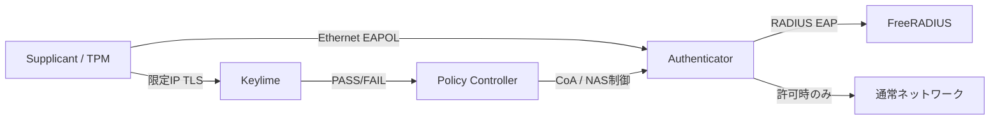

# 802.1X / RADIUS / EAP-TLS / PKI — 規格別日本語徹底解説集

作成日: 2026-11-25  
対象: Ethernet 802.1X、RADIUS、EAP-TLS、証明書・CA、TPM Remote Attestationと通信認可の連携を設計する組込み/Linuxエンジニア。

## これは何か

**各規格を1ファイルずつ読むための詳細な日本語解説**。前版の「要件表中心」「数ページの要約」から、通信フォーマット、レイヤーごとの役割、証明書/鍵の意味、典型的な失敗、デバッグ観点、設計演習を追加した。

RFCの全文翻訳や原規格の代替ではない。詳細な規範要件・Errata・現行登録番号の最終確認には、文書冒頭の公式原典を参照すること。IEEEは公開公式情報で確認できる範囲の説明であり、非公開本文の逐条対応は保証しない。

## 実装別・設定値と通信仕様（2026-11-26追加）

Supplicant・Authenticator・RADIUS Serverそれぞれの**設定値、変更時の動作、EAPOL/RADIUS通信フォーマット、OSSの種類・特徴・選定基準**を整理した実装ガイド。

- [Supplicant：設定・EAP-TLS通信・OSS比較](implementation/Supplicant_設定と通信仕様_OSS比較.md)
- [Authenticator：設定・ポート制御・OSS比較](implementation/Authenticator_設定と通信制御_OSS比較.md)
- [RADIUS Server：設定・Attribute・OSS比較](implementation/RADIUS_Server_設定と通信仕様_OSS比較.md)
- [三者の設定対応表と統合シーケンス](implementation/8021X_RADIUS_三者の設定対応と統合シーケンス.md)

※OSS固有設定キーとRFC/IEEEで規定される値を区別している。hostapdの有線データ面制御・CoA・動的VLANは機器・実装依存であり、実機/仮想環境での確認が必要。

## Linux 2台・MACsec終端スイッチ・RADIUS／Attestationの教材

| 分類 | 教材 |
|---|---|
| IEEE | [802.1X・MKA、802.1AR、802.1AEの詳細教材と統合解説](standards/ieee/README.md) |
| IETF 鍵管理 | [RFC 5247 EAP鍵管理](standards/ietf/RFC5247_EAP_Key_Management.md) |
| IETF リモートアテステーション | [RFC 9334 RATS](standards/ietf/RFC9334_RATS_Architecture.md)、[RFC 9683 TPM完全性検証](standards/ietf/RFC9683_TPM_Remote_Integrity_Verification.md)、[RFC 9684 CHARRA](standards/ietf/RFC9684_CHARRA.md)、[RFC 9711 EAT](standards/ietf/RFC9711_EAT.md) |
| TCG | [TPM 2.0 Library](standards/tcg/TPM2_Library.md)、[PC Client Firmware Profile](standards/tcg/PC_Client_Firmware_Profile.md)、[PC Client RIM](standards/tcg/PC_Client_RIM.md) |
| NIST | [SP 800-193 ファームウェアの保護・検知・復旧](standards/nist/SP800-193_Firmware_Resiliency.md) |
| DMTF | [DSP0274 SPDM](standards/dmtf/DSP0274_SPDM.md)、[DSP0277 セッション保護](standards/dmtf/DSP0277_Secured_Messages.md) |
| 接続設計 | [規格間の関係と信頼境界](implementation/規格間の関係と信頼境界.md)、[2端末とスイッチ終端の統合シーケンス](implementation/2端末_MACsec終端_統合シーケンス.md) |
| 仮想環境 | [4つの構築パターンと受入試験](implementation/仮想環境構築と受入試験.md) |

実装は IEEE のポート認証とMACsec → EAP鍵管理 → TPM測定とRATS → 2端末の統合シーケンス → 仮想環境の順で追える。CHARRA、EAT、SPDMは対応する相互運用またはコンポーネント測定を選ぶ場合に読む。

## 推奨読書順

1. IEEE 802.1X：認証前の通信制御、EAPOL、Controlled Port
2. RFC 3748：EAPのパケットと状態
3. RFC 2865：RADIUSヘッダー、属性、認証応答
4. RFC 3579：EAPのRADIUSカプセル化
5. RFC 3580：802.1XにおけるNAS・VLAN属性
6. RFC 8446：TLS 1.3本体
7. RFC 5216 → RFC 9190：EAP-TLSの基本とTLS 1.3更新
8. RFC 5280 → IEEE 802.1AR → RFC 7030：証明書、デバイスID、登録
9. RFC 5176 → RFC 2866：CoAと監査ログ
10. RFC 6613 → RFC 6614 → RFC 7360 → RFC 9765：RADIUS転送方式（TCP/TLS/DTLS）と新プロファイル
11. [RADIUS転送方式の比較](standards/RADIUS_UDP_TCP_TLS_DTLS_通信方式比較.md)：UDP、TCP、TLS、DTLSのレイヤー構造・信頼性・暗号化の違い

## システム統合の考え方

この図のKeylime/TPM/Policy Controller連携は複数規格を組み合わせた**システム設計例**であり、RADIUSやIEEE 802.1Xだけで自動規定される機能ではない。

## 追加資料（2026-11-26）

- [RADIUS over UDP / TCP / TLS / DTLS の詳細比較](standards/RADIUS_UDP_TCP_TLS_DTLS_通信方式比較.md) — ユーザー指定の図を踏まえた階層・暗号化・配送特性・規格上の注意点。RFC 6613とRFC 7360の参照も追加。

## 収録ファイル

| ファイル | サイズ | 内容 |
|---|---:|---|
| [IEEE8021AR_DevID_日本語詳細解説.md](standards/IEEE8021AR_DevID_日本語詳細解説.md) | 13.9 KiB | 独自の日本語解説・通信例・異常系・演習 |
| [IEEE8021X_ポート認証_日本語詳細解説.md](standards/IEEE8021X_ポート認証_日本語詳細解説.md) | 14.5 KiB | 独自の日本語解説・通信例・異常系・演習 |
| [RFC2865_RADIUS_日本語詳細解説.md](standards/RFC2865_RADIUS_日本語詳細解説.md) | 30.0 KiB | 独自の日本語解説・通信例・異常系・演習 |
| [RFC2866_Accounting_日本語詳細解説.md](standards/RFC2866_Accounting_日本語詳細解説.md) | 14.0 KiB | 独自の日本語解説・通信例・異常系・演習 |
| [RFC3579_RADIUS_EAP_日本語詳細解説.md](standards/RFC3579_RADIUS_EAP_日本語詳細解説.md) | 14.5 KiB | 独自の日本語解説・通信例・異常系・演習 |
| [RFC3580_IEEE8021X_RADIUS_日本語詳細解説.md](standards/RFC3580_IEEE8021X_RADIUS_日本語詳細解説.md) | 14.2 KiB | 独自の日本語解説・通信例・異常系・演習 |
| [RFC3748_EAP_日本語詳細解説.md](standards/RFC3748_EAP_日本語詳細解説.md) | 14.3 KiB | 独自の日本語解説・通信例・異常系・演習 |
| [RFC5176_CoA_Disconnect_日本語詳細解説.md](standards/RFC5176_CoA_Disconnect_日本語詳細解説.md) | 14.0 KiB | 独自の日本語解説・通信例・異常系・演習 |
| [RFC5216_EAP_TLS_日本語詳細解説.md](standards/RFC5216_EAP_TLS_日本語詳細解説.md) | 13.9 KiB | 独自の日本語解説・通信例・異常系・演習 |
| [RFC5280_X509_PKI_日本語詳細解説.md](standards/RFC5280_X509_PKI_日本語詳細解説.md) | 15.4 KiB | 独自の日本語解説・通信例・異常系・演習 |
| [RFC6614_RadSec_日本語詳細解説.md](standards/RFC6614_RadSec_日本語詳細解説.md) | 13.2 KiB | 独自の日本語解説・通信例・異常系・演習 |
| [RFC7030_EST_日本語詳細解説.md](standards/RFC7030_EST_日本語詳細解説.md) | 14.5 KiB | 独自の日本語解説・通信例・異常系・演習 |
| [RFC8446_TLS13_日本語詳細解説.md](standards/RFC8446_TLS13_日本語詳細解説.md) | 15.1 KiB | 独自の日本語解説・通信例・異常系・演習 |
| [RFC9190_EAP_TLS13_日本語詳細解説.md](standards/RFC9190_EAP_TLS13_日本語詳細解説.md) | 14.6 KiB | 独自の日本語解説・通信例・異常系・演習 |
| [RFC9765_RADIUS11_日本語詳細解説.md](standards/RFC9765_RADIUS11_日本語詳細解説.md) | 12.7 KiB | 独自の日本語解説・通信例・異常系・演習 |

## 品質上の限界

- RFCで定義される仕様と、OSSの設定値/今回の設計例は区別して読む。
- 簡略化したバイト列例は「説明用」と書いたものを実際の完成パケットとして流用しない。
- IEEEのClause番号・規範初期値を、公開情報で未確認のまま断定していない。
- 完全準拠認証や、特定版OSSの相互運用性をこの資料だけでは保証しない。
- Security Considerationsは規格発行後の新たな攻撃・更新RFCまで含めて再評価する。

## 原典入口

- [RFC Editor](https://www.rfc-editor.org/)
- [IANA RADIUS Types](https://www.iana.org/assignments/radius-types)
- [IEEE 802.1X Working Group](https://1.ieee802.org/security/802-1x/)
- [IEEE 802.1AR Working Group](https://1.ieee802.org/security/802-1ar/)