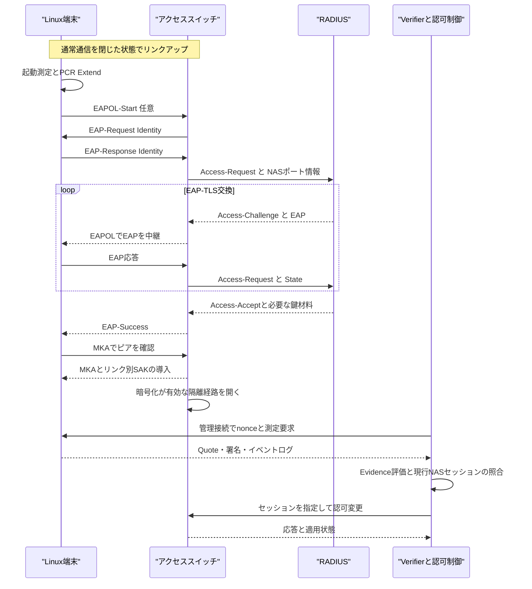
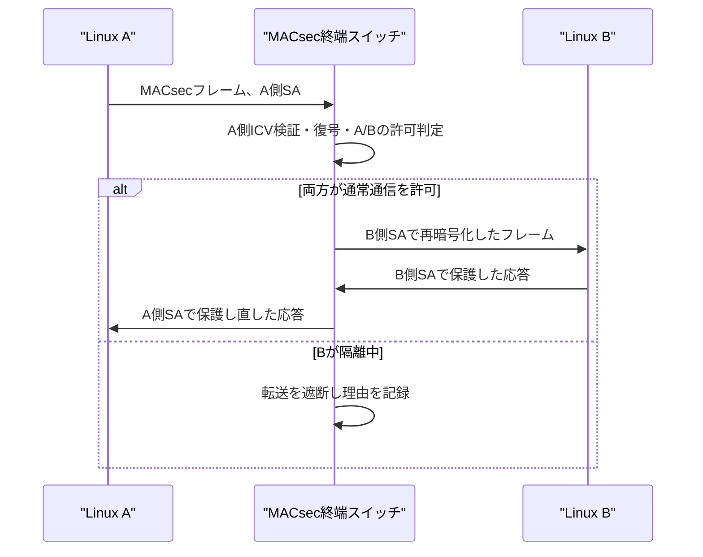

# 2端末の統合シーケンス — RADIUS・MKA・Attestationから双方向通信へ

[規格間の関係と信頼境界](規格間の関係と信頼境界.md)を前提とする。ここではEAP成功とMACsec成立の後に隔離ネットワーク上でPull型アテステーションを実施する。A/Bは独立かつ並行に通過する。

## 1. 片ポートの時系列

EAPOLとMKAまではIEEE 802.1X。EAP-TLSはRFC 9190、NAS–RADIUSはRFC 3579／3580等、フレームの暗号化はIEEE 802.1AE。評価の役割はRFC 9334。隔離経路のルール、評価の鮮度、NASセッションと結果の対応付けは本システムの設計選択。

## 2. AからBに届くフレーム

| 状態 | 到達を許す通信 | 昇格と降格 |
|---|---|---|
| 未認証 | EAPOLなど設計上のリンク制御のみ | EAP失敗なら閉じた状態を維持 |
| EAP合格・MKA未成立 | MKAの制御のみ。通常のIPv4/IPv6を遮断 | SAKを導入し双方の保護状態を確認 |
| MACsec成立・Attestation待ち | 指定した隔離到達性。管理サービス、必要なアドレス解決・時刻同期のみ | 対象・期限・ポリシーに適合した結果を照合 |
| 通常通信許可 | 承認済みA/B間の通信 | EAP失効、SA喪失、評価FAIL・期限切れ、Link Downで取り消す |

## 3. 実装時に閉じるべき競合

- **古いPASSが遅着**。認可側は受信時と適用時にNAS ID・ポート・接続世代を照合する。世代が違えば現在のポートへ反映しない。
- **CoA応答を紛失**。同一世代の状態を問い合わせ、副作用のある切替を重複適用させない。最大許可時間をNAS側のセッション期限や制御点のローカル期限で保証する。
- **ポリシー切替によるIP変更**。VLAN切替を採用するならARP/ND、DHCP、管理経路、継続アテステーションがいつ使えるかを先に確認する。同一アドレスのACL切替は比較候補。
- **再認証直後に旧SAが見える**。鍵の切替と認可期限を別々に管理する。通常通信には現在の認証・SA・評価・ACLがすべて必要。
- **Aが成功、Bが失敗**。Bポートを隔離し、Aが許可状態でもA↔Bは不通とする。方向別にテストする。

## 4. 実証時に残すもの

| 観測点 | 正常系の証跡 | 異常試験 |
|---|---|---|
| A/Bアクセスリンク | EAPOL 0x888E、MACsec 0x88E5、両端のSAカウンタ | EAP拒否、MKA不成立、片側のSA停止 |
| スイッチ内部 | 復号側と転送側のフレーム／カウンタ、アクセス制御の適用 | 平文経路の迂回なし。Aだけ認可時に両方向を遮断 |
| RADIUS管理側 | NAS・ポートID、要求と応答、鍵属性の存在 | 不一致応答、バックエンド停止 |
| Verifier | チャレンジID、鍵ID、結果、評価理由と期限 | nonce不一致、旧PASS、ログ欠落、政策版不一致 |
| A/Bアプリ | 双方向TCPの成功、必要ならアプリmTLS | Peerのアプリ証明書不正、Link Down後の拒否 |

設計演習では、正常系の時刻をEAP成功、最初のMACsec保護フレーム、PASS、ACLの適用、最初のアプリ応答に分けて測る。異常系は影響するポート、遮断までの時間、他ポートが維持される条件を示す。
