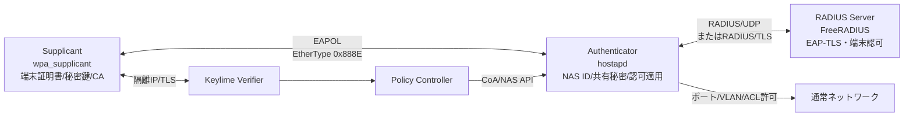
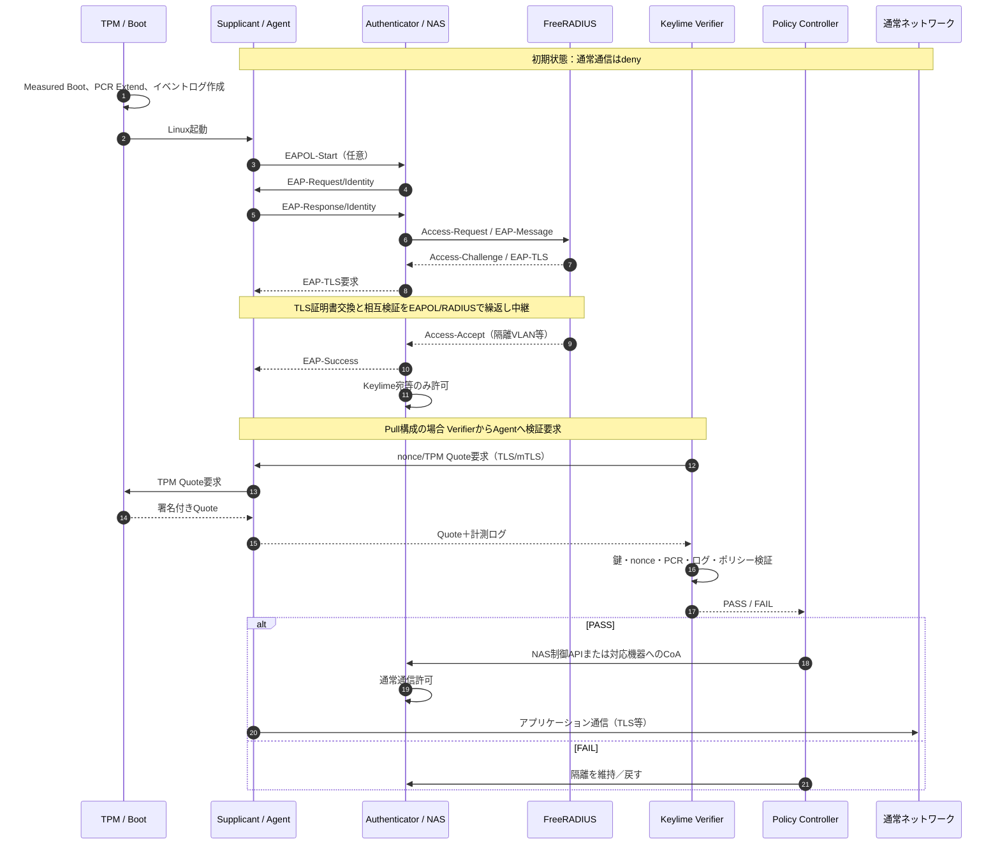

# 802.1X / RADIUS 三者の設定対応・通信シーケンス統合ガイド

> 2026-11-26 | Supplicant・Authenticator・RADIUS Serverの設定間の依存関係とパケット交換を一つにまとめた資料。Keylime/TPM統合は追加設計例。

## 1. 全体構成



## 2. 三者の設定対応表

| 機能 | Supplicant | Authenticator | RADIUS | 合わせないと何が起きるか |
|---|---|---|---|---|
| インターフェース | `-i eth0`, `-D wired` | `interface=eth1`, `driver=wired` | NASの送信元ネットワーク | EAPOLが届かず認証開始不可 |
| 802.1X/EAP | `key_mgmt=IEEE8021X`, `eap=TLS` | `ieee8021x=1` | `default_eap_type=tls` | EAP方式が一致せず認証失敗 |
| 外部端末ID | `identity=device001@...` | EAP中継、必要時NASポート情報を追加 | User-Name・証明書IDを照合 | 未登録端末を誤許可する危険 |
| サーバー証明書 | 信頼CA・`domain_suffix_match` | EAP-TLS証明書の中身は原則中継 | `certificate_file`、秘密鍵 | 偽サーバー・名前不一致で失敗すべき |
| 端末証明書 | `client_cert`、`private_key` | 通常はEAP-TLS検証をしない | `ca_file`、証明書認可 | 端末真正性検証に失敗 |
| RADIUS転送先 | 直接設定しない | `auth_server_addr/port` | Listen IP/port | Timeout、Access-Request未到達 |
| RADIUS shared secret | なし | `auth_server_shared_secret` | `clients.conf secret` | RADIUSメッセージ検証に失敗 |
| NAS識別子 | なし | `nas_identifier`、NAS-IP等 | NAS登録、ポリシー識別 | 想定外NAS扱い・認可誤り |
| 隔離VLAN | 適用される側 | VLAN/ACL適用機構が必要 | Tunnel-Type等を返す | RADIUS Acceptでも隔離にならない |
| 再認証 | EAP再実施に応答 | 再認証動作・Timer | Session-Timeout等を返す | セッション継続/切断が意図と異なる |
| CoA | 直接受信しない | NASの対応が必要 | CoAを送る側になりうる | Attestation後の権限変更が不可 |
| MACsec | 対応時 MKA | MKA/SAKの管理・SecY | EAPの認証を担当する場合あり | 802.1X成功だけでMACsecが勝手に開始するわけではない |

**RADIUS側のEAP-TLSは端末証明書を検証し、端末側のEAP-TLSはサーバー証明書を検証する**。CAをひとつにする必要はなく、証明書用途や信頼範囲を分離できる。

## 3. パケットに何が載るか

### 3.1 Supplicant → Authenticator

```text
[Ethernet]
 Dest MAC 6 / Src MAC 6 / EtherType 0x888E
  [EAPOL]
   Version 1 / Type 1 / Length 2
    [EAP] (Type=EAP-Packetの場合)
     Code 1 / Identifier 1 / Length 2 / Type 1 / Type-Data
```

### 3.2 Authenticator → RADIUS

```text
[IP][UDP/TLS選択による輸送][RADIUS]
 Code 1 / Identifier 1 / Length 2 / Authenticator 16 / Attributes
  User-Name (1), NAS-IP-Address (4), NAS-Port (5),
  State (24), NAS-Identifier (32), NAS-Port-Type (61),
  EAP-Message (79), Message-Authenticator (80)
```

EAP-MessageはEAPパケット全体を複数属性に分割できる。**EAPOLのEthernetヘッダーはRADIUSのEAP-Messageには含めない**。StateはChallengeが続く場合に次回Access-Requestで引き継ぐ。

### 3.3 RADIUS → Authenticator

Access-Challenge（Code 11）はEAPを継続、Access-Accept（Code 2）は認証・認可成功、Access-Reject（Code 3）は拒否。EAP-TLSの成否だけでなくサーバー側の認可ポリシーに従う。

### 3.4 RADIUS → NASの認可情報例

```text
Tunnel-Type = VLAN
Tunnel-Medium-Type = IEEE-802
Tunnel-Private-Group-ID = "100"
Filter-Id = "quarantine"
Session-Timeout = 3600
```

上記は**設計例**であり全属性の組合せが全NASで利用できるとは限らない。指定したフィルタ名がNASに存在しなければ、どんな制御になるかを事前に試験する。

## 4. 起動から通常通信までの時系列



注意：この図は**今回のシステムでのPull型Attestationの設計例**であり、802.1X、RFC 2865、Keylimeの各標準/実装が全体を自動連携する意味ではない。CoAをhostapdが自動的に受けてVLANを切替えられると仮定してはならない。

## 5. 運用パラメータの依存関係

| ポリシー | 例 | 変更の影響・確認事項 |
|---|---|---|
| EAP応答タイムアウト | NIC/規模で調整 | 遅いTPM証明書署名で誤タイムアウトを生む |
| RADIUS再送・サーバー切替 | 可用性要件で設計 | 重複要求を誤って二重処理しない |
| Session-Timeout | 3600秒 | 長いほど定期的な認証確認は減る。Attestation有効期限とは別 |
| Keylime再検証周期 | 設計例：数分〜数十分 | 短いほど異常検知は早いが検証負荷が増える |
| fail-closed | 認証/検証失敗で通常通信禁止 | 監視障害時に誤開放しないが運用可用性とのトレードオフ |
| CAローテーション | 新旧CA併存期間 | 端末とRADIUSの信頼ストア不整合を回避 |
| CoA失敗 | 隔離維持、再試行／監視 | ACK不達と実機適用の区別が必要 |
| 動的VLAN | 100=隔離、200=通常 | 値は規格固定ではなく運用設計 |

## 6. OSSの種類と選び方（短評）

| 役割 | 第一候補 | その他 | 注意 |
|---|---|---|---|
| Supplicant | wpa_supplicant | NetworkManager（上位管理）、歴史的XSupplicant | NetworkManagerは通常認証バックエンドを利用 |
| Authenticator | hostapd | OpenWrt（統合環境）、Linux bridge + nftables（データ面） | FirewallはEAP Authenticatorではない |
| RADIUS Server | FreeRADIUS | PacketFence（NAC全体）、GNU Radius（歴史的） | PacketFenceは単純なRADIUSデーモン代替でない |
| RADIUS/TLS Proxy | radsecproxy | 他のRADIUS/TLS対応実装 | radsecproxyはEAPサーバー本体ではない |
| Attestation | Keylime | TPM2 tools / TSS（部品） | 802.1X認証結果と結ぶPolicy Controllerが必要 |

## 7. 実装と試験の進め方

1. **端末とAuthenticator**：EAPOLが双方向に見えるかを `tcpdump -e ether proto 0x888e` で確認。
2. **AuthenticatorとRADIUS**：Access-RequestにEAP-Messageが含まれ、Challengeが戻るかWiresharkで確認。
3. **EAP-TLS**：Server Certificateの検証、Client Certificateと鍵所有の証明、失効/期限/名前不一致を試験。
4. **アクセス制御**：未認証でIPが通らないか、認証後にKeylime専用宛先だけ通るか、実際のデータ面を試験。
5. **AttestationとCoA**：PASS後のみ通常通信、FAIL/Timeout時は隔離を維持・復帰できるか確認。
6. **MACsec併用時**：802.1X MKAでCAK/SAKの鍵管理が成立し、802.1AEのSecTAGとICVを伴う保護フレームが出るか確認。

## 8. 必要な規格（読む順）

- IEEE 802.1X（EAPOL/Controlled Port/MKA） https://1.ieee802.org/security/802-1x/
- IEEE 802.1AR（IDevID/LDevID） https://1.ieee802.org/security/802-1ar/
- IEEE 802.1AE（MACsec） https://1.ieee802.org/security/802-1ae/
- [RFC 3748 EAP](https://www.rfc-editor.org/rfc/rfc3748.html)
- [RFC 2865 RADIUS](https://www.rfc-editor.org/rfc/rfc2865.html)
- [RFC 3579 RADIUS/EAP](https://www.rfc-editor.org/rfc/rfc3579.html)
- [RFC 3580 802.1X/RADIUS](https://www.rfc-editor.org/rfc/rfc3580.html)
- [RFC 9190 EAP-TLS 1.3](https://www.rfc-editor.org/rfc/rfc9190.html)
- [RFC 5176 CoA](https://www.rfc-editor.org/rfc/rfc5176.html)

## 9. 詳細資料へのリンク

- [Supplicant設定](Supplicant_設定と通信仕様_OSS比較.md)
- [Authenticator設定](Authenticator_設定と通信制御_OSS比較.md)
- [RADIUS Server設定](RADIUS_Server_設定と通信仕様_OSS比較.md)

> 各種設定例は採用OS/OSSの版、スイッチの機能、CAポリシーで検証する。IEEE/RFCの義務要件を全件列挙した適合性保証書ではない。
