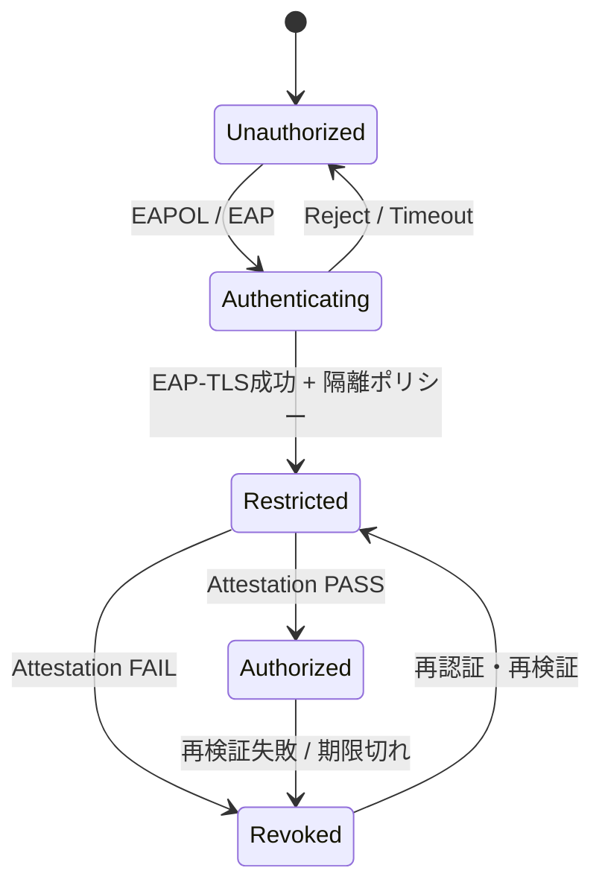

# Authenticator設定・通信制御・OSS比較 — 日本語詳細教材

> 2026-11-26 | 対象：有線IEEE 802.1X / RADIUS / EAP-TLS / MACsec連携。ホスト側の例はLinux + hostapd。
> 本書では **規格の意味**、**OSS固有のキー**、**設計判断**、**実装・ハードウェア依存機能**を区別する。

## 1. Authenticatorが必要な理由

802.1XのAuthenticator（NAS）は、SupplicantのEAPを運び、認証成功に応じて対象ポートのデータ通信を許可する主体である。**FreeRADIUSを呼び出すだけでは802.1X Authenticatorを完成したとはいえない**。特に有線Ethernetでは、未認証端末からの通常フレームを制限するControlled Portを物理/論理的に適用できなければ、EAP-TLSに成功したかどうかと無関係にデータが通る危険がある。

```text
Supplicant eth0 --(EAPOL: Ethernet 0x888E)--> Authenticator eth1
                                                |
                                                +---(RADIUS: UDP/TLS等)---> RADIUS Server
                                                |
                                                +--- controlled port/ACL ---> protected LAN
```

**Uncontrolled Port（概念）** は認証制御フレームを通す経路、**Controlled Port** は認証状態等に応じて通常データを制御する経路である。一般的なhostapd設定だけで特定Linux NICへのハードウェア遮断が自動保証されるわけではない。

## 2. hostapdの代表設定と変更の影響

| 設定キー・項目 | 例 | 何が変わるか | 設定の出所・注意 |
|---|---|---|---|
| `interface` | `eth1` | EAPOLの受信対象となるポート | hostapd固有 |
| `driver` | `wired` | 有線Ethernet向け制御バックエンドを選択 | hostapd固有 |
| `ieee8021x` | `1` | 802.1X EAP認証を有効化 | hostapdキー、仕組みはIEEE 802.1X |
| `eap_server` | `0` | 内蔵EAPサーバーではなく外部RADIUSを使用する設計例 | hostapd版・ビルド要確認 |
| `auth_server_addr` | `192.0.2.10` | 認証要求の送信先RADIUSサーバー | hostapd固有 |
| `auth_server_port` | `1812` | RADIUS認証の宛先ポート | 1812はRADIUS/UDPの標準的ポート |
| `auth_server_shared_secret` | ランダムな秘密値 | 従来型RADIUS/UDPの共有秘密。サーバー側と一致しないと検証に失敗 | RFC 2865 / hostapd |
| `nas_identifier` | `nas-lab-01` | NAS-Identifierの識別値。サーバーポリシーやログの紐付けに使える | RFC 2865 Attribute 32 / hostapd |
| `nas_ip_addr` | `192.0.2.20` | NAS-IP-Addressの通知例。送信元IPと混同しない | RFC 2865 Attribute 4 / hostapd |
| `eap_reauth_period` | `3600` | 再認証動作の間隔の例。再認証中の接続継続・失敗処理も設計が必要 | hostapd固有、3600秒は設計例 |
| RADIUSフェイルオーバー | 予備サーバー | 1台故障した時の再送・切替・可用性 | OSS/運用設計 |
| `dynamic_vlan` / VLAN関連 | 環境依存 | RADIUSで返されたVLANを適用する機構（無線/有線・ドライバ依存） | hostapd機能・環境依存 |
| CoA受信 / 再認可 | 実装依存 | 既存セッションの属性変更や切断を受ける。**hostapd単体の一般的機能と決めつけない** | RFC 5176/NAS実装 |
| 未認証時のACL | EAPOL以外を遮断 | EAPだけ通して通常IPを遮断 | 別途switch / bridge / nftables連携 |
| 認証後のACL | Keylime宛のみ | Attestation用通信だけを許可 | システム設計例 |
| MKA/CAK/CKN | MACsec使用時 | 802.1X MKAと802.1AE MACsecが動作する条件が変化 | IEEE 802.1X/AE、具体的設定はMACsec実装依存 |

**ポイント：規格で定められた「NASが送る属性」と、hostapdの同名/類似設定が常に1:1対応するとは限らない。**

### 2.1 最小構成例

```ini
# /etc/hostapd/hostapd.conf (概念例)
interface=eth1
driver=wired
ieee8021x=1
eap_server=0
auth_server_addr=192.0.2.10
auth_server_port=1812
auth_server_shared_secret=REPLACE_WITH_RANDOM_SECRET
nas_identifier=nas-lab-01
```

```sh
sudo hostapd -dd /etc/hostapd/hostapd.conf
sudo tcpdump -ni eth1 -e 'ether proto 0x888e'
sudo tcpdump -ni eth2 -vv 'udp port 1812 or udp port 1813'
```

`eth2`はRADIUS向けの仮インターフェース例であり、実際の経路に合わせる。

**危険な誤解**：この設定だけで認証前のデータ面の遮断、RADIUSで指定された動的VLAN、RFC 5176のCoA制御まで完成したとは限らない。Linux bridge / nftables / switchdevやハードウェアのポート制御で実証する。

## 3. 通信の具体的フォーマット

### 3.1 Supplicant ↔ Authenticator（EAPOL）

```text
Ethernet header:
  Destination MAC(6) | Source MAC(6) | EtherType 0x888E(2)

EAPOL:
  Protocol Version(1) | Packet Type(1) | Packet Body Length(2) | Body
Packet Type 0 = EAP-Packet
Packet Type 1 = EAPOL-Start
Packet Type 2 = EAPOL-Logoff

EAP packet:
  Code(1) | Identifier(1) | Length(2) | Type + Type-Data (Request/Response)
```

EAPのCodeはRequest=1、Response=2、Success=3、Failure=4。EAPOLのバージョンやMKAのTypeはIEEE 802.1X原典・実装に依存する。EAP-TLSはEAP Type 13で運ばれる。

### 3.2 Authenticator ↔ RADIUS Server

```text
IP/UDP(または保護されたRADIUS転送)
  └ RADIUS: Code(1) | Identifier(1) | Length(2) | Authenticator(16) | Attributes
         ├ User-Name: Type 1
         ├ NAS-IP-Address: Type 4
         ├ NAS-Port: Type 5
         ├ State: Type 24 (Challenge継続で重要)
         ├ NAS-Identifier: Type 32
         ├ NAS-Port-Type: Type 61
         ├ EAP-Message: Type 79
         └ Message-Authenticator: Type 80
```

**中継で重要な点**：AuthenticatorはEAPOLのEthernetヘッダーまでRADIUSへそのままラッピングするのではない。EAP本文をRADIUSのEAP-Message Attributeへ格納し、NAS識別情報を追加する。

### 3.3 典型的な認証状態遷移



`Restricted`や`Revoked`は**今回のネットワークポリシー例**であり、802.1X規格がこの名称の標準状態を規定するという意味ではない。

## 4. RADIUSの返す認可属性と適用結果

| 属性 | 値例 | 機器の挙動（対応機器の場合） | 根拠 |
|---|---|---|---|
| `EAP-Message` (79) | EAP-Success | SupplicantへEAP成功を中継 | RFC 3579 |
| `Session-Timeout` (27) | `3600` | セッション時間・再認証条件へ影響。Termination-Actionとの組合せに注意 | RFC 2865 / 3580 |
| `Termination-Action` (29) | `RADIUS-Request` | 時間経過時の再認証の扱い | RFC 2865 / 3580 |
| `Tunnel-Type` (64) | `VLAN` (13) | VLAN方式を指示 | RFC 2868 / 3580 |
| `Tunnel-Medium-Type` (65) | `IEEE-802` (6) | レイヤー媒体を指示 | RFC 2868 / 3580 |
| `Tunnel-Private-Group-ID` (81) | `"100"` | VLAN 100へ割当 | RFC 2868 / 3580 |
| `Filter-Id` (11) | `quarantine` | NAS側定義ACLに結び付け | RFC 2865 |

Access-Acceptを受けたからといって必ず全アクセスを許すわけではない。RADIUS側が提示した権限属性を、NASの実装とローカル方針が適用する。

## 5. CoAとAttestationの連携（設計例）

Keylimeの検証PASSをPolicy Controllerが受け取り、RADIUSセッション・端末証明書・物理ポートを一致させたうえで、対応したNASへRFC 5176 CoAを送信する。CoA-Request=43、CoA-ACK=44、CoA-NAK=45。デフォルトの動的認可ポートはUDP/3799。

**CoA送信先がhostapdの場合は事前に対応可否を検証すること**。NASがCoAを実装していないなら、別のスイッチ制御API、802.1X再認証、外部nftables制御等が必要。

## 6. 認証失敗・脅威に対する検証

| 操作 | 期待結果 | 証拠 |
|---|---|---|
| 未認証状態でTCP接続を試す | 禁止対象通信は不通 | 通信ログ・pcap |
| RADIUS shared secretを不一致にする | 認証が正しく成立しない | hostapd/FreeRADIUSログ |
| サーバー停止 | タイムアウト・再試行が設計通り | 転送ログ |
| 偽のAccess-Accept | 不正な応答を採用しない | RADIUS Authenticatorの検証 |
| 別ポートの成功結果を流用 | 認証済みセッションの紐付けを維持 | NAS-Portや端末IDとの照合 |
| Attestation FAIL | 通常通信へ昇格させない | Keylime結果とACL |

## 7. Authenticatorとして使えるOSSや機器の選択肢

| 候補 | 役割 | 適合しやすい用途 | 注意点 |
|---|---|---|---|
| [hostapd](https://w1.fi/hostapd/) | 802.1X Authenticator（有線/無線） | Linux上の検証 / ソフトウェアAuthenticator | 有線ポート制御・CoA・MKA連携はビルド・ドライバ・外部制御を要確認 |
| [OpenWrt](https://openwrt.org/) | ルーター/AP向けLinuxディストリビューション | 組込みネットワーク機器 | 単体でAuthenticatorエンジンというよりhostapd・Switch構成を統合する環境 |
| [PacketFence](https://www.packetfence.org/) | NAC/ポリシー基盤 | 多数端末・スイッチ・VLAN運用 | Authenticatorそのものではなく、既存NASをRADIUSなどで管理 |
| [Open vSwitch](https://www.openvswitch.org/) | 仮想スイッチ・フロー制御 | VM環境のデータ面遮断 | 802.1X EAP Authenticatorを単体で代替するわけではない |
| Linux [nftables](https://wiki.nftables.org/) | ACL・通信フィルタ | 認証後の許可/遮断を実証 | 認証プロトコルの実装ではない |
| 802.1X対応ネットワークスイッチ | ハードウェアNAS/Authenticator | 実製品・産業Ethernet | 機種固有設定、CoA、MACsec対応に差。OSSとは限らない |

## 8. OSS選定の判断軸

- 有線でEAPOLを受けられるか。
- 実際に通信を遮断できるControlled Portを提供するか（データプレーンの実装が最重要）。
- RADIUS/EAP中継に使えるか、TLS保護されたRADIUS転送も必要か。
- VLAN・ACL、認証失敗時のfail-closed、CoAの実装はあるか。
- 802.1X MKAと802.1AE MACsecを構成する機器の範囲はどこか。
- ARM/Linux/独自NICなど対象の製品・カーネルに移植できるか。

## 9. 原典

- IEEE 802.1X（Controlled Port、EAPOL、MKA）：https://1.ieee802.org/security/802-1x/
- [RFC 2865 RADIUS](https://www.rfc-editor.org/rfc/rfc2865.html)
- [RFC 3579 EAP over RADIUS](https://www.rfc-editor.org/rfc/rfc3579.html)
- [RFC 3580 802.1X RADIUS Usage](https://www.rfc-editor.org/rfc/rfc3580.html)
- [RFC 5176 CoA](https://www.rfc-editor.org/rfc/rfc5176.html)
- [hostapd](https://w1.fi/hostapd/)
- [PacketFence](https://www.packetfence.org/)

> 文書の仕様値とOSS設定キーは異なる。上記は実装を始めるための技術教材であり、特定版hostapdがすべての属性やCoAを正しく適用することを保証するものではない。
