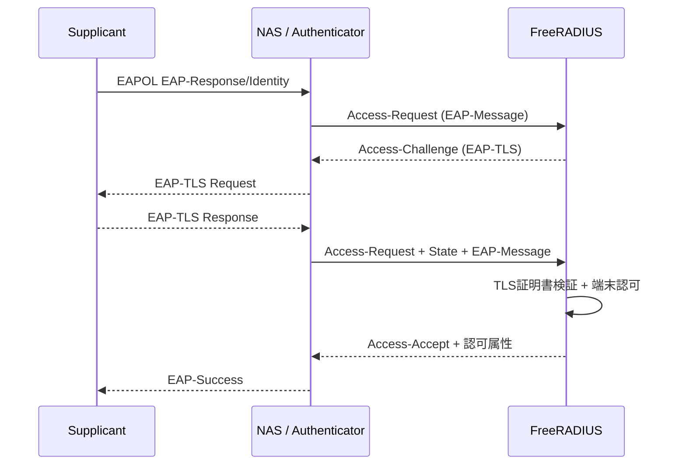
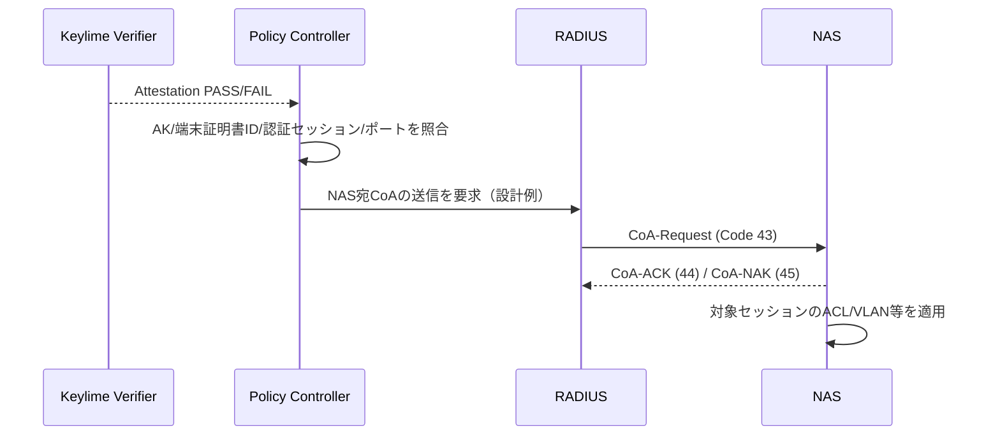

# RADIUS Server設定・属性・通信仕様・OSS比較 — 日本語詳細教材

> 2026-11-26。対象：EAP-TLS/802.1XとTPM Attestation統合のRADIUSサーバー。本書は規格に基づく日本語独自解説であり、製品版の設定例はインストールされたFreeRADIUSのバージョンで照合する。

## 1. RADIUS Serverの担当

RADIUSはNAS（Authenticator）からAccess-Requestを受け、EAP-TLSなどの認証を処理し、認証に応じてAccess-Accept、Access-Reject、Access-Challengeを返す。証明書が信用できても、その端末をネットワークに許可するかは別の**認可ポリシー**で判定する。Accounting（RFC 2866）は利用開始/終了・監査情報を扱う別系統。CoA（RFC 5176）は認証後のNASの認可変更を要求する仕組みであり、NAS側の対応が不可欠。



## 2. 設定パラメータと変更時の動作

| 設定・機能 | 代表値/設定例 | 変更で何が起きるか | 根拠 |
|---|---|---|---|
| NAS登録 `client { ... }` | NASの送信元IP/ネットワーク | 登録外NASを拒否。IPだけで端末認証しない | FreeRADIUS固有 |
| `ipaddr` | `192.0.2.20` | NASを接続元アドレスで識別 | FreeRADIUS |
| `secret` | 強い秘密値 | 従来RADIUS/UDPの検証に使用。NAS側と一致が必要 | RFC 2865 + FreeRADIUS |
| `listen { type = auth }` | `1812/udp` | Access-Requestを待つソケット | FreeRADIUS / IANA |
| Accounting listen | `1813/udp` | Accounting-Request受付 | RFC 2866 |
| CoA / Dynamic Authorization | `3799/udp` 例 | NASが対応していればセッションの認可を変更。RADIUSサーバー側が送信者にもなりうる | RFC 5176 |
| `eap.default_eap_type` | `tls` | デフォルトEAP認証方法を設定 | FreeRADIUS |
| TLSサーバー証明書 | `server.pem` | Supplicantが証明書チェーン/名前を検証 | RFC 9190 / 5280 |
| TLSサーバー秘密鍵 | `server.key` | ハンドシェイク署名。秘密鍵は送信しない | RFC 8446 |
| `ca_file` | 端末証明書の信頼CA | 不適切なCAで署名された端末証明書を拒否 | FreeRADIUS / RFC 5280 |
| `require_client_cert` | `yes` | EAP-TLSでクライアント証明書を要求 | FreeRADIUS |
| CRL/OCSP/失効処理 | 組織の失効方針 | 失効証明書の扱いを制御。通信不能時のfail-open/closedも明示 | PKIポリシー |
| 証明書主体/SAN/EKU | 許可端末の識別方針 | CAで署名済みでも許可対象ではない端末を拒否 | RFC 5280 + 認可ポリシー |
| `Session-Timeout` | `3600` | NAS側セッション制御に利用される | RFC 2865 Attribute 27 |
| `Termination-Action` | `RADIUS-Request` | 有効期限後の再認証等に影響 | RFC 2865 Attribute 29 |
| VLAN割当 | `Tunnel-* = VLAN/IEEE-802/"100"` | 対応NASが隔離VLAN 100へ接続 | RFC 2868 / 3580 |
| `Filter-Id` | `quarantine` | NASに事前設定されたフィルタの適用を要求 | RFC 2865 |
| Proxy/Realm | `example.local` | 認証要求を別サーバーへ転送するか判断 | RADIUS運用設計 |
| RADIUS/TLS | TCP/2083など | TLSでNAS↔サーバー間の通信路を保護 | RFC 6614 |
| `max_requests`、タイムアウト等 | 負荷・性能要件で決定 | 高負荷時のスロット占有・応答遅延が変わる | FreeRADIUSバージョン依存 |

**重要**： `Session-Timeout = 3600` は規格が全システムに指定する既定値ではなく設計例。証明書検証だけでアクセス権を与えるのではなく、承認済みID/ポリシーを合わせて判定する。

## 3. 代表的なFreeRADIUS設定例

FreeRADIUS 3.x系の構成概念。ディストリビューションによって `/etc/freeradius/3.0/` / `/etc/raddb/` 等が異なる。

```text
# clients.conf
client nas-01 {
    ipaddr = 192.0.2.20
    secret = REPLACE_WITH_RANDOM_SECRET
    shortname = wired-nas
}
```

```text
# mods-enabled/eap のEAP-TLS関連部分（抜粋）
eap {
    default_eap_type = tls
    tls-config tls-common {
        private_key_file = /etc/raddb/certs/server.key
        certificate_file = /etc/raddb/certs/server.pem
        ca_file = /etc/raddb/certs/client-ca.pem
        require_client_cert = yes
    }
    tls {
        tls = tls-common
    }
}
```

```text
# Access-Accept時に認可ポリシーが返す属性例
Tunnel-Type := VLAN
Tunnel-Medium-Type := IEEE-802
Tunnel-Private-Group-ID := "100"
Session-Timeout := 3600
```

**上の属性は任意の位置に貼れば動くわけではない**。FreeRADIUSの `authorize`、`authenticate`、`post-auth` 等の処理フローを理解して適切な条件で返すこと。証明書SANと登録端末IDを検証した結果に応じてリプライを構成する。

### 確認コマンド

```sh
sudo freeradius -X            # ディストリビューションによって radiusd -X
sudo ss -lunp | grep -E '1812|1813|3799'
sudo tcpdump -ni any 'udp port 1812 or udp port 1813 or udp port 3799'
```

`radtest` のPAPテスト成功は**EAP-TLS証明書認証の成功証拠にはならない**。EAP-TLSはwpa_supplicantとAuthenticatorを通した実試験を行う。

## 4. RADIUSパケットと属性フォーマット

```text
0                   1                   2                   3
+--------+----------+-------------------+
| Code   | Identifier| Length (2 octets) |
+--------+----------+-------------------+
|       Authenticator (16 octets)       |
+---------------------------------------+
|    Attributes (TLV可変長)              |
+---------------------------------------+

Attribute: Type(1) | Length(1) | Value(Length-2)
```

基本ヘッダーは20 octets。EAP-Message（79）は1属性のValueに最大253 octets格納できるため、長いEAPパケットは複数個のEAP-Messageへ分割する。

| Code/Attribute | 値 | 方向 | 意味 |
|---|---|---|---|
| Access-Request | Code 1 | NAS → RADIUS | 認証要求 |
| Access-Accept | Code 2 | RADIUS → NAS | 認証・認可成功 |
| Access-Reject | Code 3 | RADIUS → NAS | 拒否 |
| Access-Challenge | Code 11 | RADIUS → NAS | EAP継続 |
| User-Name | Type 1 | 主に要求 | 端末の外側Identity等 |
| NAS-IP-Address | Type 4 | 要求 | NASのアドレス |
| NAS-Port | Type 5 | 要求 | 認証対象ポート識別 |
| State | Type 24 | Challenge→次要求 | EAP等の継続状態。NASは内容を勝手に解釈・改変しない |
| Calling-Station-Id | Type 31 | 要求 | 端末識別情報として利用可能、単独で強固な認証とはみなさない |
| NAS-Identifier | Type 32 | 要求 | NAS識別子 |
| NAS-Port-Type | Type 61 | 要求 | Ethernet等の接続種別 |
| EAP-Message | Type 79 | 両方向 | EAPのカプセル化 |
| Message-Authenticator | Type 80 | 両方向 | EAPを含むパケットで必要なHMAC-MD5認証（RFC 3579）。単独で通信路暗号化はしない |
| Tunnel-Type | Type 64 | 応答 | VLAN等の種別 |
| Tunnel-Medium-Type | Type 65 | 応答 | IEEE-802等 |
| Tunnel-Private-Group-ID | Type 81 | 応答 | VLAN ID文字列 |

RADIUS共有秘密/MD5に依存する既存方式の限界は、RADIUS/TLSやRADIUS/1.1を検討する理由となる。MD5が残る方式を「TLS 1.3と同じ安全性」と誤説明しない。

## 5. TLS内外の違い

- **EAP-TLS（RFC 9190）**：端末↔RADIUS/EAPサーバーの認証。EAPOLとRADIUSのEAP-Messageに分割されて流れる。
- **RADIUS/TLS（RFC 6614）**：Authenticator/NAS↔RADIUSサーバー間の通信路をTLSで保護する。EAP-TLSの有無とは独立。
- **RADIUS/DTLS（RFC 7360）**：UDP上でRADIUS通信路を保護。UDPがTCPと同じ配達保証を得るわけではない。
- **RADIUS/1.1（RFC 9765, Experimental）**：旧来のMD5依存を整理する新しいプロファイル。全面的な既存製品互換を前提にしない。

## 6. CoA/Keylimeとの連動



これは標準RADIUSの自動機能ではなく、Keylime結果を認可システムに結び付ける追加設計。CoAはどのRADIUSサーバーでも自動で使えるわけではなく、NAS側の対応・セッション識別・ACL属性のサポートが必要。

## 7. 異常系

| ケース | 想定する正しい処理 | 証拠 |
|---|---|---|
| 登録外NAS送信元 | 応答せず拒否・適切にログ化 | FreeRADIUS debug |
| shared secret不一致 | RADIUSメッセージ整合性検証失敗 | サーバー/NASログ |
| EAP-Message属性が壊れている | 不正な要求を安全に拒否 | pcap / debug |
| 不正サーバー証明書 | Supplicantがハンドシェイクを中断 | wpa_supplicant log |
| 不正端末証明書 | RADIUSがEAP-TLSを拒否 | EAP-TLS log |
| 証明書は有効だが未登録 | 認証後の認可ポリシーで拒否 | 端末台帳/認可ログ |
| VLAN属性をNASが非対応 | 制限した状態を維持し、正常扱いしない | NAS実データ面試験 |
| CoAの対象セッション不一致 | 別端末を誤開放しない | Session ID / NAS-Port照合 |

## 8. RADIUS OSS候補と周辺ソフトウェア

| OSS | 機能・強み | 向く用途 | 注意 |
|---|---|---|---|
| [FreeRADIUS](https://www.freeradius.org/) | RADIUSサーバー本体、EAP-TLS、属性・ポリシー制御、プロキシ | 汎用・実装検証・組込み連携 | 版によるEAP/TLS設定差、証明書検証ポリシーを要設定 |
| [PacketFence](https://www.packetfence.org/) | NAC・デバイス登録・隔離・動的VLAN等の統合 | ネットワーク全体のアクセス制御 | FreeRADIUS等を含むシステム。単純なRADIUSデーモン代替として比較しない |
| [radsecproxy](https://radsecproxy.github.io/) | RADIUS/TLS・DTLS等の中継/ルーティング | RADIUSピア間の転送保護 | 認証・EAPサーバー本体ではない |
| [GNU Radius](https://www.gnu.org/software/radius/) | 歴史的なGNU RADIUS実装 | 仕様比較・学習 | 現行プロトコルと保守状況を確認すること |
| [OpenWISP RADIUS](https://openwisp-radius.readthedocs.io/) | 管理APIや構成管理など | Wi-Fi/ネットワーク運用統合 | 実際の認証エンジン依存・サポート機能を確認 |
| [Radiator](https://radiatorsoftware.com/) | 商用RADIUS製品 | 比較対象のみ | **OSSではない** |

## 9. 推奨評価基準

1. EAP-TLS 1.3（RFC 9190）対応のバージョン・証明書・TLSバックエンドを確認。
2. ポリシーで許可端末と許可NASを区別。
3. RADIUS/TLS/DTLS等の必要性、障害時挙動、ピア認証を確認。
4. Session-Timeout/VLAN/Filter-Id等をNASが正しく適用できるか確認。
5. CoAを安全に扱えるか、セッションの一意照合を確認。
6. 正常認証時もKeylimeの健全性検証前は隔離を維持。

## 10. 根拠

- [RFC 2865](https://www.rfc-editor.org/rfc/rfc2865.html) 基本RADIUS
- [RFC 2866](https://www.rfc-editor.org/rfc/rfc2866.html) Accounting
- [RFC 3579](https://www.rfc-editor.org/rfc/rfc3579.html) EAP-MessageとMessage-Authenticator
- [RFC 3580](https://www.rfc-editor.org/rfc/rfc3580.html) 802.1X連携
- [RFC 5176](https://www.rfc-editor.org/rfc/rfc5176.html) CoA
- [RFC 9190](https://www.rfc-editor.org/rfc/rfc9190.html) EAP-TLS 1.3
- [FreeRADIUS公式](https://www.freeradius.org/documentation/)
- [PacketFence公式](https://www.packetfence.org/)
- [radsecproxy公式](https://radsecproxy.github.io/)
