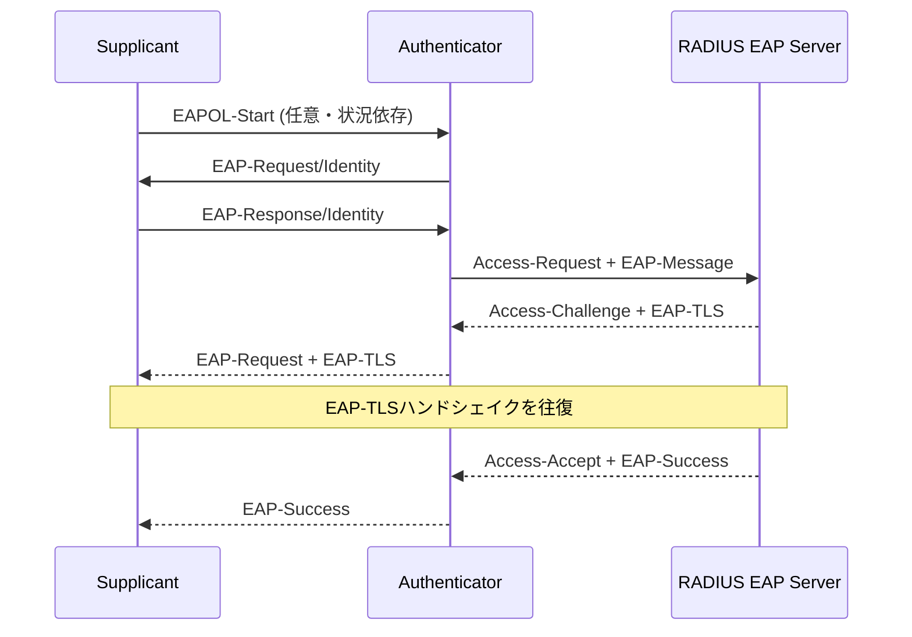

# Supplicant設定・通信仕様・OSS比較 — 日本語詳細教材

> 対象：有線Ethernet IEEE 802.1X / EAP-TLS 1.3。構成例：Embedded Linux端末 → Authenticator → FreeRADIUS。2026-11-26版。
> ここに示す値は『規格で定義』『OSS固有』『設計例』を分けて扱う。実装の対応状況は採用バージョンで要再確認。

## 1. 役割と信頼境界
Supplicantは802.1Xでネットワーク利用を要求する端末側機能。EAPOLフレームをAuthenticatorへ送り、EAP-TLSのTLS相手は原則RADIUS側のEAPサーバーである。Authenticator自身は単なる中継として動ける。証明書検証に成功しても、ネットワークアクセスを開放するかはAuthenticatorの認可制御に依存する。



## 2. ローカル設定パラメータ：何が変わるのか

| 設定/操作 | 意味・変更時の影響 | 代表例 | 根拠の種類 |
|---|---|---|---|
| インターフェース `-i` | EAPOLを送受信するNICを選ぶ。誤指定すると認証が開始しない | `eth0` | wpa_supplicant CLI |
| ドライバ `-D` | Ethernetを扱うバックエンド。`wired`で有線802.1X | `wired` | OSS |
| `ap_scan` | アクセスポイントの探索動作。wiredでは通常0 | `ap_scan=0` | OSS |
| `key_mgmt` | 802.1X/EAPの接続方式。無線のWPA-EAPとは設定区別 | `IEEE8021X` | OSS |
| `eap` | 認証方式。`TLS`ならクライアント証明書を使うEAP-TLSへ | `TLS` | EAP方式はRFC 3748/9190、キー名はOSS |
| `identity` | EAP-Response/Identityで提示する外部ID。ログ・ポリシー照合に使われうる | `device001@example.local` | RFC 3748 / OSS |
| `anonymous_identity` | 対応するトンネル型EAP方式等で外側IDを分離。EAP-TLS単独でのプライバシー確保は方式依存 | 任意 | OSS・EAP方式依存 |
| `ca_cert` | どのCAからのRADIUSサーバー証明書を信頼するか | `/etc/pki/radius-ca.pem` | RFC 5280、OSS |
| `domain_suffix_match` / `domain_match` | 証明書の名前と期待サーバー名を検証。未設定だと想定外サーバーを信頼しうる | `radius.example.local` | OSS・証明書検証設計 |
| `client_cert` | RADIUSに提示する端末証明書。証明書の発行元・EKU/KUが適切か確認 | `/etc/pki/device.crt` | RFC 9190/5280、OSS |
| `private_key` | TLS CertificateVerify等に使用する秘密鍵。相手へ送信されない | `/etc/pki/device.key` | RFC 8446、OSS |
| `private_key_passwd` | 秘密鍵の復号が必要なら使用。平文管理に注意 | 省略可能 | OSS |
| `eapol_flags` | EAPOL鍵関連の挙動。wired EAP-TLS構成では `0` の例がある | `0` | OSS（IEEE必須値ではない） |
| `phase1` | TLSプロトコルの互換性/制限等の追加オプション。使用書式は版・TLSバックエンドに依存 | 未設定を基本に検証 | OSS |
| `macsec_policy` / `macsec_integ_only` | MACsecを使う場合の動作方針。802.1AE保護とMKAの統合が必要 | デバイス能力依存 | OSS/IEEE 802.1X/AE |
| ログレベル `-dd` | デバッグ情報量増加。秘密情報のログ漏えいに注意 | 検証時のみ | OSS |

### 2.1 実装例
有線ポート用の説明用設定。証明書・鍵ファイルは事前配布し、端末の秘密鍵には最小権限を設定する。

```ini
# /etc/wpa_supplicant/wired-eap-tls.conf
ctrl_interface=/run/wpa_supplicant
ap_scan=0
network={
    key_mgmt=IEEE8021X
    eap=TLS
    identity="device001@example.local"
    ca_cert="/etc/pki/radius-ca.pem"
    domain_suffix_match="radius.example.local"
    client_cert="/etc/pki/device001.crt"
    private_key="/etc/pki/device001.key"
    eapol_flags=0
}
```

```sh
sudo wpa_supplicant -i eth0 -D wired -c /etc/wpa_supplicant/wired-eap-tls.conf -dd
sudo wpa_cli -i eth0 status
sudo tcpdump -i eth0 -n -e 'ether proto 0x888e'
```

### 2.2 証明書の調達・保存とTPM
製造時または初期登録時にCAから証明書を発行し、端末が保管する。EAP-TLS実行中に証明書チェーンと秘密鍵による署名を送るが、秘密鍵自体は送らない。TPM内の非エクスポート鍵を利用する場合はPKCS#11/TPMプロバイダーとTLSバックエンドの整合性を個別に検証する。TPMのEK/AKはAttestation用の識別/署名機構であり、EAP-TLSクライアント証明書の鍵と自動的に同一ではない。

## 3. ワイヤフォーマットと通信設定

```text
Ethernet: 宛先MAC(6) | 送信元MAC(6) | EtherType(2=0x888E)
EAPOL:   Protocol Version(1) | Packet Type(1) | Body Length(2) | Body(可変長)
EAP:     Code(1) | Identifier(1) | Length(2) | Type(1, Request/Responseのみ) | Type-Data
```

主なEAPOL Type: EAP-Packet=0、Start=1、Logoff=2。EAP Code: Request=1、Response=2、Success=3、Failure=4。EAP Type: Identity=1、TLS=13（RFC 5216/9190）。EAP-TLSではTLSレコードをEAPのType-Dataに載せ、サイズに応じ分割・再構成する。RADIUSのMessage-AuthenticatorやNAS-PortはSupplicant自身が設定・送信するものではない。

### 3.1 どの設定がどの通信に出るか
| 端末設定 | ワイヤ上で変化しうる内容 | 検証例 |
|---|---|---|
| `identity` | EAP-Response/IdentityのIdentityフィールド | EAPOLをWiresharkで確認 |
| `eap=TLS` | EAP Type 13、EAP-TLS用フラグ/データ | EAP-Type表示、TLSハンドシェイク |
| `client_cert` | TLS Certificateメッセージの証明書列 | テストCAで証明書を識別 |
| `private_key` | 署名の検証可否、CertificateVerify（鍵は送信されない） | 鍵不一致なら認証失敗 |
| `ca_cert` / `domain_*match` | 受信サーバー証明書の検証結果。直接RADIUS属性にはならない | 偽CA・SAN不一致の拒否 |
| `macsec_policy` | 対応時のMKA/MACsec動作 | EAPOL-MKA、MACsec Ethernet Frame |

## 4. 異常系と検証
| 故障注入 | 期待結果 | 調査ポイント |
|---|---|---|
| CA不一致 | サーバー証明書を拒否 | TLS検証エラー、サーバー名と証明書チェーン |
| 証明書期限切れ | 認証拒否 | 端末時計・RADIUS側時計・有効期間 |
| 端末秘密鍵不一致 | TLS相互認証失敗 | CertificateVerify関連ログ |
| EAPOL送信先/物理ポート違い | EAP開始しない | `tcpdump -e`、リンク状態 |
| RADIUSの応答なし | EAP要求が再送・最終タイムアウト | Authenticator/RADIUS区間を見る |
| 正常EAPだが通信不可 | AuthenticatorのControlled Port未開放、VLAN/ACLの問題 | supplicantログだけで判断しない |

## 5. OSS候補の比較
| OSS / 製品 | 位置付け | 強み | 制約・注意 |
|---|---|---|---|
| [wpa_supplicant](https://w1.fi/wpa_supplicant/) | 有線/無線Supplicant | EAP方式が豊富、Linux検証実績、MACsec対応構成も可能 | 証明書・TPM連携はビルドとTLSバックエンド次第 |
| [NetworkManager](https://networkmanager.dev/) | 端末ネットワーク管理 | `802-1x`接続プロファイル・管理API | EAP処理自体は通常wpa_supplicant等のバックエンドを利用。独立EAP実装と誤認しない |
| [iwd](https://iwd.wiki.kernel.org/) | 主にWi-Fi向けSupplicant | 軽量Wi-Fiスタック | 有線802.1Xのwpa_supplicant直接代替として扱わない |
| [XSupplicant](https://sourceforge.net/projects/open1x/) | 歴史的802.1X Supplicant | 他実装との比較教材 | 保守・EAP-TLS1.3対応を個別確認。新規製品の第一候補にしない |
| Windows native 802.1X | 非OSS比較対象 | 業務PCで一般的 | OSSではない |

**推奨**：Embedded Linux、有線802.1X、TPM/EAP-TLS検証ならまずwpa_supplicant。NetworkManagerは構成管理層の選択肢として比較する。

## 6. 主要根拠資料
- IEEE 802.1X-2020（EAPOL・アクセス制御）、公開規格情報：https://1.ieee802.org/security/802-1x/
- [RFC 3748 — EAP](https://www.rfc-editor.org/rfc/rfc3748.html)
- [RFC 5216 — EAP-TLS](https://www.rfc-editor.org/rfc/rfc5216.html) と [RFC 9190 — EAP-TLS 1.3](https://www.rfc-editor.org/rfc/rfc9190.html)
- [RFC 8446 — TLS 1.3](https://www.rfc-editor.org/rfc/rfc8446.html) / [RFC 5280 — PKI](https://www.rfc-editor.org/rfc/rfc5280.html)
- [wpa_supplicant公式](https://w1.fi/wpa_supplicant/) と [設定例（Google Android upstream mirror）](https://android.googlesource.com/platform/external/wpa_supplicant_8/+/master/wpa_supplicant/wpa_supplicant.conf)

### 7. 規格と実装の区別
RFC/IEEEで定義されるのはパケット形式やプロトコルの振る舞い。`ap_scan`、`eapol_flags`、`domain_suffix_match`等はOSSの設定キーで、IEEEがそのキー名や一律の値を要求しているわけではない。設定例は検証の出発点であり、製品版の認証・証明書失効・秘密鍵保護・ログ保護・MACsecの運用要件は別途定義する。