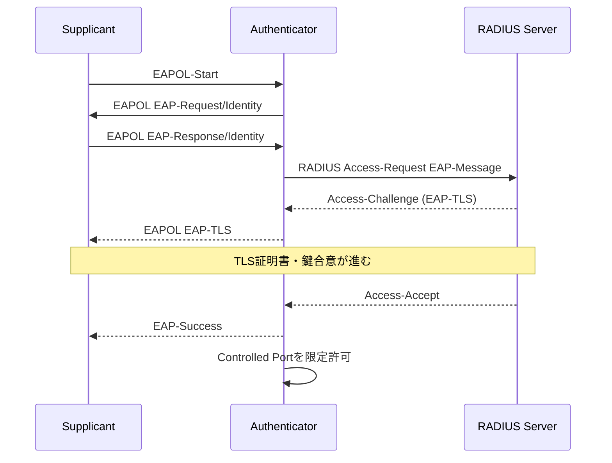

# IEEE 802.1X — Port-Based Network Access Control — 日本語詳細解説
> 原典: https://1.ieee802.org/security/802-1x/  
> 文書の位置付け: IEEE Std 802.1X-2020、Cor 1-2026。公開概要ベースの独自解説（本文全文の逐条解説ではない）  
> **注意**: 原文の翻訳・転載ではなく、章・概念に対応づけた独自の日本語技術解説。条文の正確なMUST/SHOULD/MAY、更新関係、Errataは原典で最終確認する。IEEE規格は公開資料で確認できる範囲の解説。

## 0. この規格で何を理解するか
802.1Xは『端末が接続しただけではControlled Portから通常通信を流さない』ための仕組み。EAPOLで認証情報をやり取りし、Authenticatorが認証結果をアクセス制御へ反映する。RADIUSはBackend Serverとの通信で広く用いられるが、802.1Xそのものと同義ではない。

## 1. 規格の仕組みを順番に理解する
### 1.1 Supplicant/Authenticator/Authentication Server
Supplicantは認証を受ける端末。Authenticatorはアクセスを制御するスイッチ/AP/ゲートウェイ。Authentication Serverは端末を認証する。RADIUSはAuthenticatorとAuthentication Serverの間をつなぐ代表的プロトコル。

### 1.2 Controlled PortとUncontrolled Port
Uncontrolled Portは認証プロトコルの送受信を許す論理的経路。Controlled Portは認可状態に応じて通常データの通過を制御する。物理ポートが2つあるという意味ではない。

### 1.3 EAPOLとEthernet
EAPOLはL2のプロトコルでEtherType 0x888Eを使う。IPアドレスを得る前でもEAP認証を開始できる。EAPOLをTLSやRADIUSそのものと混同しない。

### 1.4 EAPOLフレーム
EAPOLはProtocol Version、Packet Type、Packet Body Length等のヘッダーを持ち、EAP-Packet以外にStartやLogoffの制御用途もある。受信長不整合、予期しないPacket Typeを安全に扱う。

### 1.5 認証状態遷移
初期未認証→EAP交換→認証成功→Authorizedの概念。再認証失敗、ケーブル抜去、タイマー、ログオフ、サーバー障害時の遷移を設計する。異常時にUnauthorizedへ戻す条件を明確にする。

### 1.6 認証成功時のネットワーク制限
規格のポート認可と、隔離VLAN/ACLによるKeylime接続制御は別の実装レイヤー。EAP成功後は隔離ネットワークのみ許可し、Attestation PASS後に通常通信へ変更する段階的認可を設計できる。

### 1.7 802.1XとMACsecの関係
802.1Xはポート認証の基礎であり、LANフレーム自体の暗号化はIEEE 802.1AE（MACsec）など別規格の責務。EAP-TLSを使ってもデータフレームが自動的に暗号化されない。

### 1.8 規格の版と未確認箇所
2020年版と2026年のCorrigendumを区別。具体的な状態機械・タイマー既定値の厳密な要件はIEEE正式本文と製品適用版で確認する。公開概要だけから条文のMUSTを創作しない。

## 2. フィールド・データ・設定値の読み解き
| 項目 | 値・形式の例 | 意味と実装上の注意 |
|---|---|---|
| EtherType | 0x888E | EAPOLフレームを識別 |
| EAPOL Protocol Version | 1 byte | EAPOLヘッダー |
| EAPOL Packet Type | 1 byte | EAP-Packet / Start / Logoff 等 |
| Packet Body Length | 2 bytes | EAPOLのBody長 |
| EAP Packet | EAPOL Body | RFC 3748で定義 |
| Controlled Port | 論理ポート | 認証結果に応じてデータを制御 |
| Uncontrolled Port | 論理ポート | 認証用制御メッセージが通る |

### 表の読み方
ここに記載する識別番号・ビット長はプロトコル形式の説明、パス・タイマー・証明書名は設計例またはOSS固有の設定である。RFCが規定しないローカル設定を規格必須と誤解しないこと。

## 3. 通信・処理の具体例

これは802.1XとRADIUS連携の実装例でありIEEE本文の完全な状態機械図ではない。

## 4. OSS設定との対応（原理と実装を区別）
wpa_supplicantは有線IEEE 802.1XのPeer。hostapdの `driver=wired` は実装候補。ただし一般NIC・Bridgeを使った実験と実スイッチASICの強制的なポート制御は同じではない。未認証データの遮断を必ずキャプチャで確かめる。

## 5. 正常系・異常系で確認すること
- [ ] 認証前にIPv4/IPv6の通常トラフィックが通らない
- [ ] EAPOLのみに依存する状態でもタイムアウトで解放しない
- [ ] RADIUS障害時に意図せず解放しない
- [ ] 認証成功で指定された隔離ACLが適用
- [ ] Link Down/Logoffで未認証へ戻る
- [ ] CoA後の通信制御が認証セッションに一致

## 6. 他規格との接続・読む順序
RFC 3748（EAP）、RFC 3579（RADIUS EAP）、RFC 3580（利用指針）、RFC 9190（EAP-TLS 1.3）、IEEE 802.1AE（MACsec）を順に参照。

## 7. 設計レビューで説明すべきこと
1. この規格が責任を持つ境界と、責任を持たない境界はどこか。
2. 端末とサーバーのうち、どちらが値を生成し、どちらが検証するか。
3. 資格情報が不正、メッセージが欠落、通信が途絶したときに閉じた状態（fail closed）になるか。
4. 取得したパケットキャプチャとログから規格上の判定理由を説明できるか。
5. 採用OSSの版で対応しているかを公式設定例と実測で確認したか。

---
**参照**: 上記原典。規格の本文を置換するものではない。セキュリティ実装では関連する更新RFC・Errata・ベンダーの実装ガイドも確認する。


## 深掘りA：Controlled Port / Uncontrolled Portの考え方

802.1Xで重要なのは「認証を行うための通信だけは通すが、通常データを流すためのControlled Portは認証前に閉じる」というアクセス制御。EAPOLはIPアドレス設定以前にEthernetレベルで運ぶため、認証前でも交換できる。Controlled Portの許可状態は、OSのファイアウォール設定やスイッチ内部の実転送状態と一致している必要がある。

### 端末がリンクアップした後の例

```text
1. EthernetリンクUP、SupplicantのEAPOL処理開始
2. EAPOL-Start（省略される実装フローもある）
3. EAP-Request/Identity と EAP-Response/Identity
4. EAP-TLSハンドシェイク（Authenticatorは中継）
5. EAP-Success / Failure
6. Authenticator側のControlled Port状態が変化
7. 今回の設計では、まず隔離VLANのみ許可
```

### EAPOLのフォーマット

```text
Ethernet II: DA(6) | SA(6) | EtherType=0x888E (2)
EAPOL: Protocol Version(1) | Packet Type(1) | Body Length(2)
EAPOL Body: EAP Packet / Start / Logoff 等、Typeで定まる
```

Ethernet Frame Check Sequenceはネットワークカードが扱うこともあり、pcapに見えない場合がある。EAPOLの`Body Length`とEAP内の`Length`は別の長さフィールド。

## 深掘りB：何をAuthenticatorに実装するか

AuthenticatorにはEAPOL制御、EAP/RADIUS中継、セッション維持、タイマー、Port Control、再認証、認証失敗時の遮断といった機能が必要になる。hostapdを動かすだけで、仮想スイッチ上の全パケットが厳密にブロックされるとは限らない。`driver=wired` を選ぶことと「Unauthorized時に実データプレーンが閉じること」は別に検証する。

### 状態遷移の例

`UNAUTHORIZED → AUTHENTICATING → AUTHORIZED(隔離) → AUTHORIZED(通常)` は今回の統合システムの概念的な状態モデル。802.1X規格のState Machine名そのものと同一視しない。Keylime FAIL時の `REVOKED` 状態も上位ポリシーで追加する。

## 深掘りC：IEEEの境界と関連技術

802.1Xは端末が誰かの認証とポートアクセス制御に関係するが、IPアプリケーションのTLSやTPM Quoteの検証を直接規定しない。MACsecやMKAは関連するが、EAP-TLS成功だけで全Ethernetフレームが暗号化されるわけではない。EAPOLのEtherType/Packet Typeと、EAP-TLS内部のTLSメッセージを順番にたどれることが理解の目安。

**根拠**：IEEE 802.1X-2020の公開概要・IEEE 802.1 Working Group資料。2026 Corrigendumについては公開状況と修正対象をIEEEページで追跡し、未入手本文の詳細Clause・必須初期値を推測で書かない。


## 深掘り演習：設計レビューで必ず説明できるようにする

**この規格の核**：認証前にEAPOLだけを通し通常データを閉じるというL2アクセス制御が本質。EAP-TLSとIPのTLSは同じではない。

### 演習 1 — EAPOLは通るがIPが通らない
**観察する現象**：EAPOLは通るがIPが通らない。まず問題が起きている層を特定する。端末上のwpa_supplicantログ、NASの802.1X/RADIUSログ、RADIUS/EAPサーバー側の認証結果、実際のフレーム・パケットキャプチャを時刻とセッション識別子で突合する。
**考える順序**：①この規格が直接定める条件と、他規格・製品固有の条件を分離する。②ローカル設定値と通信で実際に送信された値を比較する。③認証、認可、通信経路の開放状態を別々に検証する。④不明な条件で通信を勝手に解放しない。
**具体的な確認**：認証前にEAPOLだけを通し通常データを閉じるというL2アクセス制御が本質。EAP-TLSとIPのTLSは同じではない。 試験環境では正常な要求を1つ保存してから、変更した条件を1つだけ注入し、送信側・受信側・転送装置のログがどのように変わったかを確認する。

### 演習 2 — EAP-TLS失敗後に通信できる
**観察する現象**：EAP-TLS失敗後に通信できる。まず問題が起きている層を特定する。端末上のwpa_supplicantログ、NASの802.1X/RADIUSログ、RADIUS/EAPサーバー側の認証結果、実際のフレーム・パケットキャプチャを時刻とセッション識別子で突合する。
**考える順序**：①この規格が直接定める条件と、他規格・製品固有の条件を分離する。②ローカル設定値と通信で実際に送信された値を比較する。③認証、認可、通信経路の開放状態を別々に検証する。④不明な条件で通信を勝手に解放しない。
**具体的な確認**：認証前にEAPOLだけを通し通常データを閉じるというL2アクセス制御が本質。EAP-TLSとIPのTLSは同じではない。 試験環境では正常な要求を1つ保存してから、変更した条件を1つだけ注入し、送信側・受信側・転送装置のログがどのように変わったかを確認する。

### 演習 3 — hostapdだけで遮断できると考える
**観察する現象**：hostapdだけで遮断できると考える。まず問題が起きている層を特定する。端末上のwpa_supplicantログ、NASの802.1X/RADIUSログ、RADIUS/EAPサーバー側の認証結果、実際のフレーム・パケットキャプチャを時刻とセッション識別子で突合する。
**考える順序**：①この規格が直接定める条件と、他規格・製品固有の条件を分離する。②ローカル設定値と通信で実際に送信された値を比較する。③認証、認可、通信経路の開放状態を別々に検証する。④不明な条件で通信を勝手に解放しない。
**具体的な確認**：認証前にEAPOLだけを通し通常データを閉じるというL2アクセス制御が本質。EAP-TLSとIPのTLSは同じではない。 試験環境では正常な要求を1つ保存してから、変更した条件を1つだけ注入し、送信側・受信側・転送装置のログがどのように変わったかを確認する。

### 演習 4 — Attestationサーバーへの限定接続
**観察する現象**：Attestationサーバーへの限定接続。まず問題が起きている層を特定する。端末上のwpa_supplicantログ、NASの802.1X/RADIUSログ、RADIUS/EAPサーバー側の認証結果、実際のフレーム・パケットキャプチャを時刻とセッション識別子で突合する。
**考える順序**：①この規格が直接定める条件と、他規格・製品固有の条件を分離する。②ローカル設定値と通信で実際に送信された値を比較する。③認証、認可、通信経路の開放状態を別々に検証する。④不明な条件で通信を勝手に解放しない。
**具体的な確認**：認証前にEAPOLだけを通し通常データを閉じるというL2アクセス制御が本質。EAP-TLSとIPのTLSは同じではない。 試験環境では正常な要求を1つ保存してから、変更した条件を1つだけ注入し、送信側・受信側・転送装置のログがどのように変わったかを確認する。

## 規格文書を読んで照合する方法
以下の順に原文を確認すると、説明を単純な「機能紹介」で終わらせず、規格に根拠のある設計へ落とせる。
1. 冒頭のScope/Introductionでこの規格が定義しない処理を確定する。
2. Protocol Overview/Message Flowを追い、各メッセージの生成者・検証者・次状態を並べる。
3. Packet Format/Attribute/Extensionの定義から、長さ・値域・順序・必須条件を確認する。
4. Security Considerationsから、なりすまし・改ざん・再送・失効・ダウングレードの例外条件を拾う。
5. IANA Considerations、Errata、Updates/Updated byを確認し、古い番号表や旧TLS挙動をそのまま採用しない。
6. OSSの設定名とRFCの用語が一致しない場合、OSSの実装を確認して対応表を作る。

> 注意：本書は原典に基づく**独自の詳細解説**であり、著作権上の原文の全文翻訳ではない。特にIEEEの本文限定情報は推測で補っていない。MUST等の厳密な適合性判定には該当条文とErrataを直接確認する。