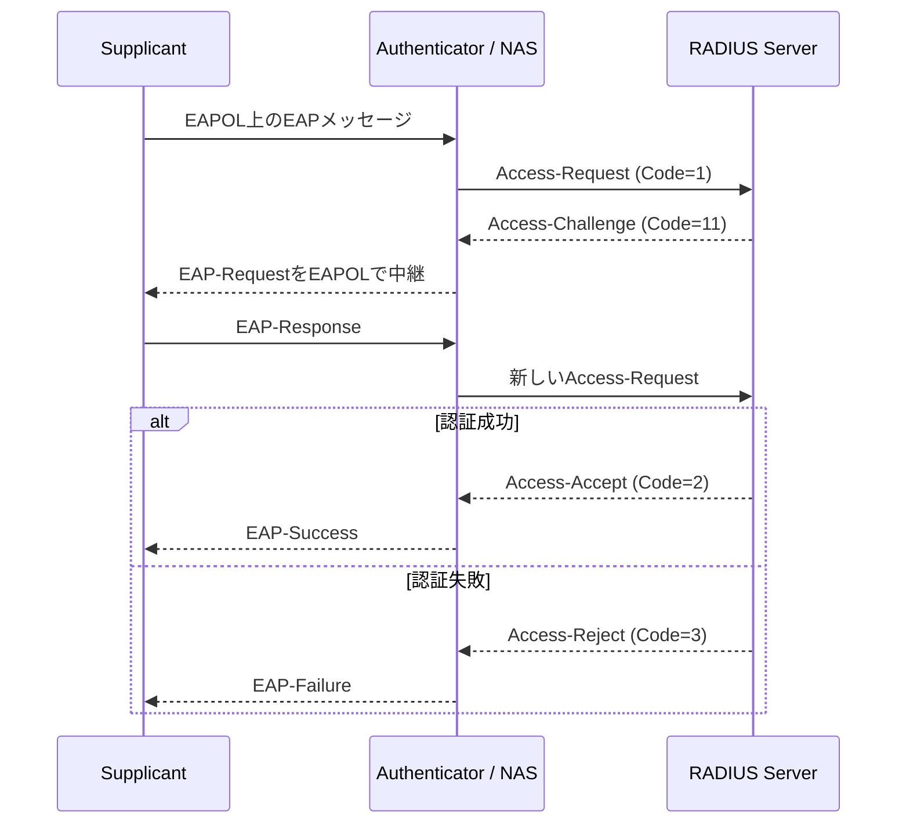

# RFC 2865 — RADIUS 日本語詳細解説

> 原典: [RFC 2865 — Remote Authentication Dial In User Service (RADIUS)](https://www.rfc-editor.org/rfc/rfc2865.html)（2000年6月）  
> 文書区分: Standards Track  
> 本書の位置付け: **逐語訳ではなく、原典の節構成に沿った詳細な日本語の解説・技術ノート**。仕様判断には原典と更新RFCを併読する。  
> 想定システム: Ethernet 802.1X Supplicant → Authenticator（NAS/RADIUSクライアント）→ RADIUSサーバー。TPM/Remote Attestationは後段の別仕組み。

## 読み方と適用範囲

RFC 2865はRADIUSの認証・認可・設定情報の交換を定義する**基本文書**。EAPをRADIUSで運ぶ細目はRFC 3579、802.1Xでの利用上の考え方はRFC 3580、EAP-TLSはRFC 5216/9190、AccountingはRFC 2866、CoAはRFC 5176で補う。したがって、RFC 2865だけではEAP-TLSを完全に実装できない。

本文に出てくる **MUST** は規格上の必須、**SHOULD** は特別な理由がない限り従う推奨、**MAY** は選択可能を意味する。以下の説明では原典の要件を「規格上の要求」、実運用上の例を「設計例」と明示して区別する。

## 1. Introduction — RADIUSが解決する課題（原典 §1）

多数のネットワークアクセス装置（NAS）が個別に利用者を管理するのではなく、認証サーバーに問い合わせる構成を採る。NASは接続を受ける側であり、RADIUSから見た**クライアント**。RADIUSサーバーは資格情報を評価し、認証の可否とサービス提供に必要な属性を返す。

### 用語上の注意

- **Supplicant**: 802.1Xで認証を受けたい端末。RADIUSクライアントではない。
- **Authenticator**: 802.1XでEAPOLを受け取る機器。通常、RADIUSに対しては**NAS / RADIUSクライアント**になる。
- **RADIUSサーバー**: 認証・認可の判定主体。EAP-TLSを処理するEAPサーバー機能を持つ場合がある。
- **Shared secret**: NASとRADIUSサーバーの間に設定する秘密。EAP-TLSの端末秘密鍵とは別。

### RFC 2865の重要な設計思想

1. クライアント/サーバーモデル。NASは要求を送り、認証結果を実施する。
2. 属性拡張性。可変長の属性群で認可情報を運ぶ。
3. 応答は単なる可否だけではなく、利用可能なサービスの設定情報を含み得る。
4. RADIUSサーバーの間にプロキシを置ける。

原典 §1.1 はMUST/SHOULD/MAYの読み方、§1.2はservice/session/silently discardなどの用語を定義する。**silently discard** は応答を返さず廃棄する動作で、監視用のログや統計カウンターを実装することが推奨されている。

## 2. Operation — 認証処理の動作（原典 §2）

### 2.0 基本フロー



図は**802.1X/EAP連携の模式図**。RFC 2865そのものは802.1Xを定義しない。チャレンジ往復でEAP-Messageを使う要件はRFC 3579を参照。

### 2.1 Challenge/Response（§2.1）

Access-Requestに対して追加の応答が必要なら、サーバーはAccess-Challengeを返せる。NASが再度Access-Requestを送り、サーバーがAccept/Reject/再Challengeを決める。`State`属性が指定されれば後続要求で引き継ぐ。

**なぜ必要か**: 1往復では完了しない認証方式を扱うため。EAP-TLSの複数往復もこの考え方を利用するが、EAPの中身と必須属性はRFC 3579で規定される。

### 2.2 PAP / CHAPとの相互運用（§2.2）

原典はPAP由来のUser-Password、CHAP由来のCHAP-Passwordなどを説明する。**今回のEAP-TLSではPAP/CHAPを認証方式として選ばない**。この節はRADIUSの歴史的な基本機構を理解するために読む。

### 2.3 Proxy（§2.3）

NAS → 転送RADIUS → 最終RADIUS の経路を取れる。プロキシは転送先との共有秘密を別に管理し、各ホップの応答認証を検証する。`Proxy-State`は中継元に戻すための状態で、規格上、順序・不透明性の保持が重要。

**セキュリティ上の注意**: RADIUSの共有秘密と認証はホップ単位。プロキシを経由した場合、経路全体が自動的にエンドツーエンドで保護されるわけではない。

### 2.4 Why UDP?（§2.4）

元来のRADIUS認証ではUDPを採用し、標準の宛先ポートは**1812/UDP**。NASはタイムアウト・再送・代替サーバーを扱う。RADIUS/TLS（RFC 6614）などは別文書に基づく拡張的なトランスポートである。

### 2.5 Retransmission Hints（§2.5）

認証要求に応答がない場合の再送や別サーバーへの切り替えを想定するが、詳細なリトライアルゴリズムや一律のタイムアウト値がRFC 2865だけで規定されるわけではない。**設計例**としてNASで再送回数、応答待ち時間、障害時のfail-closedを定義する。

### 2.6 Keep-Alives Considered Harmful（§2.6）

空の認証要求で定常的にサーバーの生存確認をする設計を避ける考え方が述べられる。監視・障害検知は対象の実装、運用要件、後続の拡張仕様に照らして設計する。

## 3. Packet Format — バイト単位の構造（原典 §3）

RADIUSメッセージは固定20オクテットのヘッダーと可変長Attributesからなる。

```text
byte offset    size    field
0              1       Code
1              1       Identifier
2              2       Length (network byte order / big-endian)
4              16      Authenticator
20             N       Attributes (TLVを連結)
```

```text
  0               1               2               4
  +---------------+---------------+---------------+
  | Code (1)      | Identifier(1) | Length (2)    |
  +---------------+---------------+---------------+
  |              Authenticator (16)               |
  |                                               |
  +-----------------------------------------------+
  |           Attributes (variable)               |
  +-----------------------------------------------+
```

### Code（1バイト）

RADIUSメッセージの種類。今回の認証では `1=Access-Request`, `2=Access-Accept`, `3=Access-Reject`, `11=Access-Challenge` が中心。Accounting用のCodeはRFC 2866、CoAはRFC 5176が定義する。

### Identifier（1バイト）

要求と応答の対応付けに用いる番号。応答は対応する要求のIdentifierに一致する必要がある。再送と新規要求を見分ける際にはIdentifierだけでなく送受信先、Authenticatorも含めて考える。

### Length（2バイト）

ヘッダーを含むRADIUSパケット全長。**20未満または4096超の値を持つパケットは原典の規則に従って破棄**する。UDPで受信したデータとLengthが一致しない場合の処理も原典§3を参照。単位はオクテット。

### Authenticator（16バイト）

Access-Requestでは予測困難な値（Request Authenticator）を使う。応答側では要求のAuthenticatorや共有秘密、パケット内容を用いてResponse Authenticatorを生成・検査する。

**誤解しやすい点**: このフィールドはTPM QuoteでもEAP-TLSのCertificateVerifyでもない。また従来RADIUSのMD5ベースの保護を、現代的な暗号化通信と同等と考えない。運用設計ではRADIUS/TLSや実装のセキュリティ勧告も確認する。

## 4. Packet Types — 応答コードの意味（原典 §4）

| Code | 名称 | 方向 | 意味 | 802.1Xでの扱い |
|---:|---|---|---|---|
| 1 | Access-Request | NAS → Server | 認証要求 | EAP応答などを中継 |
| 2 | Access-Accept | Server → NAS | 認証・認可許可 | 認可属性を適用。ただしAttestation待ちなら隔離権限のみ |
| 3 | Access-Reject | Server → NAS | 拒否 | 通常通信を許可しない |
| 11 | Access-Challenge | Server → NAS | 継続認証 | EAP要求をSupplicantへ中継 |

### 4.1 Access-Request

NASは自身の識別、アクセス対象、ユーザー情報などを属性として付与しサーバーへ送る。802.1Xでは端末が直接RADIUSを送るのではない。`User-Name`は必ずしも証明書のSubjectと同一ではなく、EAP Identityと証明書の紐付けは別途ポリシーで検証する。

### 4.2 Access-Accept

認証に成功し、サービス提供が許可された場合に返る。サービス設定を属性として付加できる。**今回の設計例では「隔離ネットワークへの接続だけ」を許可**し、TPMの健全性検証後に通常通信へ昇格させる。RFC 2865がRemote Attestationを要求しているわけではない。

### 4.3 Access-Reject

サーバー側が要求を拒否したことを表す。Authenticatorは認証成功として扱ってはならない。失敗理由の通知とログには秘密情報の漏えいに注意する。

### 4.4 Access-Challenge

中間的な認証処理を継続するための応答。`State`はクライアントで内容を解釈・変更せず、後続要求に渡す。EAP-TLSでは複数のChallengeが生じうる。

## 5. Attributes — TLVと属性の意味（原典 §5）

属性は基本的に `Type (1 byte) | Length (1 byte) | Value (Length - 2 bytes)` の連結。LengthはTypeとLength自身を含む。**属性長が2未満なら不正**。Valueの表現は属性ごとに異なる（文字列、32bit整数、IPv4アドレスなど）。

### 5.1 今回の設計で特に重要なRFC 2865属性

| Type | Attribute | Valueの意味 | なぜ使うか |
|---:|---|---|---|
| 1 | User-Name | ユーザー/端末の論理識別子 | 認証対象とポリシーの検索 |
| 4 | NAS-IP-Address | NASのIPv4アドレス | 認証元NASの識別 |
| 5 | NAS-Port | NAS内部のポート番号 | 認証対象ポートの区別 |
| 6 | Service-Type | 要求/許可するサービス種別 | 認可内容の意味付け |
| 11 | Filter-Id | フィルター識別子 | NAS側のACL等と紐づけ |
| 12 | Framed-MTU | フレームMTUに関するヒント | EAPメッセージサイズとの関係 |
| 18 | Reply-Message | 応答側のメッセージ | 表示・診断用途 |
| 24 | State | 継続処理の不透明状態 | Access-Challengeの往復で維持 |
| 25 | Class | サーバーからクライアントへ渡す不透明値 | セッション関連付け等 |
| 26 | Vendor-Specific | 企業独自拡張 | 標準属性にない機能 |
| 27 | Session-Timeout | 秒単位のセッション制限 | 期限到来時の制御 |
| 28 | Idle-Timeout | アイドル時間制限 | 未使用接続の管理 |
| 29 | Termination-Action | 終了時の動作 | 再認証などの動作指定 |
| 30 | Called-Station-Id | 接続先を表す識別子 | ポート/装置識別 |
| 31 | Calling-Station-Id | 接続要求元を表す識別子 | 端末MAC等の識別 |
| 32 | NAS-Identifier | NASの論理識別子 | NASの追跡 |
| 33 | Proxy-State | プロキシの状態 | 中継経路で元へ復帰 |
| 61 | NAS-Port-Type | 接続媒体の種類 | Ethernet等の区別 |

**注意**：EAP-Message (79)とMessage-Authenticator (80)はRFC 3579等で扱う。VLAN割当で使うTunnel-Type (64)、Tunnel-Medium-Type (65)、Tunnel-Private-Group-ID (81)も別のRFCで定義され、802.1X連携はRFC 3580で説明される。RFC 2865の属性と後続RFCの属性を混同しない。

### 5.2 State (Type 24) の具体例

1. RADIUSサーバーが `Access-Challenge + State=opaque-value` を送る。
2. NASはStateのバイト列を解釈せず保存する。
3. Supplicantから次のEAP応答を受け取る。
4. NASは次のAccess-Requestに受け取ったStateを付ける。
5. サーバーは継続中の認証処理を特定する。

### 5.3 Session-Timeoutと再認証の違い

Session-TimeoutはRADIUS応答で伝える制限情報。hostapdのローカルな再認証設定と意味が重なる場合はあるが、**常に同一のパラメータではない**。Termination-Actionなどとの組合せもRFC 3580やAuthenticator実装の仕様を確認する。

### 5.4 Vendor-Specific (Type 26)

メーカー拡張を格納できるが、特定のOSS・機器でしか解釈できない場合がある。MECEな仕様書では「標準属性／ベンダー拡張／ローカル設定」を分離し、移植性を確認する。

### 5.5 原典の他の属性

RFC 2865 §5.2–§5.43にはPAP/CHAP、PPP、SLIP、Telnet、IPX、AppleTalk、LATなどの歴史的なアクセスサービス用属性も多数含まれる。今回の有線802.1X/EAP-TLS構成では多くが未採用となる。ただし実装が汎用RADIUSスタックなら、未知属性・不正属性長・未対応サービスの扱いは重要なテスト対象。

## 6. IANA Considerations — 番号の管理（原典 §6）

RADIUSのTypeやCodeなどは、同じ番号を異なる意味に解釈しないために登録管理される。新規属性や拡張を検討する場合、既存の登録と拡張方針を確認し、適当な空き番号を独自割当しない。

## 7. Examples — 原典例の読み方（原典 §7）

原典にはTelnet接続、CHAPによるフレーム接続、Challenge/Responseカードによる認証例がある。これらはRADIUSのリクエスト/チャレンジ/応答構造を理解するのに有用。ただし**現代的な802.1X/EAP-TLSのそのままの実装例ではない**。以下に今回のシステムの概念例を示す。

### EAP-TLSを運ぶAccess-Requestの例（概念表示）

```text
Code = 1 (Access-Request)
Identifier = 0x28
Authenticator = [16-byte unpredictable value]
Attributes:
  User-Name = "device001@example.local"
  NAS-Identifier = "authenticator-01"
  NAS-Port-Type = Ethernet (値は適用RFCを参照)
  EAP-Message = [EAP-Response bytes]
  Message-Authenticator = [RFC 3579等で規定される認証値]
```

上記は**架空の説明用パケット**。属性値・順序・識別子は実トラフィックとは一致しない。実際に含める属性とMessage-Authenticatorの検証はRFC 3579および最新の安全性要件を参照。

### 802.1XとRADIUSの包み方

```text
Supplicant → Authenticator
Ethernet (EtherType 0x888E)
  └ EAPOL
      └ EAP
          └ EAP-TLS
              └ TLS handshake data

Authenticator → RADIUS Server
IP / UDP / RADIUS
  └ EAP-Message attribute
      └ EAP
          └ EAP-TLS
              └ TLS handshake data
```

**注意**：RADIUSのTLV内に入るEAPはEAPOLヘッダーを含まない。EAP-TLSの大きなメッセージがEAP-Message属性を複数使う場合もある（RFC 3579）。

## 8. Security Considerations — 設計上の注意（原典 §8）

- **共有秘密の分離**：NASとRADIUSのshared secretは設定で一致させ、外部へ露出しない。
- **クライアント識別**：未知NASからの要求は処理しない。単なるIP送信元だけに強く依存した信頼には注意。
- **不正パケット**：Length、属性境界、応答対応、Authenticatorを検証する。
- **従来RADIUS保護の限界**：MD5ベースの古い仕組みには現代の脅威に対する限界がある。RADIUS/TLSおよびMessage-Authenticatorの最新要件を別途確認。
- **EAP-TLSの証明書検証**：RADIUS基本仕様とは別の必須事項。CAだけでなくサーバー名、証明書用途、有効期間、失効、端末識別との紐づけを設計する。
- **Attestationとの分離**：RADIUSが端末を認証しても、TPMのPCR/Quoteが検証されたことにはならない。隔離ACLとPolicy Controllerで二段階制御する。

## 9. RFCに出てくる設定値とOSSでの対応

| 設計項目 | RFC 2865での位置付け | OSS例 | 設計上の判断 |
|---|---|---|---|
| RADIUS宛先ポート | 標準1812/UDP | hostapd `auth_server_port` | 標準を使用 |
| RADIUSサーバー宛先 | NASのローカル設定 | hostapd `auth_server_addr` | IP/DNSと冗長化 |
| Shared secret | NAS-Serverのホップ間秘密 | hostapd `auth_server_shared_secret` / FreeRADIUS clients設定 | 秘密管理・ローテーション |
| NAS識別子 | 属性 4/32 | `NAS-IP-Address`, `NAS-Identifier` | 装置IDとの一致 |
| Session timeout | 属性27 | FreeRADIUS返信属性 | 隔離中/通常通信中のポリシー |
| ACL識別子 | 属性11 | Filter-Id | 実際のNAS側の適用機構が必要 |
| 再送待ち | 実装・運用依存 | RADIUSクライアント実装 | 期限・回数・障害時動作 |
| EAP方式 | RFC 2865単独では規定しない | wpa_supplicant `eap=TLS` | RFC 3579/9190を併読 |

### ソフトウェア構成の対応例

- Supplicant: `wpa_supplicant`（EAPOL送信、端末のEAP-TLS）
- Authenticator/NAS: `hostapd` wired + 実際のポート遮断を行うBridge/ACL
- RADIUS Server: `FreeRADIUS`（認証・認可属性）
- Remote Attestation: `Keylime`（**RFC 2865の範囲外**）

## 10. 技術レビュー・検証ケース

| ID | 確認内容 | 合格観点 |
|---|---|---|
| R2865-01 | Access-Requestヘッダー | Code/Identifier/Length/Authが正しく解析可能 |
| R2865-02 | Access-Challengeを複数回中継 | EAPの状態が正しく維持される |
| R2865-03 | 無効なRADIUSクライアント | 要求を受理しない |
| R2865-04 | 不正なLength値 | 不正パケットを処理しない |
| R2865-05 | 不正なTLV Length | 境界外参照せず破棄 |
| R2865-06 | Access-Reject | ポートが通常通信を許可しない |
| R2865-07 | Access-Accept + 隔離ポリシー | 限定通信のみ許可 |
| R2865-08 | 対応できないサービス属性 | NASが勝手に許可しない |
| R2865-09 | RADIUSタイムアウト | fail-closed動作とログが確認可能 |
| R2865-10 | Proxy-State | プロキシ往復で値・順序が保持される |

`R2865-06`以降の一部は、今回の802.1Xシステム向け**統合試験**であり、RFC 2865だけの規範要件を意味しない。

## 11. 原典の節と本書の対応表

| RFCの節 | 本書での説明 | 今回の重要度 |
|---|---|---|
| §1–1.2 | 目的、役割、要件キーワード | 高 |
| §2–2.6 | 認証フロー、Challenge、Proxy、UDP/再送 | 高 |
| §3 | パケットヘッダーと検証 | 最重要 |
| §4–4.4 | Request/Accept/Reject/Challenge | 最重要 |
| §5–5.43 | 属性の構造と主な属性、歴史的属性の位置付け | 高 |
| §6 | IANA登録 | 中 |
| §7 | 具体例の読み方 | 中 |
| §8 | 安全上の制約 | 最重要 |
| §9–14 | 変更履歴、文献、謝辞等 | 参照用 |

## 12. 併読する一次資料

- [RFC 2865 — RADIUS](https://www.rfc-editor.org/rfc/rfc2865.html)
- [RFC 2866 — RADIUS Accounting](https://www.rfc-editor.org/rfc/rfc2866.html)
- [RFC 3579 — RADIUS Support for EAP](https://www.rfc-editor.org/rfc/rfc3579.html)
- [RFC 3580 — IEEE 802.1X RADIUS Usage Guidelines](https://www.rfc-editor.org/rfc/rfc3580.html)
- [RFC 3748 — EAP](https://www.rfc-editor.org/rfc/rfc3748.html)
- [RFC 5176 — Dynamic Authorization Extensions](https://www.rfc-editor.org/rfc/rfc5176.html)
- [RFC 9190 — EAP-TLS 1.3](https://www.rfc-editor.org/rfc/rfc9190.html)
- [RFC 6614 — RADIUS/TLS](https://www.rfc-editor.org/rfc/rfc6614.html)

## 13. 本書で扱わなかったこと

本書はRFC 2865を**章構成に沿って詳しく理解するための日本語教材**であり、RFC全文の対訳、全属性の全ビット仕様の再録、適合性保証ではない。次のRFC 3579、3580、9190では、それぞれの原典の節に対応してEAP-Message、VLAN、証明書交換の詳細を掘り下げる。


## 深掘りA：RADIUSを「認証結果の運搬」として理解する

RADIUSのクライアントは端末そのものではなく、通常はAuthenticator（NAS）である。端末の802.1X/EAP応答を受けたNASは、送信元の端末MACやポートIDなどの接続文脈を付けてAccess-Requestを作る。このため、RADIUSサーバーは「証明書が信用できるか」に加え「どのNASのどのポートから来たのか」に応じた認可判断を返せる。ただしNASが申告した値は、そのNASを信頼できることが前提であり、端末の真実を独立に証明する属性ではない。

### パケットが届いてからの受信順序

1. UDP受信時に送信元とNAS登録情報を照合する。未知NASからの入力は認証処理へ安易に渡さない。
2. RADIUSヘッダーの `Length` がUDPデータグラム内に収まるか確認する。20オクテット未満は基本ヘッダーとして成立しない。
3. Attributeを先頭から走査し、`Length` が2以上かつ残余領域内であることを確認する。未知Attributeを想定外の配列インデックスとして扱わない。
4. EAPを使う場合はRFC 3579に従って `EAP-Message` と `Message-Authenticator` を処理する。
5. 認証成功後も、RADIUS応答のVLAN/ACL指定がデータプレーンへ実際に反映されたかはNAS側で別途確認する。

### Headerの例

```text
Offset  Size  Field
0       1     Code              0x01 = Access-Request
1       1     Identifier        要求-応答の照合用
2       2     Length            big-endian、ヘッダーと属性の合計
4       16    Authenticator     要求ごとに生成する値
20      N     Attributes        Type-Length-Valueを連続配置
```

`Identifier` だけではセッションの一意性を保証できない。再送・複数NAS・同時セッションを分けるために、送信先/送信元、Request Authenticator、要求状態なども用いる。アクセスポリシー上の端末IDにも流用しない。

### Attributeが認証結果へ影響する例

`User-Name` は要求されたIdentityを示すが、EAP-TLSで安全な認証を成立させるのは証明書検証と秘密鍵所有証明である。Identity文字列だけが一致したからAccess-Acceptを返す設計は避ける。`Filter-Id` や `Tunnel-*` は認証そのものではなく認可に作用する。これは「本人確認」と「どこへアクセスできるか」を分離する設計上の基本である。

## 深掘りB：共有秘密、応答Authenticator、リプレイ

古典的なRADIUS/UDPにはホップ間で使う共有秘密が存在する。これはアプリケーションのTLS証明書に相当する万能な保護ではない。古典方式のMD5依存やMessage-Authenticator強化の事情から、現代の実運用では信頼できる経路の限定、RADIUS/TLS、最新のセキュリティ勧告の検討が必要になる。

RADIUSの応答Authenticatorは要求値と応答内容、共有秘密を用いた計算によりNAS側で検証される。従ってIP送信元が正しそうというだけでAccess-Acceptを受理してはいけない。`State` は認証対話の継続値であり、暗号学的な端末本人確認そのものではない。秘密値のログ出力や全NASでの単一共有秘密使い回しは避ける。

### 試験観点

- パケット `Length` を実際より短く・長くした場合、確実に棄却するか。
- 不明NASから送信した場合、`Access-Accept` を返さないか。
- 直前のAccess-Acceptの `Identifier` だけを再利用した偽応答を受け付けないか。
- 認証済みとして扱う時点と、802.1Xポートの開放時点が対応するか。

**根拠を読む場所**：RFC 2865 §2（処理の概要）、§3（Packet Format）、§4（Packet Types）、§5（Attributes）、§6（IANA関連）。属性番号の現行登録は [IANA RADIUS Types](https://www.iana.org/assignments/radius-types) も併記して確認する。RFC 2865は後年のセキュリティ更新を含まない原点の規格である。


## 深掘り演習：設計レビューで必ず説明できるようにする

**この規格の核**：RADIUSでのAccess-RequestはNASが生成し、EAP-TLSの内部認証は別の標準に従う。属性の構文を受け取る処理と、属性に基づく認可結果をデータプレーンへ適用する処理は異なる。

### 演習 1 — 不正Lengthを受け取る
**観察する現象**：不正Lengthを受け取る。まず問題が起きている層を特定する。端末上のwpa_supplicantログ、NASの802.1X/RADIUSログ、RADIUS/EAPサーバー側の認証結果、実際のフレーム・パケットキャプチャを時刻とセッション識別子で突合する。
**考える順序**：①この規格が直接定める条件と、他規格・製品固有の条件を分離する。②ローカル設定値と通信で実際に送信された値を比較する。③認証、認可、通信経路の開放状態を別々に検証する。④不明な条件で通信を勝手に解放しない。
**具体的な確認**：RADIUSでのAccess-RequestはNASが生成し、EAP-TLSの内部認証は別の標準に従う。属性の構文を受け取る処理と、属性に基づく認可結果をデータプレーンへ適用する処理は異なる。 試験環境では正常な要求を1つ保存してから、変更した条件を1つだけ注入し、送信側・受信側・転送装置のログがどのように変わったかを確認する。

### 演習 2 — 知らないNASからAccess-Requestが来る
**観察する現象**：知らないNASからAccess-Requestが来る。まず問題が起きている層を特定する。端末上のwpa_supplicantログ、NASの802.1X/RADIUSログ、RADIUS/EAPサーバー側の認証結果、実際のフレーム・パケットキャプチャを時刻とセッション識別子で突合する。
**考える順序**：①この規格が直接定める条件と、他規格・製品固有の条件を分離する。②ローカル設定値と通信で実際に送信された値を比較する。③認証、認可、通信経路の開放状態を別々に検証する。④不明な条件で通信を勝手に解放しない。
**具体的な確認**：RADIUSでのAccess-RequestはNASが生成し、EAP-TLSの内部認証は別の標準に従う。属性の構文を受け取る処理と、属性に基づく認可結果をデータプレーンへ適用する処理は異なる。 試験環境では正常な要求を1つ保存してから、変更した条件を1つだけ注入し、送信側・受信側・転送装置のログがどのように変わったかを確認する。

### 演習 3 — Access-AcceptのVLAN属性がNAS非対応
**観察する現象**：Access-AcceptのVLAN属性がNAS非対応。まず問題が起きている層を特定する。端末上のwpa_supplicantログ、NASの802.1X/RADIUSログ、RADIUS/EAPサーバー側の認証結果、実際のフレーム・パケットキャプチャを時刻とセッション識別子で突合する。
**考える順序**：①この規格が直接定める条件と、他規格・製品固有の条件を分離する。②ローカル設定値と通信で実際に送信された値を比較する。③認証、認可、通信経路の開放状態を別々に検証する。④不明な条件で通信を勝手に解放しない。
**具体的な確認**：RADIUSでのAccess-RequestはNASが生成し、EAP-TLSの内部認証は別の標準に従う。属性の構文を受け取る処理と、属性に基づく認可結果をデータプレーンへ適用する処理は異なる。 試験環境では正常な要求を1つ保存してから、変更した条件を1つだけ注入し、送信側・受信側・転送装置のログがどのように変わったかを確認する。

### 演習 4 — EAPのIdentityだけ一致する
**観察する現象**：EAPのIdentityだけ一致する。まず問題が起きている層を特定する。端末上のwpa_supplicantログ、NASの802.1X/RADIUSログ、RADIUS/EAPサーバー側の認証結果、実際のフレーム・パケットキャプチャを時刻とセッション識別子で突合する。
**考える順序**：①この規格が直接定める条件と、他規格・製品固有の条件を分離する。②ローカル設定値と通信で実際に送信された値を比較する。③認証、認可、通信経路の開放状態を別々に検証する。④不明な条件で通信を勝手に解放しない。
**具体的な確認**：RADIUSでのAccess-RequestはNASが生成し、EAP-TLSの内部認証は別の標準に従う。属性の構文を受け取る処理と、属性に基づく認可結果をデータプレーンへ適用する処理は異なる。 試験環境では正常な要求を1つ保存してから、変更した条件を1つだけ注入し、送信側・受信側・転送装置のログがどのように変わったかを確認する。

## 規格文書を読んで照合する方法
以下の順に原文を確認すると、説明を単純な「機能紹介」で終わらせず、規格に根拠のある設計へ落とせる。
1. 冒頭のScope/Introductionでこの規格が定義しない処理を確定する。
2. Protocol Overview/Message Flowを追い、各メッセージの生成者・検証者・次状態を並べる。
3. Packet Format/Attribute/Extensionの定義から、長さ・値域・順序・必須条件を確認する。
4. Security Considerationsから、なりすまし・改ざん・再送・失効・ダウングレードの例外条件を拾う。
5. IANA Considerations、Errata、Updates/Updated byを確認し、古い番号表や旧TLS挙動をそのまま採用しない。
6. OSSの設定名とRFCの用語が一致しない場合、OSSの実装を確認して対応表を作る。

> 注意：本書は原典に基づく**独自の詳細解説**であり、著作権上の原文の全文翻訳ではない。特にIEEEの本文限定情報は推測で補っていない。MUST等の厳密な適合性判定には該当条文とErrataを直接確認する。