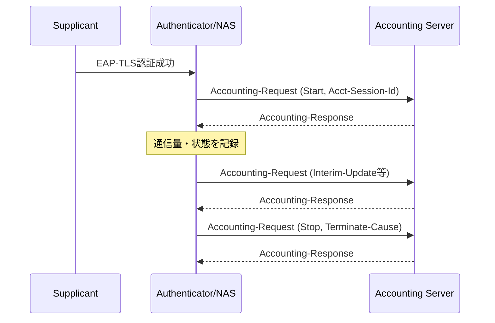

# RFC 2866 — RADIUS Accounting — 日本語詳細解説
> 原典: https://www.rfc-editor.org/rfc/rfc2866.html  
> 文書の位置付け: Standards Track  
> **注意**: 原文の翻訳・転載ではなく、章・概念に対応づけた独自の日本語技術解説。条文の正確なMUST/SHOULD/MAY、更新関係、Errataは原典で最終確認する。IEEE規格は公開資料で確認できる範囲の解説。

## 0. この規格で何を理解するか
RADIUS認証の成功/失敗と、通信利用記録（Accounting）は異なる機能。Accountingは利用開始、途中更新、終了などの記録をサーバーへ送る。課金だけでなく監査・セッション追跡・異常調査に有効。

## 1. 規格の仕組みを順番に理解する
### 1.1 認証とAccountingを分離する理由
Access-Acceptは認証/認可結果。Accounting-Requestはセッションの開始・終了と利用状況を別経路で通知する。認証が成功してもAccountingが無効な設計はあり得るが、監査上は記録を残すほうが望ましい。

### 1.2 Start・Stop・Interim-Update
Acct-Status-Typeで開始や停止などの種類を表す。中間更新（Interim-Update）は関連拡張で使う。すべての実装で中間更新が必須とは限らず、会計負荷と監査目的で周期を決める。

### 1.3 Acct-Session-Id
端末の同一認証セッションを複数のAccountingメッセージで紐づける識別子。ユーザーIDだけでは再接続時の複数セッションを区別できない。認証セッション、NASポート、Attestation判断のIDを別々に保持し、相互参照できるようにする。

### 1.4 メッセージ認証と重複
Accounting-RequestのRequest Authenticatorは認証側のAccess-Requestとは計算方法が異なる。UDP再送による同一記録の重複や応答の対応付けを処理する必要がある。

### 1.5 セッション終了理由
Acct-Terminate-Causeはどの理由で切断されたかを示す。CoA/Disconnectによる通信切断やAttestation失敗を運用上追跡する際、標準値と製品固有のログ理由を混同しない。

### 1.6 記録の完全性とプライバシー
Accountingはサービス利用履歴を扱うため、ログを保護し、保持期間・アクセス権・時刻同期を決める。従来RADIUS/UDPではセキュリティ境界を理解し、必要に応じTLS転送などを検討する。

## 2. フィールド・データ・設定値の読み解き
| 項目 | 値・形式の例 | 意味と実装上の注意 |
|---|---|---|
| Accounting-Request | Code=4 | NASからサーバーへ利用情報を送る |
| Accounting-Response | Code=5 | 記録の受領応答 |
| Acct-Status-Type | Type 40 | Start=1, Stop=2 など |
| Acct-Session-Id | Type 44 | セッション識別子 |
| Acct-Session-Time | Type 46 | セッション経過時間（秒） |
| Acct-Input-Octets | Type 42 | 受信バイト数の低位32bit等 |
| Acct-Output-Octets | Type 43 | 送信バイト数の低位32bit等 |
| Acct-Terminate-Cause | Type 49 | 終了理由 |
| 標準ポート | 1813/UDP | 代表的なRADIUS Accountingポート |

### 表の読み方
ここに記載する識別番号・ビット長はプロトコル形式の説明、パス・タイマー・証明書名は設計例またはOSS固有の設定である。RFCが規定しないローカル設定を規格必須と誤解しないこと。

## 3. 通信・処理の具体例

Accounting停止メッセージが失われたとき、サーバー側に永続セッションが残らないよう保守方針も必要。

## 4. OSS設定との対応（原理と実装を区別）
FreeRADIUSの `acct` 仮想サーバー、NAS側のAccounting送信先、共有秘密・ポートを整合させる。認証サーバーとAccountingサーバーは同一ホストにも分離ホストにもできる。NASのセッションID発行方法は製品実装に依存。

## 5. 正常系・異常系で確認すること
- [ ] StartとStopを同一Session-Idで追える
- [ ] 再送重複で二重計上しない
- [ ] 応答が返らない時にNASが安全に動作
- [ ] 時刻同期とログ保護
- [ ] 予期しない電源断後の記録補正
- [ ] Attestation失敗による切断理由を相関

## 6. 他規格との接続・読む順序
RFC 2865で認証、RFC 5176で切断・権限変更を理解するとAccountingの役割が明確になる。

## 7. 設計レビューで説明すべきこと
1. この規格が責任を持つ境界と、責任を持たない境界はどこか。
2. 端末とサーバーのうち、どちらが値を生成し、どちらが検証するか。
3. 資格情報が不正、メッセージが欠落、通信が途絶したときに閉じた状態（fail closed）になるか。
4. 取得したパケットキャプチャとログから規格上の判定理由を説明できるか。
5. 採用OSSの版で対応しているかを公式設定例と実測で確認したか。

---
**参照**: 上記原典。規格の本文を置換するものではない。セキュリティ実装では関連する更新RFC・Errata・ベンダーの実装ガイドも確認する。


## 深掘りA：Accountingが必要な理由

802.1X認証が成功したことと、端末がネットワークを何秒使い何バイト送ったかは別の事実である。Accountingは後者の記録を運び、事後監査や障害切分けの基礎になる。RADIUSサーバーがAccess-Acceptを返しても、NASがデータポート開放に失敗したなら「認証成功」と「利用開始」は一致しない。したがってStartは実際のセッション開始と整合するように設計する。

### 典型的な利用記録

```text
NAS -> Accounting Server : Accounting-Request
  Acct-Status-Type = Start (1)
  Acct-Session-Id = "session-00042"
  NAS-Port = 7
  User-Name = "device001@example.local"
Server -> NAS : Accounting-Response
... 通信 ...
NAS -> Accounting Server : Accounting-Request
  Acct-Status-Type = Stop (2)
  Acct-Session-Id = "session-00042"
  Acct-Session-Time = 7200
  Acct-Terminate-Cause = （終了理由）
Server -> NAS : Accounting-Response
```

`Acct-Session-Id` の生成主体はNAS。端末側のIdentityと同一にすると再接続や並列セッションを区別できない。ログは `(NAS-ID, Acct-Session-Id, event時刻)` 等で関連付ける。時刻同期がない環境では、並べ替えや遅延配信の解釈に注意する。

## 深掘りB：計数器・重複・切断の意味

`Acct-Input-Octets` / `Acct-Output-Octets` は方向がNAS視点で解釈される。端末視点の送受信と混同しない。古典的32bit計数器は高速なネットワークで周回するため、拡張属性で上位ビットを扱う実装や監査仕様も確認する。Interim-Updateは便利だが、短周期にしすぎるとNAS・サーバー双方の負荷が増える。

UDPでAccounting-Responseを失った場合、NASが再送して同じStart/Stopが複数届くことがある。受信側は「二回の開始」と断定せず、重複判定を行う。逆にStopが届かなかった場合に無期限で稼働状態と見なさず、運用上のタイムアウトと監査状態を区別する。

### Attestationとの接続

Keylimeで不正状態が見つかりCoA/Disconnectした場合、記録すべきなのは「Attestation失敗イベント」「ポリシー制御要求」「実際に通信が停止したイベント」の3点。AccountingだけではTPM Quoteが妥当だったかは分からない。ログの機密性にも注意し、端末ID・MAC・IP・行動履歴を管理する。

**根拠を読む場所**：RFC 2866 §2〜§4、Accountingの詳細拡張はRFC 2869等。Acct-Status-Type・Acct-Session-Id・Acct-Terminate-Causeの番号・意味は各属性定義とIANA割当を照合する。


## 深掘り演習：設計レビューで必ず説明できるようにする

**この規格の核**：Accountingの記録が実通信の開始・終了と一致するかが鍵になる。UDP再送による重複、NAS視点の通信量、ログに含まれる端末IDの機密性を個別に扱う。

### 演習 1 — Startが重複した
**観察する現象**：Startが重複した。まず問題が起きている層を特定する。端末上のwpa_supplicantログ、NASの802.1X/RADIUSログ、RADIUS/EAPサーバー側の認証結果、実際のフレーム・パケットキャプチャを時刻とセッション識別子で突合する。
**考える順序**：①この規格が直接定める条件と、他規格・製品固有の条件を分離する。②ローカル設定値と通信で実際に送信された値を比較する。③認証、認可、通信経路の開放状態を別々に検証する。④不明な条件で通信を勝手に解放しない。
**具体的な確認**：Accountingの記録が実通信の開始・終了と一致するかが鍵になる。UDP再送による重複、NAS視点の通信量、ログに含まれる端末IDの機密性を個別に扱う。 試験環境では正常な要求を1つ保存してから、変更した条件を1つだけ注入し、送信側・受信側・転送装置のログがどのように変わったかを確認する。

### 演習 2 — Stopが届かない
**観察する現象**：Stopが届かない。まず問題が起きている層を特定する。端末上のwpa_supplicantログ、NASの802.1X/RADIUSログ、RADIUS/EAPサーバー側の認証結果、実際のフレーム・パケットキャプチャを時刻とセッション識別子で突合する。
**考える順序**：①この規格が直接定める条件と、他規格・製品固有の条件を分離する。②ローカル設定値と通信で実際に送信された値を比較する。③認証、認可、通信経路の開放状態を別々に検証する。④不明な条件で通信を勝手に解放しない。
**具体的な確認**：Accountingの記録が実通信の開始・終了と一致するかが鍵になる。UDP再送による重複、NAS視点の通信量、ログに含まれる端末IDの機密性を個別に扱う。 試験環境では正常な要求を1つ保存してから、変更した条件を1つだけ注入し、送信側・受信側・転送装置のログがどのように変わったかを確認する。

### 演習 3 — 会計の送受信量が逆に見える
**観察する現象**：会計の送受信量が逆に見える。まず問題が起きている層を特定する。端末上のwpa_supplicantログ、NASの802.1X/RADIUSログ、RADIUS/EAPサーバー側の認証結果、実際のフレーム・パケットキャプチャを時刻とセッション識別子で突合する。
**考える順序**：①この規格が直接定める条件と、他規格・製品固有の条件を分離する。②ローカル設定値と通信で実際に送信された値を比較する。③認証、認可、通信経路の開放状態を別々に検証する。④不明な条件で通信を勝手に解放しない。
**具体的な確認**：Accountingの記録が実通信の開始・終了と一致するかが鍵になる。UDP再送による重複、NAS視点の通信量、ログに含まれる端末IDの機密性を個別に扱う。 試験環境では正常な要求を1つ保存してから、変更した条件を1つだけ注入し、送信側・受信側・転送装置のログがどのように変わったかを確認する。

### 演習 4 — Attestation失敗で強制切断する
**観察する現象**：Attestation失敗で強制切断する。まず問題が起きている層を特定する。端末上のwpa_supplicantログ、NASの802.1X/RADIUSログ、RADIUS/EAPサーバー側の認証結果、実際のフレーム・パケットキャプチャを時刻とセッション識別子で突合する。
**考える順序**：①この規格が直接定める条件と、他規格・製品固有の条件を分離する。②ローカル設定値と通信で実際に送信された値を比較する。③認証、認可、通信経路の開放状態を別々に検証する。④不明な条件で通信を勝手に解放しない。
**具体的な確認**：Accountingの記録が実通信の開始・終了と一致するかが鍵になる。UDP再送による重複、NAS視点の通信量、ログに含まれる端末IDの機密性を個別に扱う。 試験環境では正常な要求を1つ保存してから、変更した条件を1つだけ注入し、送信側・受信側・転送装置のログがどのように変わったかを確認する。

## 規格文書を読んで照合する方法
以下の順に原文を確認すると、説明を単純な「機能紹介」で終わらせず、規格に根拠のある設計へ落とせる。
1. 冒頭のScope/Introductionでこの規格が定義しない処理を確定する。
2. Protocol Overview/Message Flowを追い、各メッセージの生成者・検証者・次状態を並べる。
3. Packet Format/Attribute/Extensionの定義から、長さ・値域・順序・必須条件を確認する。
4. Security Considerationsから、なりすまし・改ざん・再送・失効・ダウングレードの例外条件を拾う。
5. IANA Considerations、Errata、Updates/Updated byを確認し、古い番号表や旧TLS挙動をそのまま採用しない。
6. OSSの設定名とRFCの用語が一致しない場合、OSSの実装を確認して対応表を作る。

> 注意：本書は原典に基づく**独自の詳細解説**であり、著作権上の原文の全文翻訳ではない。特にIEEEの本文限定情報は推測で補っていない。MUST等の厳密な適合性判定には該当条文とErrataを直接確認する。