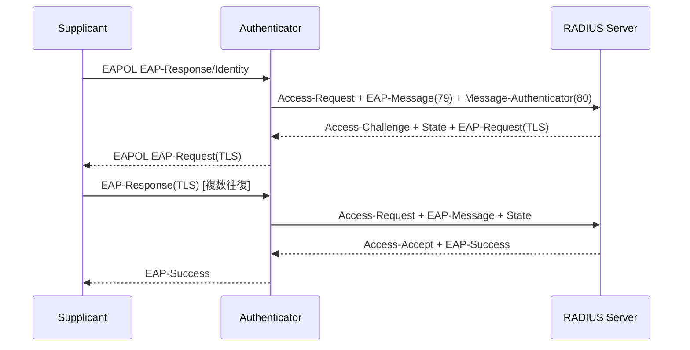

# RFC 3579 — RADIUSにEAPを載せる — 日本語詳細解説
> 原典: https://www.rfc-editor.org/rfc/rfc3579.html  
> 文書の位置付け: Standards Track  
> **注意**: 原文の翻訳・転載ではなく、章・概念に対応づけた独自の日本語技術解説。条文の正確なMUST/SHOULD/MAY、更新関係、Errataは原典で最終確認する。IEEE規格は公開資料で確認できる範囲の解説。

## 0. この規格で何を理解するか
802.1XのAuthenticatorが端末から受けたEAPをRADIUSサーバーへ届け、サーバーのEAP応答を端末へ戻すための規則。EAP-Message属性（79）とMessage-Authenticator属性（80）が核心。

## 1. 規格の仕組みを順番に理解する
### 1.1 なぜ二重のパケットが必要か
Ethernet上のEAPOLとIP/UDP上のRADIUSは異なる通信境界にある。Authenticatorは受け取ったEAPパケットをEAP-Message属性に格納してAccess-Requestを生成する。RADIUSサーバーからのAccess-Challenge/Accept/Rejectに含まれたEAPを取り出してEAPOLに載せ直す。

### 1.2 Access-ChallengeとState
EAP-TLSは多数の往復が必要。サーバーが次のEAP-RequestをAccess-Challengeで返し、Authenticatorは次のPeer応答とともにAccess-Requestを送る。Stateが返ってきたら後続要求で引き継ぎ、前段の対話を継続できるようにする。

### 1.3 EAP-Messageの分割・再構成
RADIUSの標準属性はTypeとLengthが各1 byteで、Valueが最大253 octets。大きなEAPパケットを複数のEAP-Message属性に連続して分割して載せる。受信側は正しい順番に連結する。これはTLS断片化と別の層で起きる現象。

### 1.4 Message-Authenticatorが重要な理由
EAPを運ぶRADIUSメッセージに対する改ざん対策として使用する。単にEAP-Messageが存在するだけでは外側RADIUSヘッダー・属性の改ざんを防げない。従来のRADIUSの共有秘密の運用と合わせ、属性欠落・不正MACを拒否する。

### 1.5 Access-AcceptとEAP-Success
サーバー側のEAP Method成功とRADIUS Access-Acceptは対応して扱う。中継機はAcceptだけを見て先行解放せず、EAP結果とポート状態が整合するようにする。認証済みでもAttestation未完了なら隔離ACLを維持するのは独自の後段ポリシー。

### 1.6 RADIUSのプロキシと信頼境界
RADIUSプロキシを通す場合、隣接ホップごとに共有秘密・保護が異なる。EAP-TLSはPeerとEAPサーバーの間でエンドツーエンドにTLS処理するが、RADIUSの属性すべてがTLSの保護下に入るわけではない。

### 1.7 エラー処理と不正パケット
Message-Authenticator不一致、EAP-Messageの不整合、State欠落、RADIUS応答の認証失敗、未知セッションの応答などで認証を成立させない。タイムアウトの扱いはネットワーク運用を踏まえて決める。

## 2. フィールド・データ・設定値の読み解き
| 項目 | 値・形式の例 | 意味と実装上の注意 |
|---|---|---|
| EAP-Message | Attribute Type 79 | ValueにEAPパケットを格納。1属性のValueは最大253 byte |
| Message-Authenticator | Attribute Type 80 / Value 16 bytes | EAPを伴うRADIUSパケットのメッセージ認証に重要 |
| State | Attribute Type 24 | Access-Challengeでの状態を後続Requestへ引き継ぐ |
| Access-Request | RADIUS Code 1 | 端末応答をNASからRADIUSサーバーへ運ぶ |
| Access-Challenge | RADIUS Code 11 | 認証継続、次のEAP-Requestを返す |
| Access-Accept/Reject | Code 2 / 3 | 認証結果。EAP-Success/Failureとの整合に注意 |

### 表の読み方
ここに記載する識別番号・ビット長はプロトコル形式の説明、パス・タイマー・証明書名は設計例またはOSS固有の設定である。RFCが規定しないローカル設定を規格必須と誤解しないこと。

## 3. 通信・処理の具体例

端末とRADIUSサーバーの証明書処理がAuthenticatorに透過的に中継される。

## 4. OSS設定との対応（原理と実装を区別）
hostapdではRADIUS接続先IP、ポート、共有秘密と802.1X有効化を設定。FreeRADIUSではRADIUSクライアント登録とEAPモジュールを設定。RADIUS/TLSを採用する場合は別の転送保護・証明書管理も必要で、従来UDPの共有秘密設定と混同しない。

## 5. 正常系・異常系で確認すること
- [ ] Type 79の複数属性を順序通り結合
- [ ] Type 80欠落・改ざん時に認証を拒否
- [ ] Challengeから戻るState属性を正しく維持
- [ ] 不正EAP LengthとRADIUS Lengthを拒否
- [ ] EAP失敗でAccess-Acceptを誤生成しない
- [ ] プロキシ経由の保護境界を理解

## 6. 他規格との接続・読む順序
RFC 2865のRADIUS基本構造とRFC 3748のEAPパケットを先に理解し、RFC 3580でIEEE 802.1X固有属性を確認する。

## 7. 設計レビューで説明すべきこと
1. この規格が責任を持つ境界と、責任を持たない境界はどこか。
2. 端末とサーバーのうち、どちらが値を生成し、どちらが検証するか。
3. 資格情報が不正、メッセージが欠落、通信が途絶したときに閉じた状態（fail closed）になるか。
4. 取得したパケットキャプチャとログから規格上の判定理由を説明できるか。
5. 採用OSSの版で対応しているかを公式設定例と実測で確認したか。

---
**参照**: 上記原典。規格の本文を置換するものではない。セキュリティ実装では関連する更新RFC・Errata・ベンダーの実装ガイドも確認する。


## 深掘りA：EAPがEAPOLからRADIUSへ移る瞬間

EAPOLで運ばれるEAPパケットは、NASに届いた時点でEAPの中身を再解釈して認証する必要はない。NASはEAPパケット全体をRADIUSの `EAP-Message` 属性のValueへ入れ、RADIUSヘッダーを追加する。RADIUSサーバーは属性を再構成してEAP側へ渡す。このようにEAPは「エンドツーエンドの認証対話」、RADIUSは「NASとバックエンドの運搬・認可要求」と分離できる。

```text
Ethernet [dst MAC][src MAC][0x888E]
  EAPOL [Version][Type=EAP-Packet][Length]
    EAP [Code][Identifier][Length][Type=TLS][Method-Data]

RADIUS/UDP [Code=Access-Request][ID][Length][Authenticator]
  [Type=79][Len][EAPパケット断片]
  [Type=80][Len=18][16-byte MAC]
  [NAS識別、ポート、Stateなど]
```

### 長いEAPパケットの分割

RADIUSの一般的なAttributeはType 1byte、Length 1byteで、最大総長が255byte。このうちヘッダー2byteを除いた最大253byteがValueになる。たとえばEAPの長さが600byteなら、`EAP-Message` を **253 + 253 + 94 byte** の3つのValueに分けて並べられる。これを復元した後で、EAP-TLS側のフラグメント処理を行う。この2段階の断片化を取り違えると、認証が大きな証明書のときだけ失敗する。

## 深掘りB：StateとMessage-Authenticator

`State` がAccess-Challengeで返された場合、NASは後続のAccess-Requestに指定どおり含めて処理を継続する。NASが毎回別の認証セッションを立てると、サーバーは直前のTLS状態と応答を結び付けられなくなる。

`Message-Authenticator (80)` はRADIUSメッセージの認証用属性で、EAP利用時の重要な要件となる。EAP-TLS自体のTLS署名が正しいとしても、外側のNASやVLAN指示属性が保護なしでよいわけではない。EAP内部の暗号学的検証と、RADIUSホップの完全性を別々に設計する必要がある。

### エラーの読み方

- `EAP-Message` を含むパケットで `Message-Authenticator` が欠落・不正なら、その時点で認証対話を不正として扱う。
- `State` が一致しない場合、TLS証明書不良ではなく認証セッション維持失敗の可能性がある。
- 大きな証明書でだけ失敗するなら、MTU、EAP-TLSの分割、RADIUS属性の分割を順に調べる。
- `Access-Accept` が返ってもデータポートが閉じたままなら、RADIUSと802.1Xポート状態の問題を分ける。

**根拠を読む場所**：RFC 3579 §2（EAP over RADIUSと運用）、§3（EAP-Message/Message-Authenticatorなど）、RFC 2865 §5。関連する後年のRADIUS脆弱性・更新RFCも確認する。


## 深掘り演習：設計レビューで必ず説明できるようにする

**この規格の核**：EAP-MessageはRADIUS属性の上にEAPを載せる手段であり、TLS証明書サイズを意識した断片化を理解しないと実機障害に直結する。

### 演習 1 — 証明書が大きい場合だけ失敗
**観察する現象**：証明書が大きい場合だけ失敗。まず問題が起きている層を特定する。端末上のwpa_supplicantログ、NASの802.1X/RADIUSログ、RADIUS/EAPサーバー側の認証結果、実際のフレーム・パケットキャプチャを時刻とセッション識別子で突合する。
**考える順序**：①この規格が直接定める条件と、他規格・製品固有の条件を分離する。②ローカル設定値と通信で実際に送信された値を比較する。③認証、認可、通信経路の開放状態を別々に検証する。④不明な条件で通信を勝手に解放しない。
**具体的な確認**：EAP-MessageはRADIUS属性の上にEAPを載せる手段であり、TLS証明書サイズを意識した断片化を理解しないと実機障害に直結する。 試験環境では正常な要求を1つ保存してから、変更した条件を1つだけ注入し、送信側・受信側・転送装置のログがどのように変わったかを確認する。

### 演習 2 — Message-Authenticatorが欠落
**観察する現象**：Message-Authenticatorが欠落。まず問題が起きている層を特定する。端末上のwpa_supplicantログ、NASの802.1X/RADIUSログ、RADIUS/EAPサーバー側の認証結果、実際のフレーム・パケットキャプチャを時刻とセッション識別子で突合する。
**考える順序**：①この規格が直接定める条件と、他規格・製品固有の条件を分離する。②ローカル設定値と通信で実際に送信された値を比較する。③認証、認可、通信経路の開放状態を別々に検証する。④不明な条件で通信を勝手に解放しない。
**具体的な確認**：EAP-MessageはRADIUS属性の上にEAPを載せる手段であり、TLS証明書サイズを意識した断片化を理解しないと実機障害に直結する。 試験環境では正常な要求を1つ保存してから、変更した条件を1つだけ注入し、送信側・受信側・転送装置のログがどのように変わったかを確認する。

### 演習 3 — Stateを保持できない
**観察する現象**：Stateを保持できない。まず問題が起きている層を特定する。端末上のwpa_supplicantログ、NASの802.1X/RADIUSログ、RADIUS/EAPサーバー側の認証結果、実際のフレーム・パケットキャプチャを時刻とセッション識別子で突合する。
**考える順序**：①この規格が直接定める条件と、他規格・製品固有の条件を分離する。②ローカル設定値と通信で実際に送信された値を比較する。③認証、認可、通信経路の開放状態を別々に検証する。④不明な条件で通信を勝手に解放しない。
**具体的な確認**：EAP-MessageはRADIUS属性の上にEAPを載せる手段であり、TLS証明書サイズを意識した断片化を理解しないと実機障害に直結する。 試験環境では正常な要求を1つ保存してから、変更した条件を1つだけ注入し、送信側・受信側・転送装置のログがどのように変わったかを確認する。

### 演習 4 — EAP成功とAccess-Acceptが食い違う
**観察する現象**：EAP成功とAccess-Acceptが食い違う。まず問題が起きている層を特定する。端末上のwpa_supplicantログ、NASの802.1X/RADIUSログ、RADIUS/EAPサーバー側の認証結果、実際のフレーム・パケットキャプチャを時刻とセッション識別子で突合する。
**考える順序**：①この規格が直接定める条件と、他規格・製品固有の条件を分離する。②ローカル設定値と通信で実際に送信された値を比較する。③認証、認可、通信経路の開放状態を別々に検証する。④不明な条件で通信を勝手に解放しない。
**具体的な確認**：EAP-MessageはRADIUS属性の上にEAPを載せる手段であり、TLS証明書サイズを意識した断片化を理解しないと実機障害に直結する。 試験環境では正常な要求を1つ保存してから、変更した条件を1つだけ注入し、送信側・受信側・転送装置のログがどのように変わったかを確認する。

## 規格文書を読んで照合する方法
以下の順に原文を確認すると、説明を単純な「機能紹介」で終わらせず、規格に根拠のある設計へ落とせる。
1. 冒頭のScope/Introductionでこの規格が定義しない処理を確定する。
2. Protocol Overview/Message Flowを追い、各メッセージの生成者・検証者・次状態を並べる。
3. Packet Format/Attribute/Extensionの定義から、長さ・値域・順序・必須条件を確認する。
4. Security Considerationsから、なりすまし・改ざん・再送・失効・ダウングレードの例外条件を拾う。
5. IANA Considerations、Errata、Updates/Updated byを確認し、古い番号表や旧TLS挙動をそのまま採用しない。
6. OSSの設定名とRFCの用語が一致しない場合、OSSの実装を確認して対応表を作る。

> 注意：本書は原典に基づく**独自の詳細解説**であり、著作権上の原文の全文翻訳ではない。特にIEEEの本文限定情報は推測で補っていない。MUST等の厳密な適合性判定には該当条文とErrataを直接確認する。