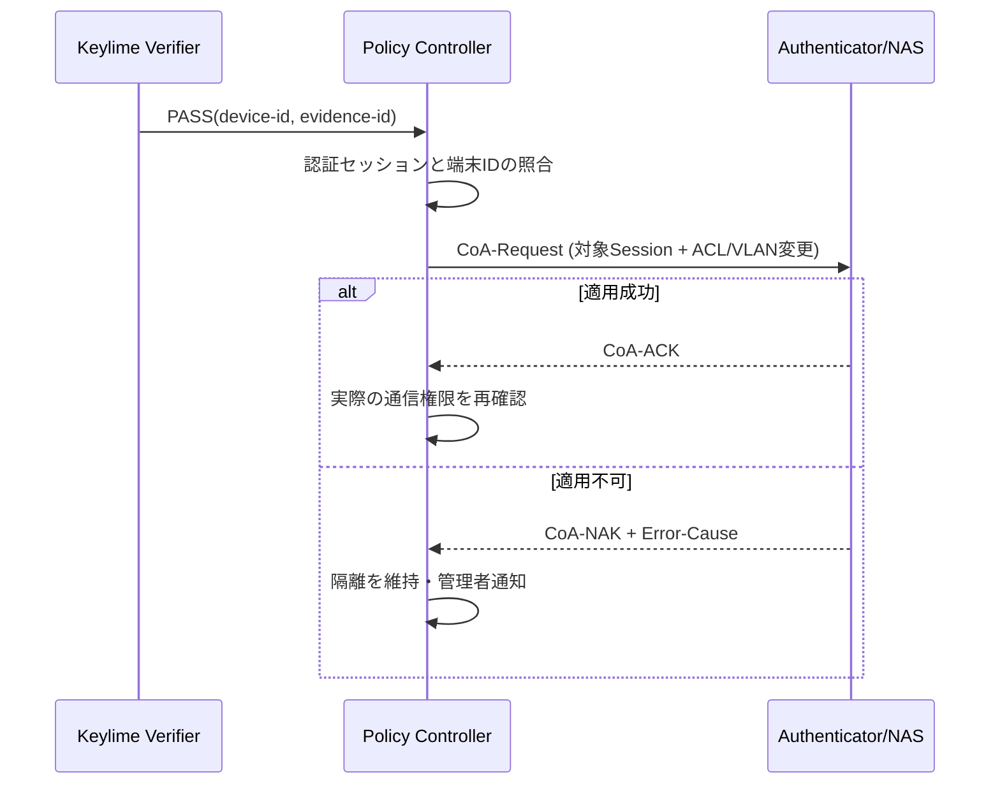
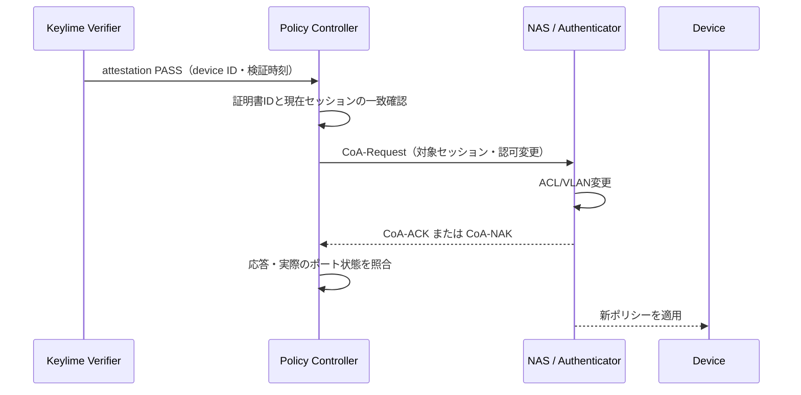

# RFC 5176 — Dynamic Authorization（CoA/Disconnect） — 日本語詳細解説
> 原典: https://www.rfc-editor.org/rfc/rfc5176.html  
> 文書の位置付け: Informational  
> **注意**: 原文の翻訳・転載ではなく、章・概念に対応づけた独自の日本語技術解説。条文の正確なMUST/SHOULD/MAY、更新関係、Errataは原典で最終確認する。IEEE規格は公開資料で確認できる範囲の解説。

## 0. この規格で何を理解するか
認証が終わった後にRADIUS側の判断で、NASに接続セッションの変更・切断を要求する仕組み。Remote AttestationのPASS/FAILを接続状態へ反映する際の重要候補。ただしNASがCoAを受け付け、実際のACL/VLAN変更を実行できることが前提。

## 1. 規格の仕組みを順番に理解する
### 1.1 通常のRADIUSとの向きの違い
通常のAccess-RequestはNAS→RADIUSサーバー。CoA/Disconnectでは動的認可の要求元（DASクライアント側）→NAS側Dynamic Authorization Serverという向きで送る。誰がどのIPから送信可能かを明示的に制限する。

### 1.2 CoAとDisconnectは目的が違う
CoAは既存セッションの認可属性を変更するための要求で、Disconnectはセッションを切断するための要求。CoAでVLANやACLを変更できる範囲はNAS実装による。切断後に再802.1X認証が必要になる場合もある。

### 1.3 対象セッションの特定
User-Nameだけで指定すると同一ユーザーの複数セッションがあり得る。Acct-Session-Id、NAS-Port、Calling-Station-Id等を適切に組合せ、誤った端末を解放しない。Keylimeの端末IDとEAP-TLS証明書IDを安全に結合する制御層が必要。

### 1.4 ACK/NAKと失敗時の扱い
CoA-ACKは要求を受け付けたことを示し、CoA-NAKは適用不可等を示す。通信途絶で応答がない場合に許可したとみなしてはならない。ACLの実状態を問い合わせるかログで確認する。

### 1.5 保護と信頼
従来の動的認可メッセージは共有秘密による認証を使う。送信元IPの厳格制限、強い秘密、管理ネットワークの分離を行い、必要なら適切な保護トランスポートを選ぶ。偽造CoAは権限昇格やDoSに直結する。

### 1.6 Remote Attestationへの適用
Keylime VerifierがPASSを出し、Policy Controllerが端末・認証セッションを照合してCoAを送る。FAILや期限切れでは隔離へ戻すかDisconnectする。RFC 5176自体はTPMやKeylimeの結果フォーマットを規定していない。

## 2. フィールド・データ・設定値の読み解き
| 項目 | 値・形式の例 | 意味と実装上の注意 |
|---|---|---|
| Disconnect-Request | Code 40 | セッション切断の要求 |
| Disconnect-ACK/NAK | Code 41/42 | 切断結果の応答 |
| CoA-Request | Code 43 | 動的認可変更要求 |
| CoA-ACK/NAK | Code 44/45 | 変更成功/不可の通知 |
| Error-Cause | Type 101 | NAK時の失敗理由 |
| 通信ポート | 通常3799/UDP | 管理ネットワーク・送信元制御が重要 |
| Acct-Session-Id | Type 44 | セッションの特定に利用可能 |

### 表の読み方
ここに記載する識別番号・ビット長はプロトコル形式の説明、パス・タイマー・証明書名は設計例またはOSS固有の設定である。RFCが規定しないローカル設定を規格必須と誤解しないこと。

## 3. 通信・処理の具体例

この図はRFC 5176とKeylimeの独自統合例でありRFCにある標準シーケンスそのものではない。

## 4. OSS設定との対応（原理と実装を区別）
FreeRADIUSの `radclient` 等でCoAを試験可能。ただしNAS側の設定、ポート許可、CoA受理設定、対象識別、ACL/VLANの変更機構が必要。hostapdだけで任意の有線ポートに対するCoAベースVLAN切替が必ず動くとは限らない。

## 5. 正常系・異常系で確認すること
- [ ] 対象セッションを一意に特定
- [ ] 偽造・不正送信元CoAを拒否
- [ ] ACKがあっても実ACL状態を確認
- [ ] NAK/Timeout時は隔離維持
- [ ] Disconnect後にデータ通信が遮断される
- [ ] Keylime結果の期限切れで再遮断

## 6. 他規格との接続・読む順序
RFC 2865/3580の認証・属性、RFC 2866のAcct-Session-Idを先に理解する。

## 7. 設計レビューで説明すべきこと
1. この規格が責任を持つ境界と、責任を持たない境界はどこか。
2. 端末とサーバーのうち、どちらが値を生成し、どちらが検証するか。
3. 資格情報が不正、メッセージが欠落、通信が途絶したときに閉じた状態（fail closed）になるか。
4. 取得したパケットキャプチャとログから規格上の判定理由を説明できるか。
5. 採用OSSの版で対応しているかを公式設定例と実測で確認したか。

---
**参照**: 上記原典。規格の本文を置換するものではない。セキュリティ実装では関連する更新RFC・Errata・ベンダーの実装ガイドも確認する。

## 深掘りA：認証が終わった後に、なぜCoAが必要か

RADIUS Access-Acceptは、EAP-TLS認証直後の許可情報をNASへ返す。ところがTPM Quoteの検証は、その後に別のKeylime Verifierが行う設計もある。起動状態に問題が発見されたとき、最初の認証結果を無期限に固定してはいけない。CoAは**既存セッションの認可状態を変更する**ための動的認可の仕組みである。Disconnectは既存セッションを切断する。両者を同じものとして扱うと、隔離への移動と完全切断の違いが曖昧になる。

### 動的認可の関係者

- NAS：セッションを保持して実通信を制御する装置。
- Dynamic Authorization Client：CoA/DisconnectをNASへ送る主体（必ずしも通常のRADIUS認証サーバーと同一プロセスではない）。
- Keylime Verifier：起動・実行状態を判断する主体。一般にCoA自体は実装しない。
- Policy Controller：Verifierの判定結果とNASセッションを照合し、適切なCoA/Disconnectを発行する統合部分。

## 深掘りB：状態変更のシーケンス

`CoA-ACK` を受け取ったことと、全スイッチの実通信が想定どおりになったことは同義ではない。Linux Bridge、外部Switch、Firewallなどにまたがる場合、実データ経路のテストも行う。

### CodeとUDPポート

| パケット | Code | 説明 |
|---|---:|---|
| Disconnect-Request / ACK / NAK | 40 / 41 / 42 | セッション切断要求と応答 |
| CoA-Request / ACK / NAK | 43 / 44 / 45 | 認可変更要求と応答 |
| Dynamic Authorization | UDP 3799 | 従来の標準的な待受ポート |

### 失敗時

セッション識別子が不足している場合は誤端末へのCoAを避ける。NASがCoAをサポートしない場合は、再認証/切断・制御API等の代替手段を設計する。Attestationの期限切れやFAIL時は**許可を維持したまま曖昧に放置しない**ことが重要。再送による二重適用は安全に扱う。

**根拠を読む場所**：RFC 5176 §2（Overview）、§3（Packet Format/Attribute）、§4（Security Considerations）。

## 深掘り演習：設計レビューで必ず説明できるようにする

**この規格の核**：CoAの送付先、対象セッション、NAS内の実権限制御が揃わないと誤開放・誤切断を招く。結果に対するセッション結合を先に設計する。

### 演習 1 — Keylime PASSの対象セッションが古い
**観察する現象**：Keylime PASSの対象セッションが古い。まず問題が起きている層を特定する。端末上のwpa_supplicantログ、NASの802.1X/RADIUSログ、RADIUS/EAPサーバー側の認証結果、実際のフレーム・パケットキャプチャを時刻とセッション識別子で突合する。
**考える順序**：①この規格が直接定める条件と、他規格・製品固有の条件を分離する。②ローカル設定値と通信で実際に送信された値を比較する。③認証、認可、通信経路の開放状態を別々に検証する。④不明な条件で通信を勝手に解放しない。
**具体的な確認**：CoAの送付先、対象セッション、NAS内の実権限制御が揃わないと誤開放・誤切断を招く。結果に対するセッション結合を先に設計する。 試験環境では正常な要求を1つ保存してから、変更した条件を1つだけ注入し、送信側・受信側・転送装置のログがどのように変わったかを確認する。

### 演習 2 — CoA-ACK後も通信制御が変わらない
**観察する現象**：CoA-ACK後も通信制御が変わらない。まず問題が起きている層を特定する。端末上のwpa_supplicantログ、NASの802.1X/RADIUSログ、RADIUS/EAPサーバー側の認証結果、実際のフレーム・パケットキャプチャを時刻とセッション識別子で突合する。
**考える順序**：①この規格が直接定める条件と、他規格・製品固有の条件を分離する。②ローカル設定値と通信で実際に送信された値を比較する。③認証、認可、通信経路の開放状態を別々に検証する。④不明な条件で通信を勝手に解放しない。
**具体的な確認**：CoAの送付先、対象セッション、NAS内の実権限制御が揃わないと誤開放・誤切断を招く。結果に対するセッション結合を先に設計する。 試験環境では正常な要求を1つ保存してから、変更した条件を1つだけ注入し、送信側・受信側・転送装置のログがどのように変わったかを確認する。

### 演習 3 — CoA-NAKが返る
**観察する現象**：CoA-NAKが返る。まず問題が起きている層を特定する。端末上のwpa_supplicantログ、NASの802.1X/RADIUSログ、RADIUS/EAPサーバー側の認証結果、実際のフレーム・パケットキャプチャを時刻とセッション識別子で突合する。
**考える順序**：①この規格が直接定める条件と、他規格・製品固有の条件を分離する。②ローカル設定値と通信で実際に送信された値を比較する。③認証、認可、通信経路の開放状態を別々に検証する。④不明な条件で通信を勝手に解放しない。
**具体的な確認**：CoAの送付先、対象セッション、NAS内の実権限制御が揃わないと誤開放・誤切断を招く。結果に対するセッション結合を先に設計する。 試験環境では正常な要求を1つ保存してから、変更した条件を1つだけ注入し、送信側・受信側・転送装置のログがどのように変わったかを確認する。

### 演習 4 — 偽のDisconnect-Requestが届く
**観察する現象**：偽のDisconnect-Requestが届く。まず問題が起きている層を特定する。端末上のwpa_supplicantログ、NASの802.1X/RADIUSログ、RADIUS/EAPサーバー側の認証結果、実際のフレーム・パケットキャプチャを時刻とセッション識別子で突合する。
**考える順序**：①この規格が直接定める条件と、他規格・製品固有の条件を分離する。②ローカル設定値と通信で実際に送信された値を比較する。③認証、認可、通信経路の開放状態を別々に検証する。④不明な条件で通信を勝手に解放しない。
**具体的な確認**：CoAの送付先、対象セッション、NAS内の実権限制御が揃わないと誤開放・誤切断を招く。結果に対するセッション結合を先に設計する。 試験環境では正常な要求を1つ保存してから、変更した条件を1つだけ注入し、送信側・受信側・転送装置のログがどのように変わったかを確認する。

## 規格文書を読んで照合する方法
以下の順に原文を確認すると、説明を単純な「機能紹介」で終わらせず、規格に根拠のある設計へ落とせる。
1. 冒頭のScope/Introductionでこの規格が定義しない処理を確定する。
2. Protocol Overview/Message Flowを追い、各メッセージの生成者・検証者・次状態を並べる。
3. Packet Format/Attribute/Extensionの定義から、長さ・値域・順序・必須条件を確認する。
4. Security Considerationsから、なりすまし・改ざん・再送・失効・ダウングレードの例外条件を拾う。
5. IANA Considerations、Errata、Updates/Updated byを確認し、古い番号表や旧TLS挙動をそのまま採用しない。
6. OSSの設定名とRFCの用語が一致しない場合、OSSの実装を確認して対応表を作る。

> 注意：本書は原典に基づく**独自の詳細解説**であり、著作権上の原文の全文翻訳ではない。特にIEEEの本文限定情報は推測で補っていない。MUST等の厳密な適合性判定には該当条文とErrataを直接確認する。