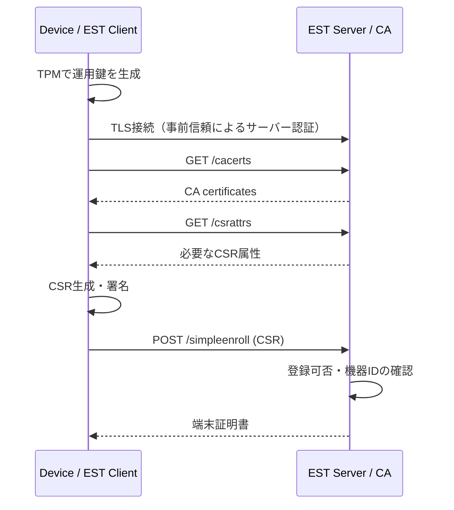
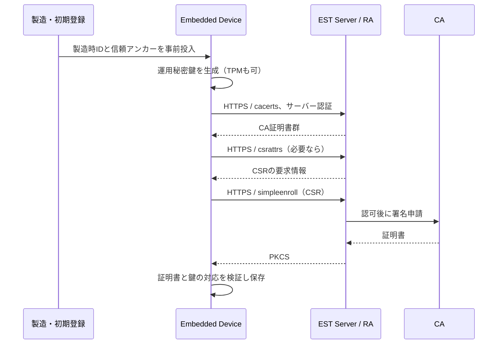

# RFC 7030 — Enrollment over Secure Transport（EST） — 日本語詳細解説
> 原典: https://www.rfc-editor.org/rfc/rfc7030.html  
> 文書の位置付け: Standards Track  
> **注意**: 原文の翻訳・転載ではなく、章・概念に対応づけた独自の日本語技術解説。条文の正確なMUST/SHOULD/MAY、更新関係、Errataは原典で最終確認する。IEEE規格は公開資料で確認できる範囲の解説。

## 0. この規格で何を理解するか
ESTはHTTPS/TLSを用いてPKI証明書やCA証明書を登録・更新するためのプロトコル。製造時に認証証明書を必ず配布する方式だけでなく、初期信頼情報で接続して運用証明書を払い出すシナリオに使える。

## 1. 規格の仕組みを順番に理解する
### 1.1 製造時証明書と運用証明書
IDevIDなど製造時のIDを起点に、運用組織のCAからLDevID等の証明書を発行する設計が可能。ESTは特定のハードウェアIDの正当性をそれだけで証明する規格ではなく、サーバー側の登録認可ポリシーが必要。

### 1.2 TLSの役割
ESTはHTTP over TLSでCAサービスにアクセスする。ESTサーバーの正当性を検証し、必要に応じてクライアント証明書等で登録者を認証する。認証前ネットワークでESTに到達させる場合は許可先を厳格に絞る。

### 1.3 cacerts
`/.well-known/est/cacerts` を用いてCA証明書群を取得する。取得した証明書を無条件で信頼ストアに追加する設計は危険。最初の信頼アンカー取得・ブートストラップ手順を別途定義する。

### 1.4 simpleenrollとsimplereenroll
simpleenrollで新規CSRを提出し証明書を取得する。simplereenrollは再登録・更新用途。更新時に鍵を再生成するか既存鍵を使うか、失効時の復旧経路を運用として決める。

### 1.5 CSR Attributes
csrattrsでサーバーがCSR生成に必要な属性やアルゴリズムのヒントを提示できる。クライアントは要求された内容を実装ポリシーと照合し、安全でない鍵長や用途へ変更しない。

### 1.6 serverkeygenと秘密鍵
ESTにはサーバー側で鍵生成を行う機能もあるが、TPM内非エクスポート秘密鍵の要件と両立しない場合がある。TPMで鍵を生成しCSRだけ外部へ送るのが適切な設計も多い。

### 1.7 Bootstrapの鶏と卵問題
802.1Xの認証に端末証明書が必要なのに、その証明書をネットワーク経由で取りたい場合、初期登録ネットワークや製造時IDなど別の信頼経路が必要。初回配布と更新フローを分けて設計する。

### 1.8 失敗・再試行・更新時刻
CAの承認待ち、HTTPエラー、証明書未発行、TLS検証失敗で中途半端な証明書を使用しない。既存証明書の有効期限と更新リトライの余裕を見積もる。

## 2. フィールド・データ・設定値の読み解き
| 項目 | 値・形式の例 | 意味と実装上の注意 |
|---|---|---|
| CA Certificates | GET /.well-known/est/cacerts | CA証明書取得 |
| CSR Attributes | GET /.well-known/est/csrattrs | CSR生成の属性ヒント |
| Simple Enrollment | POST /.well-known/est/simpleenroll | PKCS#10 CSRによる証明書登録 |
| Simple Re-enrollment | POST /.well-known/est/simplereenroll | 証明書再登録 |
| Server-side Key Generation | POST /.well-known/est/serverkeygen | 秘密鍵取扱い要件と要調整 |
| CSR | PKCS#10 | 公開鍵・識別情報等を署名付きで提出 |
| TLS | HTTPS | サーバー認証と通信保護 |

### 表の読み方
ここに記載する識別番号・ビット長はプロトコル形式の説明、パス・タイマー・証明書名は設計例またはOSS固有の設定である。RFCが規定しないローカル設定を規格必須と誤解しないこと。

## 3. 通信・処理の具体例

HTTPのエラーコードやCMSコンテンツ型などの詳細は原典各節で確認する。

## 4. OSS設定との対応（原理と実装を区別）
OSS候補は `step-ca` のEST機能（利用するバージョンの対応確認が必要）や各種ESTクライアント/サーバー実装。OpenSSL単体でCSRを生成できてもESTプロトコルサーバーが完成するわけではない。

## 5. 正常系・異常系で確認すること
- [ ] 未信頼ESTサーバーを拒否
- [ ] 未登録端末の証明書発行を拒否
- [ ] CSR署名と公開鍵を検証
- [ ] 証明書失効/更新タイミングで復旧可能
- [ ] 秘密鍵が意図せず輸出されない
- [ ] 初回ネットワーク許可範囲が限定

## 6. 他規格との接続・読む順序
RFC 5280は証明書検証、RFC 8446はTLS、IEEE 802.1ARはDevID、RFC 9190は受領した端末証明書をEAP-TLSで使う。

## 7. 設計レビューで説明すべきこと
1. この規格が責任を持つ境界と、責任を持たない境界はどこか。
2. 端末とサーバーのうち、どちらが値を生成し、どちらが検証するか。
3. 資格情報が不正、メッセージが欠落、通信が途絶したときに閉じた状態（fail closed）になるか。
4. 取得したパケットキャプチャとログから規格上の判定理由を説明できるか。
5. 採用OSSの版で対応しているかを公式設定例と実測で確認したか。

---
**参照**: 上記原典。規格の本文を置換するものではない。セキュリティ実装では関連する更新RFC・Errata・ベンダーの実装ガイドも確認する。

## 深掘りA：ESTが解決する「証明書は最初からあるのか」

802.1XのEAP-TLS端末には認証前から端末証明書が必要になる。ESTはその端末証明書を**初回登録・更新**する仕組みの一つ。工場出荷時のブートストラップ認証材料を使って運用証明書を取得する。ただしESTを使えば初回認証材料が不要になるわけではない。最初にESTサーバーを信用するためのCA情報や初期ID、製造時秘密鍵、事前共有された安全な経路などを設計する必要がある。

### 主要EST操作とHTTPパス

| 操作 | 典型エンドポイント | 意味 |
|---|---|---|
| CA証明書取得 | `/.well-known/est/cacerts` | サーバー側が提供するCA証明書情報 |
| 証明書登録 | `/.well-known/est/simpleenroll` | CSRを使った証明書発行申請 |
| 再登録 | `/.well-known/est/simplereenroll` | 既存端末の証明書更新 |
| CSR属性取得 | `/.well-known/est/csrattrs` | CAが要求するCSR属性 |
| サーバー鍵生成 | `/.well-known/est/serverkeygen` | 鍵生成をサーバーへ委ねる特別なフロー |

最後のサーバー鍵生成は一般的な「TPMから秘密鍵を出さない」設計とは相性がよくない。TPM内の秘密鍵を非エクスポートにしたいなら、端末で鍵生成してCSRを送る `simpleenroll` / `simplereenroll` を基本にする。

## 深掘りB：初回登録の時間軸

ESTサーバーが端末をどのように認証・認可するかは導入環境で異なる。単にCSRを作れたという理由だけで発行すると、任意の攻撃者が端末証明書を取得し得る。

## 深掘りC：隔離ネットワークの到達性

運用証明書が期限切れになった端末はEAP-TLSに失敗し、通常ネットワークへ入れない可能性がある。更新用ESTサーバーへの隔離経路、製造時IDを使った再登録、失効・復旧ポリシーを事前に決める。ESTはHTTPSにより通信を保護するが、証明書発行条件を標準があなたの製品向けに自動定義するわけではない。

**根拠を読む場所**：RFC 7030 §3（ESTの操作）、§4（Server Authorization）、§5（Security Considerations）。デプロイ方法はCA/RAの公式実装仕様も確認する。

## 深掘り演習：設計レビューで必ず説明できるようにする

**この規格の核**：初回登録には事前の信頼材料が不可欠。証明書が失効した端末の更新経路を含めてネットワーク到達性を設計する。

### 演習 1 — 証明書失効で802.1Xに入れない
**観察する現象**：証明書失効で802.1Xに入れない。まず問題が起きている層を特定する。端末上のwpa_supplicantログ、NASの802.1X/RADIUSログ、RADIUS/EAPサーバー側の認証結果、実際のフレーム・パケットキャプチャを時刻とセッション識別子で突合する。
**考える順序**：①この規格が直接定める条件と、他規格・製品固有の条件を分離する。②ローカル設定値と通信で実際に送信された値を比較する。③認証、認可、通信経路の開放状態を別々に検証する。④不明な条件で通信を勝手に解放しない。
**具体的な確認**：初回登録には事前の信頼材料が不可欠。証明書が失効した端末の更新経路を含めてネットワーク到達性を設計する。 試験環境では正常な要求を1つ保存してから、変更した条件を1つだけ注入し、送信側・受信側・転送装置のログがどのように変わったかを確認する。

### 演習 2 — 製造時IDevIDからLDevIDを発行
**観察する現象**：製造時IDevIDからLDevIDを発行。まず問題が起きている層を特定する。端末上のwpa_supplicantログ、NASの802.1X/RADIUSログ、RADIUS/EAPサーバー側の認証結果、実際のフレーム・パケットキャプチャを時刻とセッション識別子で突合する。
**考える順序**：①この規格が直接定める条件と、他規格・製品固有の条件を分離する。②ローカル設定値と通信で実際に送信された値を比較する。③認証、認可、通信経路の開放状態を別々に検証する。④不明な条件で通信を勝手に解放しない。
**具体的な確認**：初回登録には事前の信頼材料が不可欠。証明書が失効した端末の更新経路を含めてネットワーク到達性を設計する。 試験環境では正常な要求を1つ保存してから、変更した条件を1つだけ注入し、送信側・受信側・転送装置のログがどのように変わったかを確認する。

### 演習 3 — 秘密鍵をTPM内で維持する
**観察する現象**：秘密鍵をTPM内で維持する。まず問題が起きている層を特定する。端末上のwpa_supplicantログ、NASの802.1X/RADIUSログ、RADIUS/EAPサーバー側の認証結果、実際のフレーム・パケットキャプチャを時刻とセッション識別子で突合する。
**考える順序**：①この規格が直接定める条件と、他規格・製品固有の条件を分離する。②ローカル設定値と通信で実際に送信された値を比較する。③認証、認可、通信経路の開放状態を別々に検証する。④不明な条件で通信を勝手に解放しない。
**具体的な確認**：初回登録には事前の信頼材料が不可欠。証明書が失効した端末の更新経路を含めてネットワーク到達性を設計する。 試験環境では正常な要求を1つ保存してから、変更した条件を1つだけ注入し、送信側・受信側・転送装置のログがどのように変わったかを確認する。

### 演習 4 — 未認可CSRの発行要求が届く
**観察する現象**：未認可CSRの発行要求が届く。まず問題が起きている層を特定する。端末上のwpa_supplicantログ、NASの802.1X/RADIUSログ、RADIUS/EAPサーバー側の認証結果、実際のフレーム・パケットキャプチャを時刻とセッション識別子で突合する。
**考える順序**：①この規格が直接定める条件と、他規格・製品固有の条件を分離する。②ローカル設定値と通信で実際に送信された値を比較する。③認証、認可、通信経路の開放状態を別々に検証する。④不明な条件で通信を勝手に解放しない。
**具体的な確認**：初回登録には事前の信頼材料が不可欠。証明書が失効した端末の更新経路を含めてネットワーク到達性を設計する。 試験環境では正常な要求を1つ保存してから、変更した条件を1つだけ注入し、送信側・受信側・転送装置のログがどのように変わったかを確認する。

## 規格文書を読んで照合する方法
以下の順に原文を確認すると、説明を単純な「機能紹介」で終わらせず、規格に根拠のある設計へ落とせる。
1. 冒頭のScope/Introductionでこの規格が定義しない処理を確定する。
2. Protocol Overview/Message Flowを追い、各メッセージの生成者・検証者・次状態を並べる。
3. Packet Format/Attribute/Extensionの定義から、長さ・値域・順序・必須条件を確認する。
4. Security Considerationsから、なりすまし・改ざん・再送・失効・ダウングレードの例外条件を拾う。
5. IANA Considerations、Errata、Updates/Updated byを確認し、古い番号表や旧TLS挙動をそのまま採用しない。
6. OSSの設定名とRFCの用語が一致しない場合、OSSの実装を確認して対応表を作る。

> 注意：本書は原典に基づく**独自の詳細解説**であり、著作権上の原文の全文翻訳ではない。特にIEEEの本文限定情報は推測で補っていない。MUST等の厳密な適合性判定には該当条文とErrataを直接確認する。