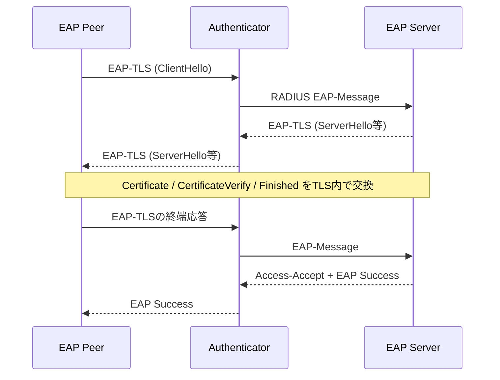

# RFC 9190 — EAP-TLS 1.3 — 日本語詳細解説
> 原典: https://www.rfc-editor.org/rfc/rfc9190.html  
> 文書の位置付け: Standards Track（RFC 5216を更新）  
> **注意**: 原文の翻訳・転載ではなく、章・概念に対応づけた独自の日本語技術解説。条文の正確なMUST/SHOULD/MAY、更新関係、Errataは原典で最終確認する。IEEE規格は公開資料で確認できる範囲の解説。

## 0. この規格で何を理解するか
EAP-TLSをTLS 1.3と組み合わせるためのプロトコル更新。EAP-TLS 1.3の正常終了、証明書認証、プライバシー、再開を理解するにはTLS 1.3（RFC 8446）と併読する。

## 1. 規格の仕組みを順番に理解する
### 1.1 EAPとTLS 1.3の境界
EAPはRequest/Responseフレームを運び、TLS 1.3はその中で鍵共有・認証・暗号化ハンドシェイクを処理する。TLS 1.3のサーバーとEAPのAuthenticatorは異なる役割。AuthenticatorにTLS秘密鍵を配布する必要はない。

### 1.2 ClientHello・ServerHello
端末のClientHelloで対応暗号・鍵共有情報などを示し、サーバーがServerHelloで合意する。TLS 1.3では多くの後続ハンドシェイクメッセージが暗号化されるため、通常のパケットキャプチャだけで証明書の中身が読めないことがある。

### 1.3 サーバー証明書とクライアント証明書
サーバーは自身の証明書と秘密鍵所有の証明を提示し、端末は信頼CAと期待サーバー名を検証する。クライアント証明書による相互認証を基本とするが、規格文面のサーバー側要求強度と具体的な導入ポリシーは区別する。今回の設計では端末証明書を必須にする。

### 1.4 FinishedとEAP-Success
FinishedはTLSハンドシェイクの暗号学的な整合性を確認する。EAP-Successは外側のEAP結果。両者は別メッセージであり、TLSのFinishedだけを見てAuthenticatorが独自に認証済みにするわけではない。

### 1.5 TLS 1.3のプライバシーとTLS 1.2との差
TLS 1.3の証明書伝送の暗号化、ハンドシェイク構造変更により、TLS 1.2時代と可視範囲が異なる。識別情報を外側Identityに平文で置く設計では、この保護の恩恵が限定的。

### 1.6 セッション再開と認証寿命
Resumptionは握手のコストを減らせるが、端末証明書更新・失効・姿勢検証との整合が必要。再開により新しい証明書検証を省略する可能性を運用要件で検討する。EAP再認証とKeylime再検証は別のタイマーを持つ。

### 1.7 0-RTTの扱いと認可
TLS 1.3に0-RTTという機構があるが、EAP-TLS 1.3では早期データを一般的なアプリ通信として扱うべきではない。認証成立前のポート解放を許可しない。

### 1.8 大きな証明書チェーン
TLS 1.3はEAPOLのMTU制約をなくさない。証明書の圧縮・チェーン最適化・フラグメント処理を別途設計し、PQC移行時には証明書・署名が巨大になる影響を測定する。

## 2. フィールド・データ・設定値の読み解き
| 項目 | 値・形式の例 | 意味と実装上の注意 |
|---|---|---|
| EAP Type | 13 | EAP-TLS |
| ClientHello/ServerHello | TLS 1.3 Handshake | 暗号方式と鍵交換の交渉 |
| Certificate | TLS Handshake | 公開鍵を含む証明書チェーン |
| CertificateVerify | TLS Handshake | 秘密鍵所有を署名で証明 |
| Finished | TLS Handshake | ハンドシェイク完全性の確認 |
| EAP Success | EAP Code=3 | 外側EAPの認証完了通知 |
| Resumption | PSK / session ticket 等 | 再開時のポリシー要確認 |

### 表の読み方
ここに記載する識別番号・ビット長はプロトコル形式の説明、パス・タイマー・証明書名は設計例またはOSS固有の設定である。RFCが規定しないローカル設定を規格必須と誤解しないこと。

## 3. 通信・処理の具体例

図はTLS 1.3/EAP-TLSの概念図で、断片応答・最終メッセージ順序の全詳細を表していない。厳密な状態遷移はRFC 9190 §2と原典図を参照。

## 4. OSS設定との対応（原理と実装を区別）
端末側は `eap=TLS` だけでTLS 1.3対応を保証しない。wpa_supplicant、TLSライブラリ、FreeRADIUSの各バージョンと設定が必要。CAとサーバー名検証、端末証明書の用途（EKU）と認可のチェックを必須設計とする。

## 5. 正常系・異常系で確認すること
- [ ] TLS 1.3のNegotiationが成立
- [ ] サーバー名・CA不一致で拒否
- [ ] クライアント証明書ポリシーを満たさない端末を拒否
- [ ] TLS 1.2/1.3混在方針が明確
- [ ] 再開時の失効・認可方針を確認
- [ ] 断片化・大きなチェーンで認証を完遂

## 6. 他規格との接続・読む順序
RFC 5216/8446/5280の知識が前提。大きな証明書はRFC 9191、TLSベースEAP全般へのTLS 1.3導入はRFC 9427も参照。

## 7. 設計レビューで説明すべきこと
1. この規格が責任を持つ境界と、責任を持たない境界はどこか。
2. 端末とサーバーのうち、どちらが値を生成し、どちらが検証するか。
3. 資格情報が不正、メッセージが欠落、通信が途絶したときに閉じた状態（fail closed）になるか。
4. 取得したパケットキャプチャとログから規格上の判定理由を説明できるか。
5. 採用OSSの版で対応しているかを公式設定例と実測で確認したか。

---
**参照**: 上記原典。規格の本文を置換するものではない。セキュリティ実装では関連する更新RFC・Errata・ベンダーの実装ガイドも確認する。

## 深掘りA：TLS 1.3をEAPに載せると何が変わるか

RFC 5216はEAP-TLSの基礎だが、TLS 1.3ではハンドシェイクと鍵導出、認証メッセージの保護方法が変わる。RFC 9190はTLS 1.3をEAP-TLS Type 13に使うための更新を定義する。TLS 1.3のバイト列をEAPOLへ入れれば終わりではなく、EAPとしての成功通知・鍵出力・フラグメント処理まで整合させる必要がある。

### 特に重要なprotected success

EAP-TLS 1.3では、TLSハンドシェイク後にサーバーが保護されたsuccess indicationとしてTLS application dataの `0x00` を送る。EAP層のEAP-Successだけでなく、TLSの保護境界内の成功通知を確認することで状態の一致を図る。これは一般的な業務アプリのデータ0x00を交換しているという意味ではない。

### 0-RTT・TLSアプリケーションデータ

TLS 1.3には早期データ(0-RTT)の仕組みがあるが、EAP-TLS 1.3では一般のアプリデータの送受信を用途としない。0-RTTを安易に使って認証が終わる前にアクセスを許可することはできない。802.1Xポート制御はEAPの結果と適切に結び付ける。

## 深掘りB：EAP-TLS 1.3の証明書の検証

サーバー証明書を厳格に検証し、端末証明書の要求/検証は当該規格・実装・ネットワークポリシーに基づき扱う。今回のEAP-TLSによる端末証明書認証では**端末証明書必須**を設計として選ぶ。TLS 1.3のCertificateRequestやCertificateVerifyが登場する状況を追い、接続先サーバー名検証を外さない。サーバー証明書の有効期限を確認するには起動直後の端末時刻も重要になる。

### 断片化を起こす典型例

組込み端末で証明書チェーンが長く、EAPOLのフレーム制約、EAP-TLSのフラグメント、RADIUS属性分割が重なる。TLSの受信サイズ上限とRADIUSの `Framed-MTU` など、複数層の制約を切り分ける。PQC証明書導入時は大きな証明書や署名によってこの問題が一層重要になるが、RFC 9190自体が自動的に耐量子認証を完成させるわけではない。

## 深掘りC：鍵出力と後段の認可

EAP MethodはEAP用鍵素材を生成する場合がある。これをMACsec等でどう利用するかは別の規格・実装の役割となる。EAP-TLSの成功はTPM Quoteの検証成功ではないため、RADIUS Access-Accept後も隔離ネットワークに置き、Remote AttestationのPASS後に通常通信を解放する設計は合理的。

**根拠を読む場所**：RFC 9190 §2（Protocol Overviewと詳細）、§3（Security Considerations）、RFC 8446。RFC 9191はEAP-TLSのメッセージサイズ最適化を読む際の追加資料になる。

## 深掘り演習：設計レビューで必ず説明できるようにする

**この規格の核**：TLS 1.3の成功とEAPにおける成功は関係するが同一メッセージではない。protected success indicationを確認する。

### 演習 1 — TLSハンドシェイク後にEAP-Successが早すぎる
**観察する現象**：TLSハンドシェイク後にEAP-Successが早すぎる。まず問題が起きている層を特定する。端末上のwpa_supplicantログ、NASの802.1X/RADIUSログ、RADIUS/EAPサーバー側の認証結果、実際のフレーム・パケットキャプチャを時刻とセッション識別子で突合する。
**考える順序**：①この規格が直接定める条件と、他規格・製品固有の条件を分離する。②ローカル設定値と通信で実際に送信された値を比較する。③認証、認可、通信経路の開放状態を別々に検証する。④不明な条件で通信を勝手に解放しない。
**具体的な確認**：TLS 1.3の成功とEAPにおける成功は関係するが同一メッセージではない。protected success indicationを確認する。 試験環境では正常な要求を1つ保存してから、変更した条件を1つだけ注入し、送信側・受信側・転送装置のログがどのように変わったかを確認する。

### 演習 2 — 0-RTTを使おうとする
**観察する現象**：0-RTTを使おうとする。まず問題が起きている層を特定する。端末上のwpa_supplicantログ、NASの802.1X/RADIUSログ、RADIUS/EAPサーバー側の認証結果、実際のフレーム・パケットキャプチャを時刻とセッション識別子で突合する。
**考える順序**：①この規格が直接定める条件と、他規格・製品固有の条件を分離する。②ローカル設定値と通信で実際に送信された値を比較する。③認証、認可、通信経路の開放状態を別々に検証する。④不明な条件で通信を勝手に解放しない。
**具体的な確認**：TLS 1.3の成功とEAPにおける成功は関係するが同一メッセージではない。protected success indicationを確認する。 試験環境では正常な要求を1つ保存してから、変更した条件を1つだけ注入し、送信側・受信側・転送装置のログがどのように変わったかを確認する。

### 演習 3 — EAP-TLSだけ成功してTPMは不正
**観察する現象**：EAP-TLSだけ成功してTPMは不正。まず問題が起きている層を特定する。端末上のwpa_supplicantログ、NASの802.1X/RADIUSログ、RADIUS/EAPサーバー側の認証結果、実際のフレーム・パケットキャプチャを時刻とセッション識別子で突合する。
**考える順序**：①この規格が直接定める条件と、他規格・製品固有の条件を分離する。②ローカル設定値と通信で実際に送信された値を比較する。③認証、認可、通信経路の開放状態を別々に検証する。④不明な条件で通信を勝手に解放しない。
**具体的な確認**：TLS 1.3の成功とEAPにおける成功は関係するが同一メッセージではない。protected success indicationを確認する。 試験環境では正常な要求を1つ保存してから、変更した条件を1つだけ注入し、送信側・受信側・転送装置のログがどのように変わったかを確認する。

### 演習 4 — PQC証明書でパケットサイズが増えた
**観察する現象**：PQC証明書でパケットサイズが増えた。まず問題が起きている層を特定する。端末上のwpa_supplicantログ、NASの802.1X/RADIUSログ、RADIUS/EAPサーバー側の認証結果、実際のフレーム・パケットキャプチャを時刻とセッション識別子で突合する。
**考える順序**：①この規格が直接定める条件と、他規格・製品固有の条件を分離する。②ローカル設定値と通信で実際に送信された値を比較する。③認証、認可、通信経路の開放状態を別々に検証する。④不明な条件で通信を勝手に解放しない。
**具体的な確認**：TLS 1.3の成功とEAPにおける成功は関係するが同一メッセージではない。protected success indicationを確認する。 試験環境では正常な要求を1つ保存してから、変更した条件を1つだけ注入し、送信側・受信側・転送装置のログがどのように変わったかを確認する。

## 規格文書を読んで照合する方法
以下の順に原文を確認すると、説明を単純な「機能紹介」で終わらせず、規格に根拠のある設計へ落とせる。
1. 冒頭のScope/Introductionでこの規格が定義しない処理を確定する。
2. Protocol Overview/Message Flowを追い、各メッセージの生成者・検証者・次状態を並べる。
3. Packet Format/Attribute/Extensionの定義から、長さ・値域・順序・必須条件を確認する。
4. Security Considerationsから、なりすまし・改ざん・再送・失効・ダウングレードの例外条件を拾う。
5. IANA Considerations、Errata、Updates/Updated byを確認し、古い番号表や旧TLS挙動をそのまま採用しない。
6. OSSの設定名とRFCの用語が一致しない場合、OSSの実装を確認して対応表を作る。

> 注意：本書は原典に基づく**独自の詳細解説**であり、著作権上の原文の全文翻訳ではない。特にIEEEの本文限定情報は推測で補っていない。MUST等の厳密な適合性判定には該当条文とErrataを直接確認する。