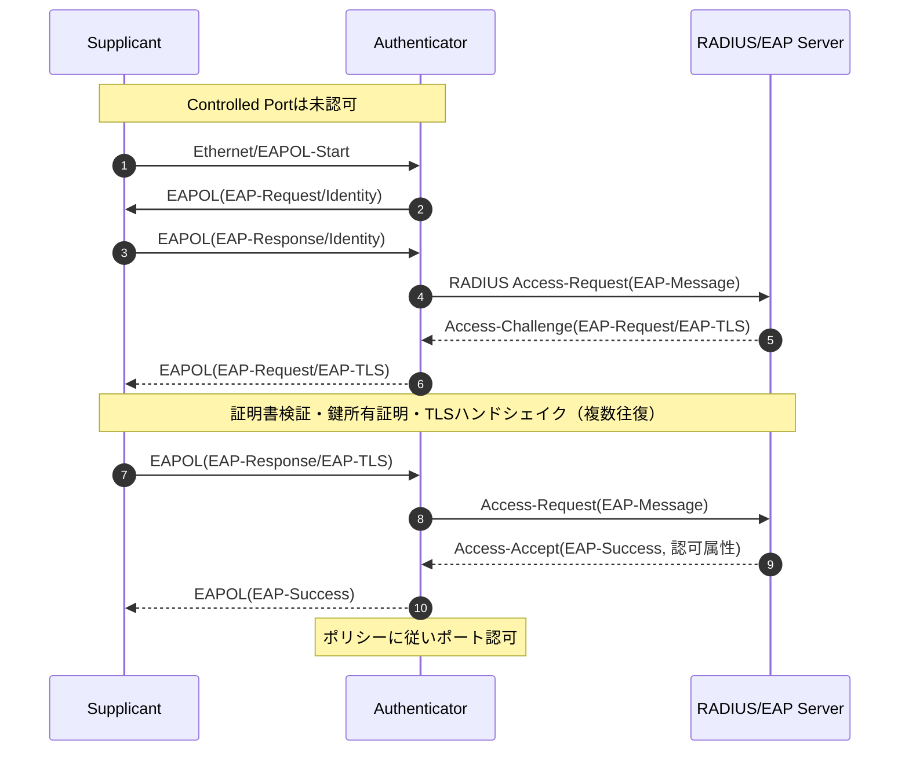

# IEEE 802.1X-2020：ポートベース認証・EAPOL・MKAの詳細教材

> 版：2026-11-26 / 原本を参照した**独自の日本語技術解説**。IEEE規格の公認翻訳・全文訳ではない。  
> 表記：**[規格]**=原文・IEEE公式の確認範囲、**[設計例]**=実装に向けた例、**[要確認]**=製品・規格本文の細目検証が必要。  
> IEEE 802.1の仕様とIETF RFCの仕様、OSSの設定キーは混同しない。細かな適合性判断には原本・追補・Errataを参照。

## 1. 原典と規格の守備範囲

- 原典：[IEEE 802.1X公式](https://1.ieee802.org/security/802-1x/) ／ [IEEE Std 802.1X-2020情報](https://standards.ieee.org/ieee/802.1X/7345/)
- 原文の章立ての確認：[ISO/IEC/IEEE 8802-1X:2021の公開プレビュー（IEEE 802.1X-2020に基づく）](https://cdn.standards.iteh.ai/samples/82672/923719360abc40faae0933a781ce3501/ISO-IEC-IEEE-8802-1X-2021.pdf)
- 2026年のCorrigendum 1はYANGモジュールのインターフェース条件を訂正。認証方式を全面変更する改訂ではない。再改訂のP802.1X-2020-Revは進行中のプロジェクトで、成立済み標準と混同しない。

**[規格]** 802.1XはLANのポートアクセス制御、EAPに基づく認証の運搬、MACsecに必要な鍵確立・MKAを体系化する。**802.1ARのIDevIDを使用することは802.1Xの必須前提ではない**。例えば別のPKIから発行した端末証明書でもEAP-TLSに使える。

## 2. 何を守る規格か：Identity / Authentication / Authorization / Secure Connectivity

認証前の端末が通常のデータフレームを自由に流せると、機器の正当性を確かめる前にLANへ参加できてしまう。802.1Xはアクセスを制御し、認証に必要な通信と通常のデータ通信を区別する。認証に成功しただけで通信が暗号化されるわけではないので、必要ならMKAとMACsecを使用する。

- **Supplicant**：接続を希望しEAP認証に参加する端末機能。
- **Authenticator**：認証結果をもとにポートアクセスを制御する装置・機能。スイッチやAP、Linux実装など。
- **Authentication Server**：資格情報を検証する機能。EAP-TLSなら証明書を検証する。多くの場合RADIUSサーバーに組み込まれるが、RADIUSは802.1Xそのものではない。
- **PAE（Port Access Entity）**：ポート認証に関係する機能。
- **Controlled Port**：認可により通常データフレームを通過させる論理ポート。
- **Uncontrolled Port**：認証・鍵合意に必要な制御メッセージを扱う経路。実際のフィルタ設計ではプロトコルごとの許可範囲を明確にする。

### 誤解を防ぐ

**EAPOL=認証メッセージをEthernetで運ぶ仕組み**であり、IP、TCP、TLSの代替ではない。EAP-TLSはEAP内でTLSを使う認証方式で、RADIUS/TLSはAuthenticator↔RADIUSサーバーの輸送保護。これらは別の経路で重なりうる。

## 3. 原文対応の読み方

| 原文Clause | 学習の中心 | 設計での問い |
|---|---|---|
| 5 | 適合性・必須機能と選択機能 | Supplicant/Authenticator/MKAをどこまで実装するか |
| 6 | ポートアクセス制御、鍵階層、PAE/PAC | 認証状態とデータ転送可否をどう結びつけるか |
| 7 | 有線・MACsecの複数利用パターン | リンクがP2Pか、ブリッジ・集約か |
| 8 | EAP認証、PACP、タイマー | 誰がEAPを開始し再送するか |
| 9 | MKAの鍵階層・Key Server・SAK | CAK/CKNの供給源、SAK配布、再鍵処理 |
| 10 | Network Announcements | 許可・能力情報をどう伝えるか |
| 11 | EAPOL PDUの送受信・形式 | パケットのType/Lengthをどう解釈するか |

### Clause 6：ポートアクセス制御の原理

認証時の論理状態と実際の転送経路を分けて理解する。例えば未認証時は普通のIPv4/ARP等のフレームを通常ネットワークへ流さず、必要なEAPOLを通す。認証成功後にControlled PortがAuthorizedとなる。認証プロトコルだけを実装しても物理転送経路が開いたままなら、セキュリティ要件は達成できない。

### Clause 8：EAP認証

SupplicantのEAPOL-Startは開始を促すメッセージ。AuthenticatorからのEAP-Request/Identityを受けてResponse/Identityを返し、認証方式のネゴシエーションを進める。EAP-TLSの証明書検証と秘密鍵の所有証明は、SupplicantとEAPサーバー側が担当する。Authenticatorは通常EAPの内容をRADIUSへ中継する。認証成功/失敗時はEAP-Success/Failureが通知され、ポート状態を切り替える。

### Clause 9：MKA

MKAは相互に認証されたMACsecピアを見つけ、通信に使うSAKを共有するための鍵合意プロトコルである。MACsecの暗号アルゴリズム・SecTAGを定義する規格は802.1AE。MKAにはCAK（Connectivity Association Key）とCKN（Connectivity Association Key Name）の概念がある。CAKは事前共有の方法やEAP認証による鍵素材から得る方法など、構成によって供給源が異なる。

MKAは参加者の活性確認、Key Serverの選定、SAKの生成・配布・切替を管理する。**認証成功→必ずMACsec開始**ではなく、MACsecの合意と鍵導入に成功したことを確かめて、保護対象のデータフレームを通す設計が必要。

## 4. Ethernet/EAPOLのワイヤ形式

```text
Ethernet II（通常の例）
Dst MAC (6) | Src MAC (6) | EtherType=0x888E (2) | EAPOL PDU | FCS (4)

EAPOL共通ヘッダー
Protocol Version (1 octet) | Packet Type (1) | Packet Body Length (2) | Body (可変)
```

EAPOLの代表的なType：`0x00=EAP-Packet`、`0x01=EAPOL-Start`、`0x02=EAPOL-Logoff`、`0x03=EAPOL-Key`、`0x05=EAPOL-MKA`。EAPOL-Packetに載るEAPは、`Code(1) | Identifier(1) | Length(2) | Type(通常Request/Response時に存在) | Type-Data`という形。EAPのCodeはRequest=1、Response=2、Success=3、Failure=4。詳細はRFC 3748を参照。

- `Protocol Version` はEAPOLの形式・互換性判断のため。異なる版を受け取ったときの振る舞いは原文Clause 11で確認。
- `Packet Type` でEAP本体、Start、Logoff、MKA等を区別する。同じEtherTypeでも中身は異なる。
- `Packet Body Length` はEAPOLボディの長さ。ネットワーク全体のEthernetフレーム長ではない。
- MKA PDUの詳細はClause 9（運搬）および11。MKAの内部パラメータをEAP-TLSと同じものとして扱わない。

## 5. 802.1X + RADIUS + EAP-TLSの詳細シーケンス



これは圧縮した概念図で、TLS/EAPの断片化、State、Message-Authenticator、EAP-TLSの最終応答、鍵導出を省略。RADIUSの正確なAttribute、分割・再構築はRFC 3579を参照する。

## 6. 設定値はどの規格・実装が決めるのか

| 設定 | 装置 | 規格か実装か | 理由 |
|---|---|---|---|
| EAP認証を要求するポート | Authenticator | 802.1Xの概念 / 実装設定 | 未認証で通常データを通さない |
| `key_mgmt=IEEE8021X` | Supplicant | wpa_supplicant固有 | 有線802.1Xを利用する |
| `eap=TLS` | Supplicant | wpa_supplicant固有 / EAP-TLSはRFC 5216/9190 | 証明書による端末認証 |
| `driver=wired`, `ieee8021x=1` | Authenticator | hostapd固有 | 有線PAEを構成 |
| RADIUS宛先/共有秘密 | Authenticator | RFC 2865と実装の組合せ | NASと認証サーバーの接続 |
| 再認証・タイムアウト | Supplicant/Authenticator | IEEEが動作概念、具体値は実装・運用に依存 | 遅延やリトライとのトレードオフ |
| CAK/CKNとMKA policy | MACsecピア | 802.1X/MKAの概念 / 実装設定 | セキュアな鍵合意 |
| `macsec_policy`, `mka_cak`, `mka_ckn` | Supplicant等 | wpa_supplicantの実装例 | 静的CAK構成など |

**[要確認]** ソフトウェアのバージョンによって有効な設定名や機能が違う。特にhostapdの有線AuthenticatorとMACsecハードウェアの連携・認可状態の強制は、実機で検証する。

## 7. EAPOLとMKAで通信が見える具体例

1. `eth.type == 0x888e` でEAPOLを抽出。
2. EAPOL-Startは認証開始の合図であり、端末証明書をこの1フレームで送るわけではない。
3. `EAP-Request/Identity` / `Response/Identity` で初期Identityを交換。プライバシーのために外側Identityと証明書Subjectを同一にする必要はない。
4. `EAP-TLS`の断片化や再送がありうる。全TLSレコードが1 Ethernetフレームに収まるとは限らない。
5. `Access-Accept`を受けてもMKAが未完了なら、MACsecで保護されたフレームが流せる状態とは断定しない。
6. `EAPOL-MKA`とMACsecフレーム（EtherType `0x88E5`）は別物。前者は鍵管理、後者はデータプレーン。

## 8. 異常系・攻撃モデル

- EAPOLなりすまし・不正なType/Length：異常PDUを不適切に受け入れないこと。
- 端末証明書の検証失敗：EAP-TLSは失敗扱いにしてポートを開かないこと。
- RADIUS到達不能：フェイルオープンにせず、業務上必要なら明示した限定通信・復旧ポリシーへ。
- MKAピア不一致やCAK/CKN不整合：MACsec開始に失敗しうる。EAP-Successだけで正常通信と判断しない。
- リプレイ・鍵失効：MKAのSAK更新とMACsecのPN/リプレイ保護を区別して監視する。
- ループやブリッジ迂回：フレームが認可制御を迂回するポートがないことを実験で確認する。

## 9. 習得判定・検証演習

- EAPOLのヘッダーを4バイト単位で説明し、Start/Logoff/EAP/MKAを判別できる。
- AuthenticatorがTLS証明書の信頼判定を通常行わない理由を説明できる。
- EAP-Success、Controlled Port認可、MKA完了、MACsec SA導入の4イベントを区別できる。
- `tcpdump -i eth0 -e -vv 'ether proto 0x888e'` の出力を読み、未知/不正フレームを検出できる。
- 認証後も平文Ethernetを流す設計と、MACsec保護を必須とする設計の脅威差を説明できる。

## 10. 原文に戻る場所

[802.1X-2020の原典・GET入口](https://1.ieee802.org/security/802-1x/)／[RFC 3748](https://www.rfc-editor.org/rfc/rfc3748.html)／[RFC 3579](https://www.rfc-editor.org/rfc/rfc3579.html)／[RFC 3580](https://www.rfc-editor.org/rfc/rfc3580.html)／[RFC 9190](https://www.rfc-editor.org/rfc/rfc9190.html)
