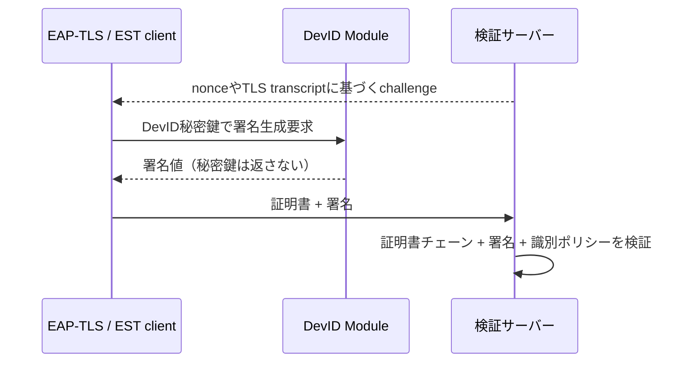
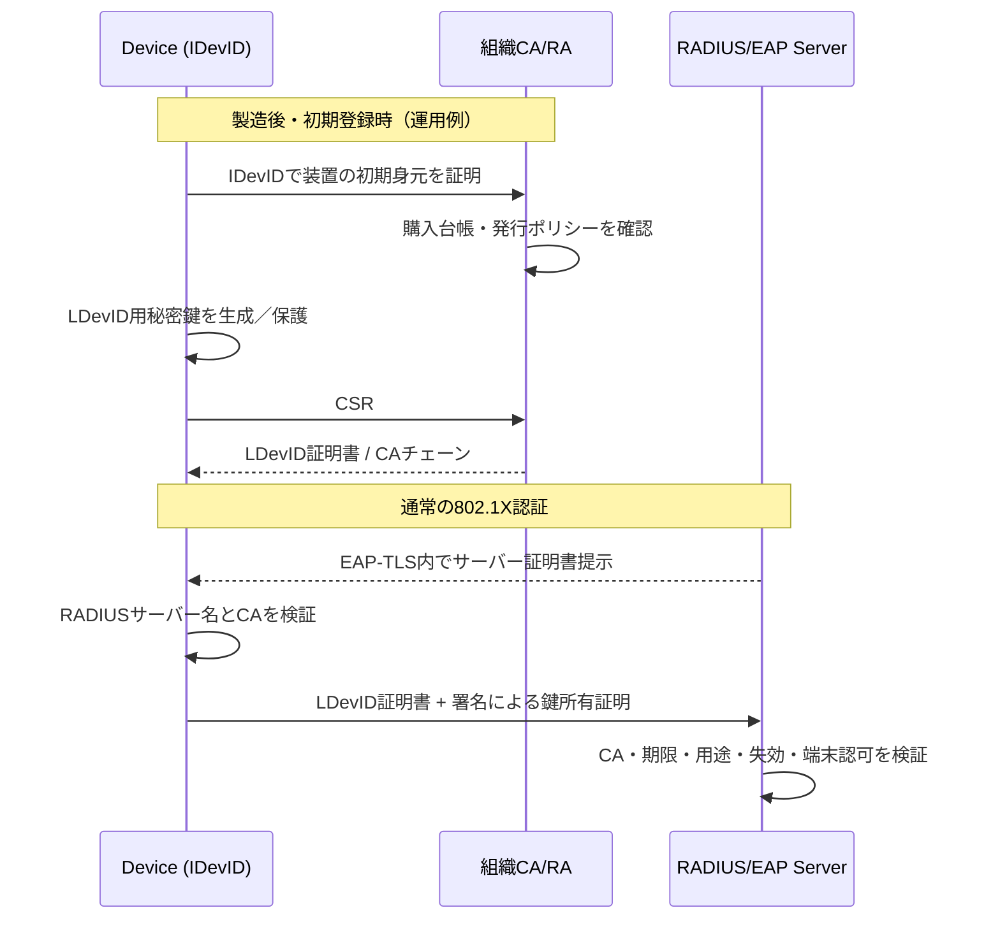

# IEEE 802.1AR-2018：IDevID・LDevID・デバイス証明書の詳細教材

> 版：2026-11-26 / 原本を参照した**独自の日本語技術解説**。IEEE規格の公認翻訳・全文訳ではない。  
> 表記：**[規格]**=原文・IEEE公式の確認範囲、**[設計例]**=実装に向けた例、**[要確認]**=製品・規格本文の細目検証が必要。  
> IEEE 802.1の仕様とIETF RFCの仕様、OSSの設定キーは混同しない。細かな適合性判断には原本・追補・Errataを参照。

## 1. 規格の役割と一次資料

- IEEE公式：[802.1AR Secure Device Identity](https://1.ieee802.org/security/802-1ar/)
- IEEE規格：[802.1AR-2018](https://standards.ieee.org/ieee/802.1AR/6995/)
- 原本文確認対象：IEEE Std 802.1AR-2018。Clause 6（DevID）、Clause 7（DevID Module）、Clause 8（DevID Certificate）、Clause 9（Signature Suites）、Annex B（利用例）を中心とする。
- 2026年にはML-DSA対応の802.1AReg-2026追補が承認・公開情報に記載されている。2018基本仕様と追補の差分は別扱いとし、暗号パラメータは実装時に原文で確認する。

**[規格]** この規格は、機器へ暗号学的に結びついたID（DevID）と、その秘密情報の保護、証明書・署名インターフェースを定義する。802.1XやEAP-TLSの通信プロトコルそのものを定義する規格ではない。

## 2. なぜMACアドレスやシリアル番号だけでは不足するのか

MACアドレスや製品シリアル番号は識別子としては便利でも、それを文字列として提示するだけでは、提示者が本物の機器であることを暗号学的に証明できない。DevIDでは、識別情報が証明書に入り、対応秘密鍵を所有する機器だけが署名等を生成できる。この署名を検証することで、単なる文字列の一致より強い所有証明ができる。

**証明書は公開してよいが秘密鍵を送らない**。秘密鍵を取り出せる実装は、鍵をコピーされたときのなりすましに弱い。DevIDモジュールは鍵の利用インターフェースを提供しつつ外部への鍵漏えいを防ぐことが設計の核である。

## 3. IDevIDとLDevIDの正確な違い

| 観点 | IDevID | LDevID |
|---|---|---|
| 由来 | 製造者・供給者が初期装備するID | 管理者の運用ドメインに合わせて導入するID |
| 意味 | 装置の初期固有身元 | その組織・用途の中で扱う身元 |
| CA/信頼基点 | 製造者等の信頼体系 | 組織内PKI等 |
| 主な使用場面 | 初期登録・所有証明・ゼロタッチ導入 | 802.1X/EAP-TLS・運用mTLS |
| 寿命/更新 | 初期装備されるもので運用上の扱いに注意 | 更新・追加・削除を計画する |
| 他規格との関係 | 検証側が製造者等のCAを信頼する必要 | RADIUSが運用CAを信頼すればEAP-TLS認証に利用できる |

**[規格]** IDevIDはグローバルに一意な供給者によるIDで、保護して保存する。LDevIDは管理ドメイン内で使う追加IDである。LDevIDを発行したからといってIDevIDが消えるわけではない。

## 4. 原文Clause 6：DevIDとライフサイクル

1. 初期製造：機器にDevID秘密鍵と対応証明書を備える。秘密鍵と証明書の紐づけ、CAの信頼性を考える。
2. 初期登録：管理ドメインは製造者の信頼基点とデバイスが持つ鍵所有証明に基づき機器を認識する。
3. ローカルID導入：運用用LDevIDのCSR・証明書の発行とインストールを行う。実装方式はEST等の別規格を組み合わせてもよい。
4. 利用中：EAP-TLS/mTLS等でLDevIDやIDevIDを提示し、署名を生成する。
5. 更新：有効期限・失効・鍵漏えい・装置移管に合わせて運用IDを更新する。
6. 廃棄：鍵や証明書を無効化し、登録台帳と許可ルールを失効させる。

プライバシー上、IDevIDをそのまま繰り返し外部へ提示すると、機器の追跡可能性が増す場合がある。どのIDを外部のネットワークへ出すかは設計判断が必要。

## 5. 原文Clause 7：DevID Module

DevIDモジュールは抽象的な暗号境界を持つ機能で、TPMに限定されない。TPM、セキュアエレメント、保護されたソフトウェアなどで構築できるが、どれも自動的に802.1AR準拠になるわけではない。

Clause 7.1の中心は、秘密の機密保存、署名等の暗号演算、鍵生成に使う良質な乱数、更新時の整合性。Clause 7.2はアプリに公開する操作（鍵・証明書列挙、署名、Enable/Disable、LDevID鍵生成・導入・削除、証明書・チェーン導入・削除等）を説明する。Clause 7.3には管理側操作を扱う。

### 秘密鍵を用いた署名処理

上の図は仕組みを説明する抽象シーケンス。TLS 1.3のCertificateVerifyではトランスクリプトを指定の形式で署名し、単純な「nonceだけの署名」とは異なる。具体的なTLS署名入力はRFC 8446に従う。

## 6. 原文Clause 8：証明書の構造と検証

DevID証明書はX.509を利用する。証明書を通信で見たときは「名前」「公開鍵」「発行者」「期限」「拡張」「署名」に分ける。

| X.509フィールド | 意味 | よくある誤解 |
|---|---|---|
| Subject / SAN | 証明書上の識別情報 | 文字列だけで本人確定と思うこと |
| SubjectPublicKeyInfo | 秘密鍵と対になる公開鍵 | 公開鍵は秘密ではない |
| Issuer | 発行CA | Issuer名の文字列一致だけでCA信頼が成立すると考えること |
| Validity | 有効期間 | 期限内なら失効していてもよいと考えること |
| SignatureAlgorithm / signatureValue | CA署名 | チェーンと署名検証を省略すること |
| KeyUsage / ExtendedKeyUsage | 鍵用途制限 | 署名用なら無条件にTLSクライアント用として使えるとすること |
| AuthorityKeyIdentifier等 | 鍵とチェーンの手掛かり | IDフィールドのみで証明書を信用すること |

DevID固有のX.509プロファイルはClause 8を参照する。X.509証明書パス検証の一般原則はRFC 5280。CAや証明書を「前もって持つ」だけでなく、管理ドメインで信用するCA/証明書名・失効状態・用途を照合する。

## 7. 原文Clause 9：Signature Suitesと暗号強度

[規格] 802.1AR-2018は対応する署名方式や証明書フィールドの表現を規定し、2018年版でECDSA P-384/SHA-384に対応した。2026年のML-DSA追加は新しい追補の範囲なので、2018年の表だけを「現在の全ての選択肢」として扱わない。**鍵長の違い、証明書サイズの違い、署名サイズの違い**は別々に評価すること。

## 8. TPMとの関係：EK/AKを混同しない

TPMにはEndorsement Key（EK）、Attestation Key（AK）、署名に利用するアプリ鍵など別目的の鍵がある。

- EKはTPMの保証・所属確認に使う信頼情報であり、EAP-TLS用LDevIDと同一ではない。
- AKはTPMのPCRに対するQuote等を署名するための鍵。802.1ARのDevID証明書と機能が異なる。
- 運用用EAP-TLS秘密鍵をTPMで生成・保持してDevID用途に使う設計は可能だが、証明書プロファイル、API、鍵の移管不可能性などを検証する。
- Measured BootのPCRが正常でも、そのことだけでLDevID証明書の運用認可が自動的に成立しない。逆も同じ。

## 9. 証明書の登録からEAP-TLS利用まで

[設計例] CA登録にEST（RFC 7030）を使用できるが、802.1ARはESTの採用を必須にする規格ではない。EAP-TLSの認証用証明書は初回アクセス前に配布するか、隔離ネットワークで登録する経路を用意する。

## 10. 異常系とセキュリティ

- 製造者CAを無条件にすべて信頼すると、接続可能な機器の範囲が過大になる。購入台帳・許可リスト等の認可判断が必要。
- 秘密鍵をエクスポートできると、証明書が正しくても別機器でなりすまされうる。
- 証明書の有効期限が過ぎた場合の更新経路を設計する。未認証で更新もできない循環を避ける。
- CA鍵漏えい・失効した証明書・機器の移譲を想定し、再登録を検証する。
- 証明書に固有IDが含まれる場合、追跡可能性・情報開示の設計が必要。

## 11. パラメータとOSS・検証

| パラメータ | 設計例 | 出典レイヤー |
|---|---|---|
| IDevID証明書 | 製造時に事前書込み | IEEE 802.1AR 概念 |
| LDevID証明書 | 組織CAから発行 | IEEE 802.1AR + PKI運用 |
| Private Key Storage | TPM内で非エクスポート鍵にする | 設計選択 |
| Certificate Chain | CA・中間CAを検証 | RFC 5280 + 802.1ARプロファイル |
| Key Usage / EKU | TLS client認証に合致させる | RFC 5280/8446・EAP-TLS |
| Provisioning | EST / step-ca / EJBCA等 | RFC 7030・OSS例 |
| Signing API | TPM2-TSS/PKCS#11等 | 実装選択（準拠は別途検証） |

テスト：端末入替、鍵交換、誤ったIssuer、SAN欠落、期限切れ、失効、証明書だけコピー、鍵だけコピー、TPM交換の各場合を実施する。**「同じ証明書文字列を送れる」と「秘密鍵の正当所有者」が一致するか**が要点。

## 12. 学習確認

1. IDevIDとLDevIDの発行主体・信頼基点・利用場面の差を説明できるか。
2. DevID秘密鍵をサーバーへ送信しなくても認証できる理由を説明できるか。
3. TPM EK・AK・DevID用アプリ秘密鍵の目的を分けられるか。
4. 802.1ARが802.1Xのフレーム形式を決めていない理由を説明できるか。
5. 初期登録と日々のEAP-TLS認証を時間軸で分離できるか。
