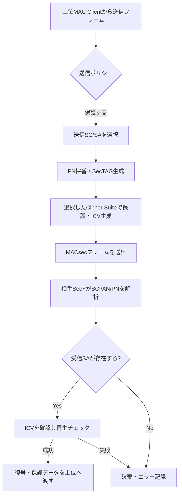
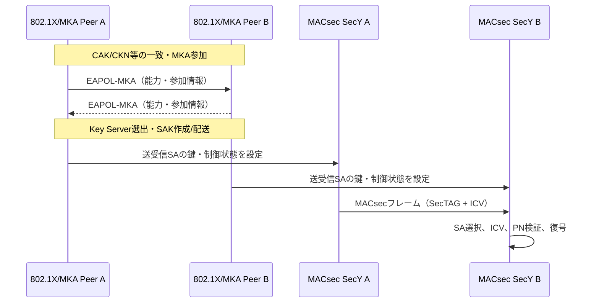

# IEEE 802.1AE-2018：MACsecのフレーム保護・SecTAG・暗号処理の詳細教材

> 版：2026-11-26 / 原本を参照した**独自の日本語技術解説**。IEEE規格の公認翻訳・全文訳ではない。  
> 表記：**[規格]**=原文・IEEE公式の確認範囲、**[設計例]**=実装に向けた例、**[要確認]**=製品・規格本文の細目検証が必要。  
> IEEE 802.1の仕様とIETF RFCの仕様、OSSの設定キーは混同しない。細かな適合性判断には原本・追補・Errataを参照。

## 1. 規格概要・原典と更新状況

- [IEEE 802.1AE公式](https://1.ieee802.org/security/802-1ae/)
- [IEEE 802.1AE-2018 基本規格](https://standards.ieee.org/ieee/802.1AE/7154/)
- 関連規格：IEEE 802.1X-2020（MKAの鍵管理）、802.1AEdk-2023（MAC Privacy Protection）、802.1AE-2018/Cor 1-2020（Tag Control Information図の訂正）。
- 改訂プロジェクトP802.1AE-2018-RevやAscon Cipher Suite関連の開発中案件は、承認済み規格と別扱いにする。

**[規格]** MACsecはEthernetなどIEEE 802 LANのMACサービスを利用する上位層に対し、データの機密性・完全性・送信元真正性を提供する。データフレームを保護する機能であって、端末証明書を発行したり、RADIUSを実行したり、遠隔からPCRを検証したりする規格ではない。

## 2. MACsecは何を暗号化するのか

TLSは典型的にアプリケーションのTCP上の通信を保護する。MACsecはそれより下のL2でフレームを保護するため、リンク上で運ばれるIPv4/IPv6だけでなく、ARPなどのL2通信も対象にできる。一方、MACsecは通常**リンクごと**の保護である。別の装置を経由してMACsec終端を越えた先までエンドツーエンドの暗号化を自動提供するものではない。

### なぜ802.1Xとは別の規格か

- 802.1AR：デバイスの暗号的な身元を持つ。
- 802.1X：ネットワークへの認証・認可、MKAでデータ保護用鍵を調整。
- 802.1AE：受信・送信時にMACsecのセキュリティ処理を行う。

**[規格]** 802.1X/MKAはKey Serverを選び、SAKを配る。802.1AEの暗号エンジンはインストールされたSAKでデータを処理する。鍵を設置する制御プレーンと、フレームを保護するデータプレーンを混同しない。

## 3. MACsecを支えるデータモデル

| 用語 | 概念 | 実装で見るもの |
|---|---|---|
| SecY (MAC Security Entity) | MACsec処理の主体 | LinuxのmacsecインターフェースやNIC offload |
| Secure Channel (SC) | ある送信元からの保護フレームの流れ | 送信SCと受信SC |
| Secure Association (SA) | 特定の鍵などを使う保護関係 | SAK・SA状態・ANなど |
| Secure Association Key (SAK) | 実データの暗号・認証で用いる対称鍵 | MKAで配布・更新する鍵 |
| Secure Channel Identifier (SCI) | SCを識別する情報 | MACアドレスとポート識別情報からなる8-octet識別子 |
| Association Number (AN) | 同一SC内のSAを識別する番号 | 鍵切替時に使用。2ビットのフィールド |
| Packet Number (PN) | リプレイ検出・暗号ノンスの構成要素 | 送信時に増加、受信時に窓で検査 |
| Integrity Check Value (ICV) | フレームの改ざん検出用タグ | GCM認証結果（一般的な16-octetタグ） |

### Secure ChannelとSecure Associationの違い

SCは送信側を基準とする論理的なストリーム、SAはそのストリーム内で利用する具体的な鍵と状態。鍵更新時には新SAを導入できるため、SC=1鍵という単純な理解では不十分。送信と受信は別々のSA/PN状態を持つ。

## 4. ワイヤフォーマット：Ethernet IIとMACsecの比較

```text
保護しないEthernet（概念図）
Destination MAC (6) | Source MAC (6) | EtherType (2) | Payload | FCS (4)

MACsec保護されたEthernet（概念図）
Destination MAC (6) | Source MAC (6) | [タグ等] | EtherType 0x88E5
    | SecTAG (TCI/AN, SL, PN, SCI条件付き)
    | Secure Data（ペイロードの保護対象、必要に応じ暗号化）
    | ICV（典型的に16 octets） | FCS (4)
```

ここで`0x88E5`はMACsecフレームのEtherType。802.1X用EAPOL/MKAの`0x888E`とは別。SecTAGは通常構成でSCIを省略する場合もあり、基本8-octet相当＋SCI 8-octet（存在時）の形式を念頭に置く。ただしVLANタグ位置、タグ構成、暗号化範囲、EDE等によりフレーム表示は変化するため、上の図は**説明用**である。

### SecTAGの代表要素

| 項目 | 説明 | 失敗時の問題 |
|---|---|---|
| TCI/AN | タグ制御情報とSA識別 | フレーム解釈・鍵選択が誤る |
| SL | Short Length。短い保護データの長さ情報 | 長さ検査の不一致 |
| PN | パケットの番号（通常のPNは32ビット） | 再送・重複検出、nonce再利用リスク |
| SCI | 送信元のSecure Channelを識別 | 別SCを混同すると誤った鍵・状態に照合 |
| ICV | 認証タグ | 破損・改ざん時に検証失敗 |

**[規格]** PNはリプレイ防御だけでなくAEADのnonce管理にも深く関係するため、上限に達する前のSAK更新が重要。Extended Packet Number（XPN）は32ビットPNだけの運用より大きな番号空間を扱うCipher Suiteであり、同じ鍵で使用できるフレーム数に関係する。暗号鍵の強度を単に「128→256」にするだけではPN問題は解消しない。

## 5. フレーム送受信の内部処理



`encrypt off`の構成でもMACsecの整合性保護だけを提供する場合がある。**MACsecが有効=必ず機密性あり、とは限らない**。ポリシーで暗号化有無を確認する。

## 6. 暗号スイートの理解

基本規格はGCM-AES-128を基軸とし、GCM-AES-256、XPN対応のスイートを扱う。GCMは認証付き暗号（AEAD）であり、暗号化と整合性検証を一体として扱う。鍵が同じでもnonceが重複すると安全性を失うため、PNやSCIの組み合わせ・鍵更新が重大となる。

| 選択肢 | 主な考慮点 |
|---|---|
| GCM-AES-128 | 128ビット鍵、対応実装が広い |
| GCM-AES-256 | 256ビット鍵、双方のサポートとハードウェア負荷確認 |
| GCM-AES-XPN-128 / XPN-256 | Extended Packet Number。高速・長寿命セッションで重要 |
| MAC Privacy Protection（802.1AEdk） | 通信元/宛先MAC等の露出低減に関係。基本MACsecの機密性と異なる追加特性 |

**[設計例]** スループットが高いポートではPN枯渇・鍵更新・ハードウェア対応を早期に確認する。Cipher Suiteの相互互換は必ず試験し、単純な強度ランキングだけで決めない。

## 7. MKAと鍵導入の詳細な関係



**[設計例]** リモート側が相互にMACsecを有効化できず、片側だけ鍵を入れた状態では、通常の通信は失敗しうる。鍵サーバーの選定、SAK導入、SecY作動、ポート開放を独立して監視する。

## 8. Linux OSSでの確認項目

Linuxは`iproute2`の`ip macsec`やkernel MACsec機能でSecYを構成できる。`wpa_supplicant`のMKA機能はMACsec鍵管理と連携可能。ただし、Linux MACsecインターフェースを作っただけではEAP-TLS/RADIUSとの鍵連携を自動実装したことにならない。

```
# 存在する機能を調査する例（変更を伴わない）
ip macsec help
ip link help macsec
ip -d link show
ethtool -k eth0
```

設定される主要値は送信暗号化、受信の`validate`（strict等）、`replay`（on/off）、`window`、cipher suite、SAK、SCI、AN、PN。秘密鍵をコマンド履歴に残さず、実験用の鍵は本番で再利用しない。参考：[ip-macsec(8)](https://man7.org/linux/man-pages/man8/ip-macsec.8.html)。

## 9. 典型的な故障・攻撃と防御

- 認証済みでもMACsec無効：フレームは平文となり得る。設計仕様が「暗号化必須」ならFAIL。
- MACsecの保護範囲がリンク途中で終わる：途中のスイッチの次のリンクに保護が自動継続するわけではない。
- ICV不一致：改ざん・鍵不一致・設定誤りを切り分ける。
- PNリプレイ：同じSAで旧フレームを送った場合の拒否を確認する。window設定との関係を検討。
- PN上限到達：安全なSAK更新が遅れると、送信停止や安全性喪失のリスク。
- MKAのKey Server不一致：鍵配布失敗。EAP成功と分けてログを確認。
- TLSとMACsecの二重保護：用途が異なり冗長とは限らない。TLSはアプリエンドポイント保護、MACsecはリンク保護。

## 10. 検証と合格条件

1. `0x88E5`のMACsecフレームをキャプチャで観測できる。
2. 上位のIPv4/ARPなどを許可しても、MACsec必須のリンクで対象フレームが平文で流れないこと。
3. 不正ICV、誤SAK、重複PNで受信拒否されること。
4. SA再鍵時に短時間の切替を含め、再接続・不正受理が起きないこと。
5. 帯域・MTU/オーバーヘッド・CPU/NIC offloadの性能を測定すること。
6. AuthenticatorのポリシーによりMACsecなし通信を許す例外がないか確認すること。

## 11. 原典に戻る場所

[IEEE 802.1AE公式・GET入口](https://1.ieee802.org/security/802-1ae/) ／ [IEEE 802.1X](https://1.ieee802.org/security/802-1x/) ／ [Linux macsec manual](https://www.man7.org/linux/man-pages/man8/ip-macsec.8.html)。SecTAGの各ビット位置や例外の完全な適合判定はIEEE 802.1AE-2018原文とCorrigendumを参照すること。
