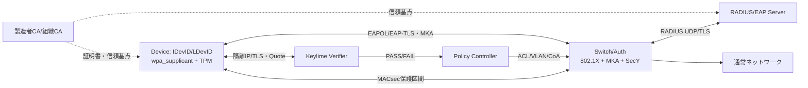
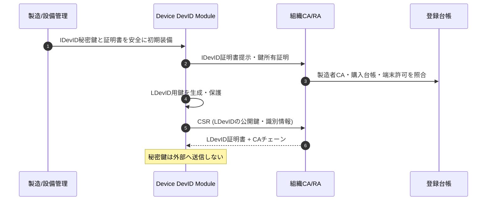
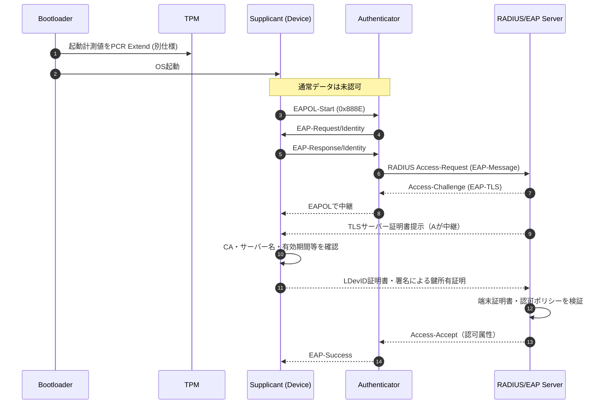
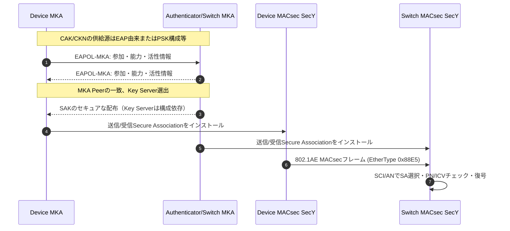
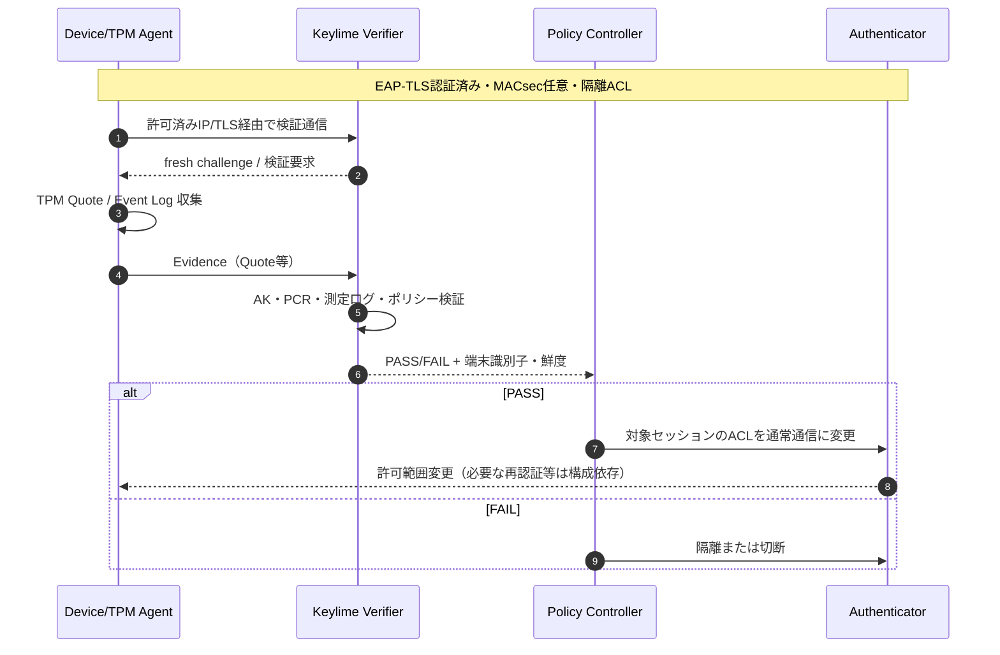

# IEEE 802.1X・802.1AR・802.1AE 統合技術教材：初期登録から認証・MKA・MACsec・TPMまで

> 版：2026-11-26 / 原本を参照した**独自の日本語技術解説**。IEEE規格の公認翻訳・全文訳ではない。  
> 表記：**[規格]**=原文・IEEE公式の確認範囲、**[設計例]**=実装に向けた例、**[要確認]**=製品・規格本文の細目検証が必要。  
> IEEE 802.1の仕様とIETF RFCの仕様、OSSの設定キーは混同しない。細かな適合性判断には原本・追補・Errataを参照。

## 1. 最初に結論：3規格の依存は「必須連鎖」ではない

| 規格 | 主目的 | 他2規格との結合点 |
|---|---|---|
| **802.1AR** | 装置に暗号学的なIDを持たせる | DevIDを802.1X/EAP-TLSの端末証明書として利用できる |
| **802.1X** | ポート認証・認可、MKAによる鍵確立 | ARからIDを借り、AEにSAKを渡す役割を担える |
| **802.1AE** | 実際のEthernetデータフレーム保護 | 802.1X/MKAが配布する鍵を使用できる |

**[規格]** 802.1Xでは802.1AR必須ではないし、802.1AEがない802.1Xポート制御も成立する。またMACsecには事前共有鍵ベースのMKA構成もある。「IDevID発行→必ずEAP-TLS→必ずMACsec」の固定シーケンスをIEEEが義務付けているわけではない。

## 2. 全体の機器構成と信頼境界



MACsecの暗号化範囲はDevice↔隣接のMACsecピア（たとえばSwitch）である。KeylimeとのIP/TLS通信はその上に乗ることができるが、端末からKeylime VerifierまでがMACsecでエンドツーエンドに保護されるとは限らない。

## 3. 時間軸A：工場出荷・初期登録（ネットワーク接続より前）



**[設計例]** ここでのLDevID発行にEST（RFC 7030）を使う場合は、bootstrap時にESTサーバーとの信頼確立・認証・CSR作成の手順が必要。製造時に直接LDevIDを入れる運用もあり、規格は一つの方法を固定しない。

## 4. 時間軸B：端末ブートから802.1X EAP-TLS認証まで



このEAP-TLSシーケンスは省略図。TLS 1.3でのCertificateVerify/Finished、EAP-TLS 1.3のProtected Success、RADIUSの複数Access-ChallengeはRFC 8446/9190/3579に従う。**802.1ARそのものはこのEAPOL形式やRADIUS Codeを規定していない**。

## 5. 時間軸C：MKAを実施しMACsecを使用開始する



**重要な点**：図のKey ServerがAuthenticator側なのは説明例であり、MKA選出の結果は構成で決まる。802.1X EAP認証成功とMKA鍵配布成功は別。通常データを保護必須にするなら、SA導入を確実に確認する必要がある。

## 6. 時間軸D：Remote Attestationとの連携（IEEE 3規格では未規定の設計）



このシーケンスは**[設計例]**である。Remote Attestationで端末が健全かを判断する機能はIEEE 802.1X/AR/AE自体の規定ではない。MACsecとmTLSは限定通信の別レイヤーで併用できる。Keylimeのpush/pullを選ぶとIPの開始方向が変わるため、隔離ACLをそれに合わせる。

## 7. 4つの検査ゲートを別々に持つ

| Gate | 確認したこと | それだけでは未確認のこと |
|---|---|---|
| A. DevIDの証明 | 秘密鍵に対応する機器が証明書を提示 | OS健全性、接続の許可 |
| B. EAP-TLS / RADIUS | 資格情報が認証され、アクセス属性が返された | MACsecの有効化、PCR健全性 |
| C. MKA / MACsec | 相互ピアとSAKを合意し、指定L2区間を保護 | アプリ宛先の正当性、OSの健全性 |
| D. TPM Remote Attestation | Quote等が所定ポリシーに合致 | TLSで話す相手のアプリ認可、将来の健全性 |

**設計上の原則**：A/B/C/Dのいずれかを単独で「安全な端末」と表現しない。例えば、攻撃者が正常なデバイスIDの端末でマルウェアを動かしても、DevID/EAP-TLSは成功する可能性がある。ここをAttestationで補完する。

## 8. 同じEthernetでもパケット種類は別

| 区間 | 方式 | EtherTypeまたは上位の層 | 説明 |
|---|---|---|---|
| Device↔Switch | EAPOL/EAP | 0x888E | 802.1Xの認証制御 |
| Device↔Switch | EAPOL-MKA | 0x888E（EAPOL内Type 5） | MACsecの鍵管理 |
| Device↔Switch | MACsec frame | 0x88E5 | 802.1AEで実データを保護 |
| Switch↔RADIUS | RADIUS | IP/UDP 1812など、またはTLS | EAPメッセージと認可属性の運搬 |
| Device↔Keylime | TLS/HTTPS等 | IP/TCP/TLS | Quote等のAttestation通信 |

RADIUS over TLSを採用してもDevice↔SwitchのEAPOLがTLSで直接包まれるわけではない。EAP-TLSのTLSハンドシェイクはEAPペイロードとして中継される。

## 9. 構成パターン比較

| 構成 | 802.1AR | 802.1X | 802.1AE | 向く場面 |
|---|---|---|---|---|
| A. 端末証明書 + 802.1X | 任意（別PKI可） | あり | なし | 認証中心。リンク暗号化はしない |
| B. IDevID/LDevID + EAP-TLS | あり | あり | なし | 工場から運用までIDを追跡 |
| C. 802.1X + MKA + MACsec | 任意 | あり | あり | 認証とL2リンク暗号化 |
| D. 3規格 + TPM Attestation | あり | あり | あり | 端末ID・アクセス・通信・健全性を分担 |
| E. MKA-PSK + MACsec | なしでも可 | MKA機能 | あり | 事前共有鍵によるL2保護（認証方式の前提を区別） |

## 10. Linux仮想環境の実装方針と落とし穴

最低限の役者はDevice（wpa_supplicant + TPM/swtpm）、Authenticator（hostapd / Bridge / ACL / MKA対応）、RADIUS（FreeRADIUS）、CA（step-ca等）、Verifier（Keylime）。ただしhostapdの有線Authenticatorを置いただけでMACsec対応Switchが完成したわけではない。LinuxのmacsecインターフェースとMKAの構成も必要。

分割して試験する：

1. **DevIDとPKI**：証明書を入れ替えると認証が拒否されるか。
2. **EAPOL/RADIUS**：認証前にEAPOLだけ通し、通常通信を遮断できるか。
3. **MKA**：双方がCAK/CKNを共有し、MKA参加者が成立するか。
4. **MACsec**：`0x88E5`のフレームを取得し、平文L2データが漏れないか。
5. **Attestation**：PCR変更で検証失敗し、通常通信権限を取り消せるか。
6. **複合異常系**：証明書失効中、RADIUS障害中、SAK更新中、Verifier停止中にフェイルセーフになるか。

## 11. 設計時に必要な状態管理

```text
OFFLINE -> BOOTING -> EAP_AUTHENTICATING -> EAP_AUTHENTICATED
                                   |                 |
                                   v                 v
                                 REJECTED       MKA_NEGOTIATING
                                                       |
                                                       v
                                                MACSEC_ACTIVE
                                                       |
                                                       v
                                                ATTESTATION_PENDING
                                                       |
                                          PASS --------+------- FAIL
                                            |                     |
                                            v                     v
                                      AUTHORIZED             QUARANTINED
```

状態遷移は**今回の統合システム向け設計例**で、IEEEにこのまま一つの状態機械が定義されているわけではない。MKAを使わない構成なら状態をスキップ可能。Attestationを先に実施する構成なら順番も変わる。

## 12. 仕様・設定・ログを結びつける追跡表

| 仕様根拠 | 設定/実装 | パケット/ログの証拠 | 合格条件 |
|---|---|---|---|
| IEEE 802.1AR Clause 6–9 | DevID鍵・証明書 | CSR/証明書チェーン/署名検証 | 偽端末が認証できない |
| IEEE 802.1X Clause 8, 11 | Supplicant、Authenticator | EAPOL, RADIUSログ | 未認証ポートで通常通信不可 |
| IEEE 802.1X Clause 9 | MKA | EAPOL-MKA、Key Serverログ | SAKを導入できる |
| IEEE 802.1AE 基本規格 | SecY/SC/SA | MACsecフレーム、ICV/PN統計 | 暗号化・完全性・リプレイ保護が正常 |
| RFC 3579 / 3580 / 9190 | RADIUS EAP-TLS | pcap、TLS証明書検証ログ | 正しい認証・認可 |
| TPM / Keylime（別仕様） | Agent、Verifier、Policy | PCR、Quote、判定ログ | 不健全端末の通信を遮断 |

## 13. 設計上の重要な注意

- 802.1ARはデバイスIDを提供する規格で、全LDevIDがEAP-TLSに使えるとは限らない。証明書用途とサーバーの証明書ポリシーをそろえる。
- RADIUSのAccess-AcceptはMACsec成功を意味しない。MKA完了まで開放しない設計も考える。
- 802.1AEのMACsecはL2リンク保護。MACsecを設定しても、アプリケーションエンドツーエンドのmTLSが不要になるとは限らない。
- TPM EK/AKの信頼とDevID証明書の信頼は独立の信頼体系として扱う。
- Attestation結果のIPアドレスだけで同一端末と判断せず、DevID・AK登録・RADIUSセッション・物理ポートなどを適切に関連付ける。

## 14. 原典リンク

- [IEEE 802.1X](https://1.ieee802.org/security/802-1x/)
- [IEEE 802.1AR](https://1.ieee802.org/security/802-1ar/)
- [IEEE 802.1AE](https://1.ieee802.org/security/802-1ae/)
- [RFC 2865](https://www.rfc-editor.org/rfc/rfc2865.html)、[RFC 3579](https://www.rfc-editor.org/rfc/rfc3579.html)、[RFC 3580](https://www.rfc-editor.org/rfc/rfc3580.html)
- [RFC 9190](https://www.rfc-editor.org/rfc/rfc9190.html)、[RFC 7030](https://www.rfc-editor.org/rfc/rfc7030.html)、[RFC 8446](https://www.rfc-editor.org/rfc/rfc8446.html)
